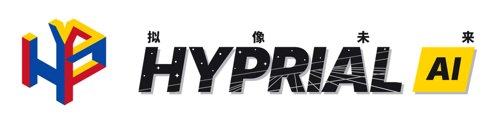
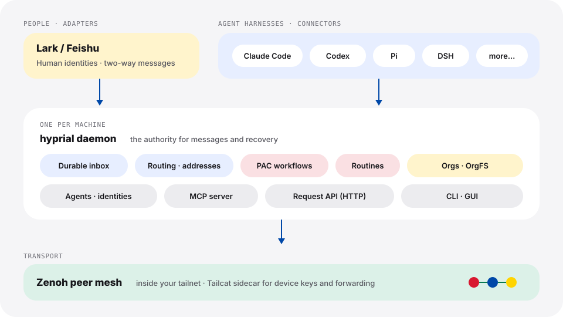

<div align="center">

<picture>
  <source media="(prefers-color-scheme: dark)" srcset="docs/assets/brand/hyprial-lockup-en-dark.png">
  
</picture>

### The organization layer for Agents and humans

[](pyproject.toml)
[](LICENSE)
[-0048A8)](#-installation)
[](https://www.hyprial.com/)

**English** · [简体中文](docs/i18n/README.zh-CN.md)

[Website](https://www.hyprial.com/) ·
[Quickstart](https://www.hyprial.com/quickstart/) ·
[Documentation](docs/README.md) ·
[Changelog](CHANGELOG.md)

</div>

> [!NOTE]
> **The GitHub repository [`Hyprial/hyprial`](https://github.com/Hyprial/hyprial) is a read-only release mirror.**
> Development happens on our internal Forgejo. We do not accept pull requests on GitHub yet —
> please open an [issue](https://github.com/Hyprial/hyprial/issues) instead.

## ✨ What is HyprialOS?

HyprialOS (`hyprial`) is a decentralized, durable communication layer for AI agents and the
harnesses that run them. It gives every human and agent a persistent identity, a reliable inbox,
shared workflows, and routines that keep working after you close the terminal.

You keep the tools you already use. A **connector** attaches an agent harness — Claude Code,
Codex, Pi or DSH — and an **adapter** brings a human channel such as Lark (Feishu) into the same
network. Each machine runs one **daemon** that stores messages, routes them across machines, and
tracks shared work. If a coordinator, a worker or a chat channel goes away for a while, the goals
and messages stay findable, recoverable and verifiable.

## 🚀 Features

- 🪪 **Persistent agent identity** — an agent is not the process that happens to run it.
  Restart it, switch its model or move it to another harness; its address, inbox and history stay.
- 📬 **Durable delivery across machines** — messages are written to disk first, then delivered,
  acknowledged and retried. Offline custody and dead-letter state are visible
  (`hyprial message status`, `hyprial message trajectory`).
- 🔌 **Bring your own harness** — Claude Code, Codex, Pi and DSH, interactive or headless.
  Agents talk to the network through built-in MCP tools.
- 💬 **Humans in the loop** — the Lark adapter maps people and group chats onto the same
  addressing model, so a person in Lark and an agent in Codex receive work the same way.
- 🧩 **PAC workflows** — declare who gets which task, in what order, with approval gates and
  completion evidence. PAC dispatches and tracks; harnesses and humans do the work
  (`hyprial workflow`).
- ⏱️ **Routines** — persistent, scheduled duties with health, history and pause/resume
  (`hyprial routine`).
- 🏢 **Organizations and OrgFS** — orgs with members and access policies, and a replicated
  shared file space for documents and work items (`hyprial org`, `hyprial org fs`).
- 🛡️ **Private by default** — daemons form a Zenoh peer mesh inside your tailnet. The bundled
  Tailcat sidecar handles device keys and cross-network forwarding.

## 🏗️ Architecture

<p align="center">
  
</p>

| Concept | What it does |
| --- | --- |
| **daemon** | Long-running process on each machine. It owns the transport session, the durable inbox, routing and managed runtime state, and is the authority for messages and recovery. |
| **connector** | Attaches one harness session (Claude Code, Codex, Pi, DSH) to the daemon and manages its input, output and lifecycle. |
| **adapter** | Connects an external platform (Lark today) and maps its identities and messages onto HyprialOS addresses and delivery. |
| **PAC** | Declarative dispatch and tracking: task graphs, conditions and wait rules. It does not do the work itself. |
| **routine** | A scheduled duty cycle that starts PAC runs from board annotations. |
| **OrgFS** | The replicated shared file space that organizations are built on. |
| **sidecar** | A helper process that HyprialOS verifies and controls (Tailcat, shipped in the wheel) for device keys and forwarding. |

The full vocabulary is in [GLOSSARY.md](GLOSSARY.md). The design records start at
[docs/design/design.md](docs/design/design.md).

## 📦 Installation

### One-line install (recommended)

macOS and Linux:

```bash
curl -fsSL https://dl.hyprial.com/install.sh | sh
```

Windows (x64), in PowerShell:

```powershell
powershell -c "irm https://dl.hyprial.com/install.ps1 | iex"
```

The installer downloads a prebuilt wheel, checks its SHA-256 against the published
`SHA256SUMS`, and installs it with [uv](https://docs.astral.sh/uv/). If uv is missing, it installs
uv first into `~/.local/bin` without editing your shell profile. When you see
`Installed hyprial <version>`, open a new terminal so that `hyprial` is on your `PATH`
(run `uv tool update-shell` if it is not).

### Release tracks

| Track | Follows | Select it with |
| --- | --- | --- |
| `stable` (default) | Formal releases | — |
| `nightly` | The last build that passed the scheduled E2E runs, or `stable` | `HYPRIAL_TRACK=nightly` |
| `internal` | The head of the development branch | `HYPRIAL_TRACK=internal` |

```bash
curl -fsSL https://dl.hyprial.com/install.sh | HYPRIAL_TRACK=nightly sh
```

After installation, `hyprial daemon upgrade` keeps the tool up to date. Automatic upgrades are
off until you run `hyprial config set autoUpgrade true`.

### Platform support

| Platform | Install | Daemon and agents |
| --- | --- | --- |
| macOS 13+ (Apple silicon, Intel) | ✅ | ✅ launchd user service |
| Linux, glibc (x86_64, aarch64) | ✅ | ✅ systemd user service |
| Windows (x64) | ✅ | 🚧 in progress |

### Other ways to install

<details>
<summary>Install from the public repository with uv</summary>

This follows the `internal` track tag on the public release repository:

```bash
uv tool install git+https://github.com/Hyprial/hyprial.git@internal
hyprial daemon upgrade --tag internal
```

The second command reinstalls with the dependency pins from that commit's `uv.lock`.
This path builds from source, so it also needs Node.js 24+ with npm (for the web GUI) and
Go 1.27 (for the Tailcat sidecar). The one-line installer needs neither.

</details>

<details>
<summary>Legacy installs (v0.4.0 and the retired TypeScript version)</summary>

If you installed v0.4.0 from the old `harness-bridge-py` source, refresh the source at the same
version before upgrading. The `v0.4.0` tag is not on the public repository; ask a maintainer for
the recovery command.

There is no migration from the old TypeScript version. If a machine still has it, stop it,
remove it and archive its state directory before a fresh install. The steps are in the
[retired TypeScript install runbook](docs/guides/cutover-runbook.md).

</details>

## ⚡ Quickstart

1. **Sign in and prepare this machine.** A browser opens for login; then the daemon starts.

   ```bash
   hyprial init
   ```

   Add `--service` to register the daemon as a user service (launchd on macOS, systemd on
   Linux) so that it starts when you log in. You can run `hyprial init --service` again later.

2. **Check the installation.**

   ```bash
   hyprial version
   hyprial doctor
   ```

3. **Create your personal assistant, Squire, on a harness you already use** — for example Codex
   (run `codex login` first):

   ```bash
   hyprial squire setup --provider openai --model gpt-6.1-sol --preferred-harness codex
   hyprial agent provider login codex --actor squire
   hyprial agent start codex --name squire --provider openai --model gpt-6.1-sol --headless
   hyprial agent list
   ```

   `squire` shows `online` when it is ready.

The [full quickstart](https://www.hyprial.com/quickstart/) also covers the Pi + DeepSeek route,
connecting Lark, and sending your first message. To join an existing network, follow the
[onboarding checklist](docs/guides/onboarding-checklist.md).

### Command overview

| Command | Purpose |
| --- | --- |
| `hyprial init` · `login` · `doctor` · `version` | Set up, sign in and diagnose |
| `hyprial daemon …` | Start, stop, restart, upgrade; `daemon service` manages the user service |
| `hyprial agent …` | Create, start, stop and inspect agents; providers, secrets and grants |
| `hyprial message …` | Send, read, acknowledge and trace messages |
| `hyprial adapter …` | Connect and manage Lark Apps, routes and identities |
| `hyprial workflow …` · `routine …` | PAC workflows and scheduled routines |
| `hyprial org …` | Organizations, members, OrgFS, services and work items |
| `hyprial gui` | Open the bundled web GUI (preview) |

Every command accepts `--help`, and most accept `--json` for scripting.

## 📚 Documentation

| Topic | Where |
| --- | --- |
| Install, first start, upgrades, profiles, login and device keys | [Operator guide](docs/guides/operator-guide.md) |
| Release tracks and how they move | [Upgrade tracks](docs/guides/upgrade-tracks.md) · [Release rules](docs/guides/release-rules.md) |
| Joining a network · two-machine setup | [Onboarding checklist](docs/guides/onboarding-checklist.md) · [Zenoh two-machine guide](docs/guides/zenoh-two-machine.md) |
| Connecting Lark | [Lark App onboarding](docs/guides/lark-app-onboarding.md) |
| Daemon lifecycle · harness providers | [P2 daemon](docs/reference/p2-daemon.md) · [Harness model providers](docs/reference/harness-model-providers.md) |
| PAC workflows | [PAC workflow](docs/design/design-pac-workflow.md) · [PAC v2 graph/flag reactor](docs/design/design-pac-graph-flag-reactor.md) |
| Networking | [Tailcat cutover and sidecar protocol](docs/design/tailnet-cutover-architecture-2026-10-03.md) |
| Known problems | [Known problems](docs/reference/known-problems.md) |
| Everything else | [Documentation index](docs/README.md) |

Most pages under `docs/` are written in Chinese with English technical terms.

## 🗺️ Status and roadmap

HyprialOS is in active development. Releases follow the version in [`VERSION`](VERSION), and every
release is recorded in [CHANGELOG.md](CHANGELOG.md). Long-term goals and release obligations are
in [ROADMAP.md](ROADMAP.md).

Work in progress includes:

- 🖥️ **Web GUI** — `hyprial gui` serves a bundled, checksum-verified build of the shared web GUI
  in [`gui/`](gui/). It is a preview: most screens still return `BACKEND_NOT_WIRED` while the
  settings, chat and first-run screens are being wired to the daemon's request API.
- 🪟 **Windows** — the installer works; native daemon start-up and services are being fixed.
- 💬 **More channels** — Lark is the only adapter today; more IM adapters are planned.
- 🧬 **Agent model** — cells, threads and conversations are being designed to replace the
  current link model.

## 🤝 Contributing

Thank you for your interest! Development currently happens on the internal network:

- 🐛 **Everyone** can report bugs and request features in
  [GitHub issues](https://github.com/Hyprial/hyprial/issues).
- 🔧 **Code contributions need access to the development network.** Please contact a maintainer
  to request access. The GitHub mirror does not accept pull requests yet.

To read the code and run the tests, clone the public mirror. With development-network access,
use the internal remote a maintainer gives you instead; the steps are the same.

```bash
git clone https://github.com/Hyprial/hyprial.git
cd hyprial
uv sync --extra test
uv run --with libcst==1.9.0 pytest tests/
uv run ruff check .
./contract/run-all.sh --isolated-only
```

Feature branches go into the current `release/v*` integration branch; `dev` only accepts
`release/*` and `hotfix/*` pull requests. Read [CONTRIBUTING.md](CONTRIBUTING.md) for the test
rules, pull-request checklist and branch model, and [AGENTS.md](AGENTS.md) if you contribute
through a coding agent.

| Toolchain | Version | Needed for |
| --- | --- | --- |
| Python + [uv](https://docs.astral.sh/uv/) | 3.12+ | Everything |
| Node.js + npm | 24+ / 11+ | The web GUI and wheel builds |
| Go | 1.27 | The Tailcat sidecar |

## 🔒 Security

Please do not report security problems in public issues. Contact a maintainer through a private
channel, and include only the minimum redacted evidence needed to reproduce the problem. Never
attach real credentials or production data.

## 📄 License

HyprialOS is licensed under the [Apache License 2.0](LICENSE).
Copyright 2026 Hyprial Tech.
