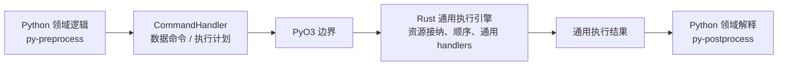

# Actor Rustify：讨论边界与实施前规划

状态：WIP，调研与规划，不是产品实现。独立集成分支 `intg/actor-rustify → dev`；基点为当前 dev `e384bba7bf112baf5af27612bafbd0b4c11db32b`。0.5.5 tag 已存在（tag 对象 `587a112329c5666c53e8535395b1658e8ef7f8a8`，peeled commit `5dc2d1c95c97243c954724198b15b9eda9a6f424`），该开发线不调整其发布历史。

当前决定：**选择 Ractor 作为唯一 actor 框架，Tokio 为运行底座，PyO3 为薄绑定；首版 node-only。** 用户明确要求尽量复用现成 actor 机制、专注 Python 业务，因此撤回自建 Tokio/Tower executor 的建议。见 [接口 v0.2](actor-rustify-interface-v02-2026-10-24.md)、[框架决定与语义实验](actor-rustify-runtime-decision-2026-10-24.md)、[评审处理](actor-rustify-review-response-2026-10-24.md)。

当前进入 [正式实施规划](actor-rustify-implementation-plan-2026-10-24.md)。[既有Dispatch功能标定](../notes/ractor-dispatch-performance-2026-10-24.md)已完成；主要目标是改善分层、收敛权威并减少自有actor机制，性能为辅助证据。

用户最新明确S2以完全剔除Pykka、完成核心actor引擎Rustify为标准。已补[分发ADR](actor-rustify-build-distribution-adr-2026-10-24.md)、[S2设计](actor-rustify-s2-design-2026-10-24.md)和[实施计划/拟议goal](actor-rustify-s2-execution-plan-2026-10-24.md)；旧S2–S5统一为S2子里程碑。先让主开发团队评审goal，本轮不设置goal或实施产品替换。

## 1. 与 Inbox 热修分开

Inbox subagent已完成#1891限定修复，现按用户新指令继续Inbox残余收尾、PAC tick、macOS ps三项算法改进；整体验收仍有FAIL，完成前保持WIP。最终只通过#1892 / `intg/daemon-inbox-perf → dev`交主团队，#1891为内部实施PR。该工作线不等待Rust改造。

前期架构审查、单 actor 微基准和讨论记录在 #1893；本 PR 成为 actor-rustify 后续讨论与规划的独立入口。此前建议中“业务 handler 全部迁 Rust”或“产品长期保留 Pykka + native backend”已经被用户后续要求替代，不作为当前目标。

## 2. 当前目标与工作假设

- 用户已确定：先走 Rust 路线，借鉴 BEAM/OTP 的设计理念；本阶段不引入 BEAM 运行时。
- Rust 层不理解 Inbox、OrgFS、PAC、Lark、Jev 等领域语义，只提供通用执行/状态访问能力。
- Python 负责领域规则、边缘 SDK 适配、输入计划构造与结果解释。
- CommandHandler 是唯一 native 命令入口；目标产品移除 Pykka，只保留一套 actor/execution model，不保留静默 fallback。
- 一次 native 命令内部不再通过 Python callback 或另一套业务 actor 流程继续执行。
- 单入口不等于一条全局串行队列；资源顺序、并发和独立任务由统一 native 执行机制管理。

当前调研采用的解释是“Python 决定业务，Rust 执行明确的通用原语”。候选原语如条件读写/CAS、参数化事务、队列操作、定时器和受限 I/O；这些只是待验证的候选，不是已批准的完整新接口。

如果要求连实际计算和 I/O 都只能在 Python 执行，Rust 就只能调度 Python 执行者，仍需 callback 或领取/完成回报。这与不回调 Python 的严格单向路径不同，不能在实现时混淆。若业务必须根据中间查询结果再决策，可能需要由 Python 显式进行多次同入口调用，或提供可表达该条件的事务计划；不能承诺任意业务都能自动编译成一次 native 调用。

## 3. 已有源码与实验事实

- 固定 dev `729c1c965` 的前期 AST 审查发现 61 个 ActorSpec 注册点；这是源码位置，不是运行中实例数量。通用 CommandHandler 直接执行位置只有 Pykka backend 一处，其返回值被忽略，业务结果经事件/投影/waiter 返回。
- 当前有细粒度容器访问也排队、Session→effect→持久化 actor、OrgFS state→effect→writer 等层叠执行路径。它们的责任和顺序要保留，但不能逐点机械翻译为 61 类 Rust actor。
- 单 actor 简单微基准，每轮 10 万条、7 组：同一轻量 Python handler，Pykka 119.985 ms、Actix/PyO3 282.030 ms；同一 Python 计算 handler 为 317.718/481.021 ms。逐条回调 Python 的简单适配更慢。
- Rust 计数 handler 参考组 23.351 ms，同时迁移了处理逻辑并允许 producer/consumer 并行；不代表保留 Python 业务逻辑的透明替换收益。
- 微基准使用无界队列、共享主机，没有 Hyprial 有界接纳、持久责任或恢复验收。旧版本仅为实验对照，不是目标产品的第二套 actor model。

前期证据来源 head `023510c4d`（#1893）；微基准和审查清单已原字节复制到 repro 目录，来源与字节校验见 [provenance](../notes/actor-rustify-evidence-provenance-2026-10-24.md)。没有根据微基准宣布整个 daemon 性能改善。（复现材料已于 2026-11-06 移出仓库，原件见 `cb2584a8b` 及之前的历史）

## 4. 生态调研要回答的问题

1. “通用 actor 执行机制 + callbacks/handlers”是否已有标准模式？Erlang/OTP 的 behaviours 是首要参考。
2. 哪些 Rust 库可以直接承担统一执行层，哪些只提供类型接口或 middleware？重点比较 Tokio/Tower、Ractor、Kameo、Actix。
3. 哪些库提供可复用通用 worker/handler？其内部是否又建立大量 actor/队列，是否满足我们的粒度与责任要求？
4. Erlang/Elixir 的 GenServer、gen_statem、gen_event、Task/Supervisor、GenStage 有哪些可借鉴机制？直接引入 BEAM 是否会偏离 Python+Rust 目标？
5. 这些框架提供的是通用运行机制，还是完整的通用命令执行器？不能把“可注册业务 callback”误认为“业务可留 Python 且不跨语言回调”的成品。

## 5. 计划与未决项

选型后已完成P0a内存路径性能验证，现按 [正式实施计划](actor-rustify-implementation-plan-2026-10-24.md)推进；[验证计划](actor-rustify-performance-plan-2026-10-24.md)中的持久路径和daemon部分随接线补齐。

- 先形成带官方来源的能力/语义对比，区分直接使用、仅借鉴和不匹配项。
- 冻结最小通用命令集合及实际工作负载：Python 规划→native 执行→Python 解释全链计时，包含转换和提交完成，不只测空 mailbox。
- 已选择 Ractor，下一步实现限定原型；对照采用相同批量接口与工作量的 Python 路径，不要求先建设并上线另一套 Python 池化 actor 产品，也不另建调度/监督框架。
- 在真实接纳/提交/恢复语义等价后判断该实现能否进入产品迁移，性能不通过就如实修订；本轮讨论接口和选型，不改产品依赖/源码。
- 不引入第二份 durable inbox、成员表或状态真值。通用存储原语需要复用既有持久化边界，并具备版本前置条件及已提交结果识别。

第一轮生态调查见 [库能力与边界对比](actor-rustify-library-survey-2026-10-24.md)。OTP behaviours 作为设计先例；Ractor、Kameo、Actix 的能力保留为备选研究记录。推荐依据是接口和执行拓扑，不是未测的性能排名。

基础库语义实验5 passed，P0a另有8项行为验证、三项故障负对照和15组性能配对。当前UNKNOWN：完整PyO3/SQLite组合、daemon收益、迁移等价、多资源/全部handler与跨平台表现。没有以局部结果冒充完整接口PASS。

后续问题已补充到 [Actix/Tower 与移动端分析](actor-rustify-runtime-mobile-2026-10-24.md)：Actix 可以通过 Service adapter 与 Tower 组合；BEAM 节点服务与手机本地嵌入应分开评估。当前手机 Core 不运行 daemon，未来若复用 native 执行库，应将纯 Rust 核心与 PyO3 绑定隔离，避免让移动端必然依赖 Python。

历史 [v0.1](actor-rustify-handler-contract-draft-2026-10-24.md) 已被 [v0.2](actor-rustify-interface-v02-2026-10-24.md) 的明确接口语义替代。首版取 State/CAS、单 SQLite Transaction、资源级 ChangeFeed 与控制命令；其余驱动和多资源事务不宣称已覆盖。[消息清单](actor-rustify-message-catalog-2026-10-24.md) 区分静态分支索引与已人工核对的语义。

Contract-Impact: documentation only; no product actor, wire field, event or error-code contract changed.
Skill-Impact: not-needed: no agent commands or shared skills changed.
