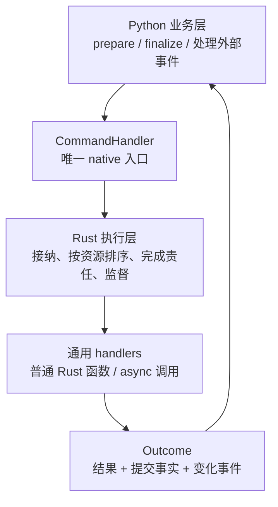

# Rust 通用 handler 与组合接口草案 v0.1

**历史草案：当前接口见 [v0.2](actor-rustify-interface-v02-2026-10-24.md)，框架已选 [Ractor](actor-rustify-runtime-decision-2026-10-24.md)。** 下文保留家族/备选组合讨论，不作为六类已覆盖全部现状的声明。

状态：WIP、可评审草案，尚未实现或冻结 API。用户已确定先走 Rust 路线，借鉴 BEAM 设计理念；业务领域规则保留 Python，目标产品移除 Pykka，不同时维护两套 actor model。本文回答 Actix/Tower 能力重叠、Ractor+Factory 对比，以及可以从现有代码归纳出的抽象。

主入口 #1897 / `intg/actor-rustify → dev`。Inbox 去重复修复继续独立，不等待本草案。

## 1. Actix 已有类似 Tower 的哪部分能力

需要区分三个名字：`actix` 是 actor crate；`actix-service` 提供通用异步 Service/ServiceFactory/Transform；`actix-web` 是 HTTP 框架，使用这套 Service/Transform 组织 middleware。当前 actix-web 的 manifest 并不把 actor crate `actix` 作为其普通依赖，不能把 Actix Web 的每个请求当作 actor 消息。[actix-service](https://docs.rs/actix-service/latest/actix_service/)、[actix-web manifest](https://github.com/actix/actix-web/blob/master/actix-web/Cargo.toml)

| 能力 | Actix 生态 | Tower |
|---|---|---|
| request→response 异步接口 | Service | Service |
| 包装处理过程 | Transform | Layer |
| 输出/错误映射、前后串接 | ServiceExt 的 map/map_err/and_then | ServiceExt、ServiceBuilder 及 Layers |
| HTTP 请求与响应 middleware | Actix Web 的 wrap/from_fn 等 | tower-http 等协议适配组件；Tower 本身保持通用 |
| 通用策略组件 | 可以用 Transform 实现；具体内置/外部组件需逐项选择 | 已有 timeout、limit、load shedding、retry 等可选组件 |

来源：[ServiceExt](https://docs.rs/actix-service/latest/actix_service/trait.ServiceExt.html)、[Transform](https://docs.rs/actix-service/latest/actix_service/trait.Transform.html)、[Actix Web middleware](https://docs.rs/actix-web/latest/actix_web/middleware/)、[Tower](https://docs.rs/tower/latest/tower/)。相似层次不代表两个 Service trait 可直接互换。

结论：若采用 Actix，可先选 `actix-service` 作为唯一组合抽象，没有必须再叠 Tower 的理由。若采用普通 Tokio 执行器，则 Tower 是合理的通用 Service/Layer 选择。actix-web 只在需要 HTTP 边缘服务时考虑，不为取得通用 handler 组合而把整个 HTTP 框架带入内核。

## 2. Ractor + Factory 的优势与代价

用户所指的库名是 Ractor。它通常也运行在 Tokio 上，所以不是“Ractor 对 Tokio”的同层比较；真正比较的是不同的调度/监督/处理组合。

| 维度 | Tokio + Ractor/Factory | Tokio + Actix + actix-service（或选 Tower adapter） | Tokio + Tower + 最小资源执行器 |
|---|---|---|---|
| 状态/监督机制 | 接近 OTP 的 actor/监督；Factory 管 worker 生命周期 | 有 actor 生命周期与 Supervisor，需映射现有 generation/恢复语义 | 需要实现或组合任务监督与资源 owner |
| 按 key 的工作分派 | Factory 已有 key-persistent、sticky、queuer、round-robin 等 | 通常需应用层设计路由和 pool | 应用层实现 keyed executor |
| 处理链组合 | Factory 不是 Service middleware 链；handler 内仍需普通组合 | actix-service/Transform 可复用 | Tower Service/Layer 可复用 |
| 排队结构 | 通常有 factory 与 worker 两个调度位置，队列位置可配置 | actor mailbox，加哪些外层 Buffer 由我们决定 | 可以保留一个明确接纳/队列边界 |
| 适合的工作 | 通用 job 池、按 key 分派、需要 worker 重建的任务 | 有明确资源状态 owner，且希望复用 actor 生态 | 少量通用 handlers、执行拓扑尽量直接 |
| 需要补的语义 | 已接纳工作的持久责任、in-flight 失败、重试/丢弃、扩缩容的 key 所有权 | 容量、超时/取消、重启和结果责任适配 | 监督、恢复、接纳/结果责任，以及自身实现维护 |

Factory 的 routing 和 queue/lifecycle 是实有能力；其 worker 内存队列管理不等于 durable exactly-once，也不能据此认为进程崩溃后所有已执行工作都能恢复。其 discard/retry 策略必须与本项目接纳/提交语义区分。[Factory](https://docs.rs/ractor/latest/ractor/factory/index.html)、[routing](https://docs.rs/ractor/latest/ractor/factory/routing/index.html)、[discard](https://docs.rs/ractor/latest/ractor/factory/discard/index.html)

若需求严格要求一次命令只有一次排队，Factory 的中转层要纳入成本/边界评估，不能因为开箱即用就忽略。单个 SQLite 状态权威也不能通过复制多个 worker 状态实例来增加并发。

当前不宣称哪套最快。用户明确要求少维护 actor 底座后，已选择 Ractor，撤回自建 Tokio/Tower executor 建议。上表保留取舍依据，框架类型不进入 Python API。

## 3. 三层职责，而非每种功能一个 actor



执行层处理“谁可以运行、按什么资源顺序、什么时候算完成”。handler 处理明确的通用原语。组合器直接调用 handler/service，不为每个子步骤创建 ActorRef、mailbox、waiter。

资源由可信宿主注册，Python 业务提交已有 ResourceId 和数据参数。此内部原语面不直接暴露给未认证客户端；“领域无关”不等于任意用户可以执行 SQL、打开路径或启动进程。

## 4. 可以归纳出的 handler 家族

这是能力草案，不表示第一版同时实现全部驱动。

| 家族 | 候选操作 | 对应当前需求与边界 |
|---|---|---|
| **State / Snapshot** | snapshot、批量读、compare-and-set、按条件更新、只读投影 | DispatchState、各域 projection 等；是现有内存状态的 native 实现或派生投影，不新增另一份 durable 真值 |
| **Transaction** | 参数化 query、条件 write/delete、单 DB transaction | Inbox/Agent/Session/PAC 等现有 SQLite 持久化；复用既有数据库，业务表和语义由 Python 计划定义 |
| **ChangeFeed** | 按资源 version 发布变化、wait-since、订阅/取消、事件批量读取 | 无变化不增加版本、不通知；发布绑定真实提交/状态变化，不绑定普通回复 |
| **Timer / Schedule** | schedule-at、cancel、按 key 合并、到期事件 | cadence、退避/到期维护；调度数据命令或产生事件，不能存一个 Python callable 在 Rust timer 中 |
| **I/O Resource** | 对已注册文件/blob/stream 资源的 read/write/flush/close | 日志、文件、字节流与网络基础驱动；Lark/Jev 规则留 Python，具体 native 协议驱动可独立实现 |
| **Process Resource** | spawn、observe、wait、signal、close | 已有进程 owner/harness 生命周期的底层操作；保留 PID birth/generation fence，不理解模型/Agent 业务 |

CRDT/Zenoh 等可作为后续通用 resource driver，而不把 OrgFS 的成员规则或 agent 路由政策写入核心。CRDT 内存状态与 SQLite journal 的一致性不是通用 SQL transaction 自动解决的，需独立定义该资源的提交/恢复边界；不作为 v0.1 已解决能力。

第一轮原型只需 State/CAS、Transaction、ChangeFeed 三类，足以验证资源顺序、数据转换、真实变化和无变化路径；Timer 随后加入。I/O/Process/CRDT 驱动按现有 61 个注册点逐项映射，不机械一对一迁移。

## 5. 输入与结果草案

名称均为设计示意，尚未形成公开 API。

```text
NativeCommand
  operation_id
  resource_ids
  expected_epoch / expected_revision
  wait_deadline / execution_policy
  plan: 已知 NativeOp 或有限组合

Outcome
  operation_id
  state: rejected | pending | completed | failed
  value: owned data
  commit: no_write | unchanged | committed | outcome_unknown
  durability: transient | persistent
  revisions / committed_changes
  events: 数据事件，不是待执行的 Python 函数
```

- 成功、实际变化和提交事实分别表达；非空返回值或成功 bool 不自动意味着 changed。
- 不把 SQLite total_changes 单独视作语义变化。条件语句/驱动应提供真实变化依据；publication 只消费已提交变化，回滚不能产生假通知。
- 变化与版本按 ResourceId 归属，并区分 transient/persistent。内存准入状态变化不冒充持久消息变化；只通知订阅该资源的等待者，不无条件广播所有资源。
- wait_deadline 结束只影响等待者，不能自动撤销已接纳的操作；pending/outcome_unknown 必须保留 operation_id 和后续查询路径。
- operation/late-result 管理复用现有资源的持久回执边界；不额外创建第二个全局 durable ledger 来和业务数据库争夺权威。
- 核心使用 Rust owned 值，PyO3 仅在入口和出口转换。Python 对象、SDK client、DB connection、ActorRef 不穿过执行边界。

## 6. 组合函数草案

| 组合 | 语义 | 关键约束 |
|---|---|---|
| `sequence(a, b, ...)` | 顺序执行已构造的操作 | 不自动提供跨操作回滚；后续失败仍须保留前面已提交事实 |
| `parallel(limit, independent_ops)` | 对独立资源有限并发并收集结果 | 同 resource 不绕过其序列化；一个失败不代表其他已提交操作被撤销 |
| `transaction(db, statements)` | 单数据库的原子提交 | 初版不宣称跨 DB/CRDT/外部 API 原子事务 |
| `guard(preconditions, op)` | 检查 epoch/version 等通用条件 | 检查与相关写入处于同一受保护执行边界，不能存在检查后再排队的竞态 |
| `coalesce(key, policy, op)` | 合并被明确声明可合并的工作 | 用于刷新/重复调度，不任意丢弃已接纳写操作；能力由可信注册定义 |
| `retry(policy, op)` | 对允许重试的结果重试 | 明确未接纳或已证明幂等；unknown commit 先查询原 operation，不能换 ID 重做 |
| `wait_until(deadline, operation_id)` | 有界观察一个已接纳操作 | 等待超时不等于执行取消，不释放仍被工作拥有的容量 |
| `publish_if_changed(outcome)` | 从已提交变化产生版本和通知 | 不因普通完成事件触发，且不进入第二套 actor 流程 |

Service 层还可组合 limit/load-shed/trace 等机制，但只保留一个清晰的接纳边界，不每层新建 Buffer。`map`/`map_err`/`and_then` 可作为 Rust 内部类型组合工具；不能通过它们注入 Python 业务闭包。

初版不提供任意 `if/loop/eval` 脚本语言。依赖中间结果的业务分支由 Python 明确编排，必要时再次经同一 CommandHandler 提交数据命令；这是显式业务步骤，不是 Rust handler 内暗中回调另一 Python actor。

## 7. callback 与生命周期方法

需要严格区分 Rust 内部扩展点和 Python 业务函数。

### Rust handler/driver 的基本方法

```text
open(resource_spec) -> ResourceState
execute(resource_state, operation_context, native_op) -> Outcome
recover(resource_spec, persisted_facts) -> ResourceState
close(resource_state, deadline) -> DrainReport
```

这些是 Rust 实现的 trait 方法。`execute` 的同步或 async 形式取决于驱动；框架适配把它们映射到 Actix/Ractor 生命周期或 Tokio task，不把这些框架类型暴露出去。

`recover` 恢复驱动和机制事实，不在 Rust 中重新实现业务恢复规则；需要领域重建的部分由 Python 构造数据恢复计划，再经同一入口提交。State 访问应以一个业务步骤所需的按需/批量快照为单位，不重新把每次 Python dict.get 变成 native 排队调用。

提交变化、fault、cancel 和 observation 的钩子属于统一执行层：

- `on_commit` 只消费驱动提供的已提交事实，更新 operation 结果与变化发布。
- `on_fault` 执行配置化重启/隔离策略；保留 generation fence 和未完成操作责任。
- `on_cancel` 只能给出明确的取消阶段与结果，不把“调用者不等了”宣称为回滚。
- `on_observe` 记录计数/时延等，不参与业务决定或再发 actor 命令。

它们不应该成为任意 Python callback 注册点；否则会重现逐条 Rust→Python 回调的开销与边界混乱。

### Python 边缘函数

```text
prepare(business_input, observed_facts) -> NativeCommand
finalize(business_input, Outcome) -> business_response
on_native_event(data_event) -> 新的外部业务输入（需要时）
```

`prepare/finalize` 在普通 Python 调用栈执行，Rust 不反向调用。外部事件通过结果/事件数据通道交给 Python，不将 SDK callback 保存到 native runtime。新的 timer/network/process 事件可再次进入同一入口；它不是原 handler 嵌套进入另一 actor 流程。

若最终回复必须依赖中途外部 I/O，需由同一个 native operation 完成该通用 I/O，或显式保持 pending 语义；不能先返回 completed，再让 Python postprocess 补真正提交。

## 8. 从当前代码到抽象的映射

| 当前结构 | 可折叠到的能力 |
|---|---|
| DispatchOwnedMap 的逐 get/put actor RPC | 同一资源执行上下文中的 State 操作/批量读 |
| Session→DesiredStateIo→StatePersistence | Transaction + operation 完成责任；保留绑定 fence |
| Inbox 回复→版本/刷新/广播 | 纯结果返回 + Transaction/ChangeFeed 的显式提交变化 |
| BoundedCadence actor→worker→actor | Timer/coalesce + 一个受限 native job |
| 日志、profile、fetch receipt 等 I/O actor 包装 | 注册资源的 I/O/Transaction handler |
| ProcessOwner 和进程探测 | Process Resource + Timer + generation/birth fence |
| Lark/TypeSafe SDK | Python SDK/外部 worker 边缘，不因为底座迁移而搬进 Rust 领域逻辑 |

这些是设计映射，不是已完成迁移。资源持久化/恢复等价、跨资源步骤和平台驱动仍需逐项实现及测试。

## 9. 当前实施建议

按 v0.2 的 Command/Outcome/driver 接口和选定的 Ractor 实现限定原型，以相同粗粒度操作、容量和工作量与 Python 对照，不同时开发多套产品 backend。

原型必须包含 Python prepare/finalize、数据转换与真实提交，比较有变化、无变化、同 key 和不同 key；不能再用“Rust 计数器比 Python 快”代替本项目数据路径。框架已选 Ractor，基础语义实验已运行，完整业务数据路径尚未验证。
