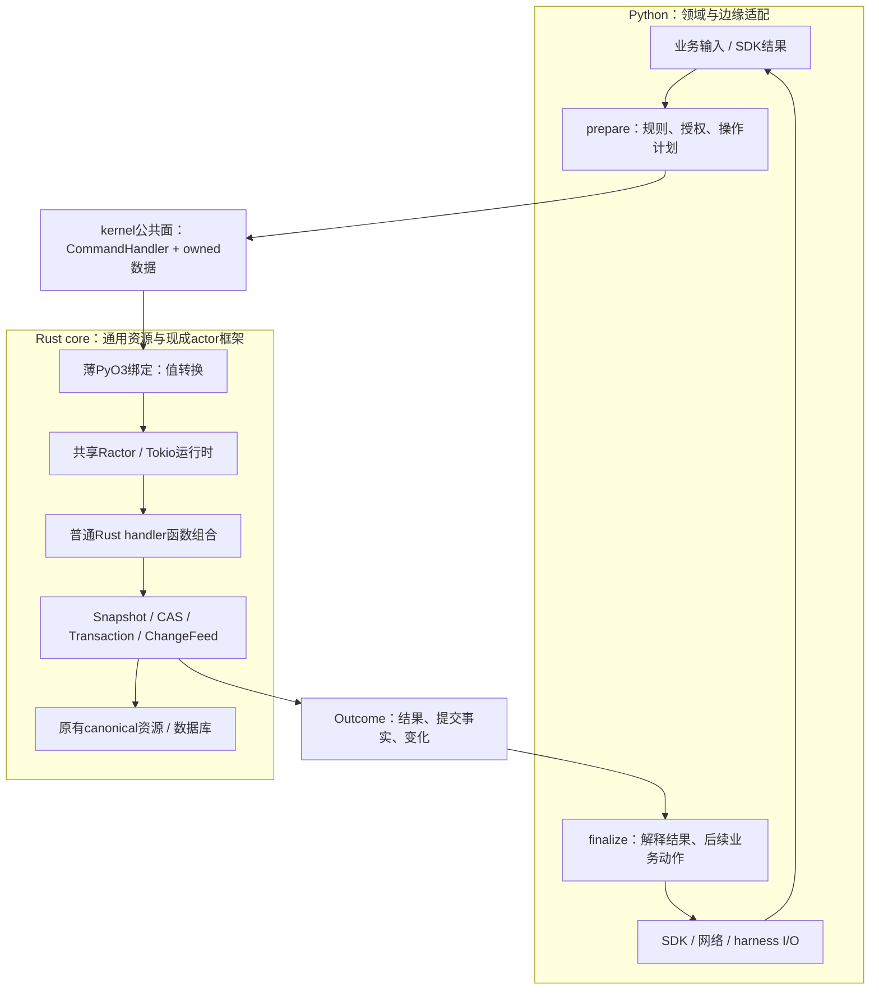

# Rustify Core 正式实施计划

状态：进入正式实施规划；框架选定Ractor，尚未改变产品执行后端。现有Dispatch内存路径已完成P0a标定，支持继续实现，但性能不是唯一目标。方案入口为#1897 / `intg/actor-rustify → dev`；不把Rustify列为0.5.5.1算法修复的前置条件。

**阶段定义已按用户最新要求调整：S2现在是完全剔除Pykka、完成全部生产路径真实替换的总阶段。** 旧S2–S5收敛为S2子里程碑，Dispatch仅为首个切片。入口：[S0/S1分发ADR](actor-rustify-build-distribution-adr-2026-10-24.md)、[S2设计](actor-rustify-s2-design-2026-10-24.md)、[S2实施计划与拟议goal](actor-rustify-s2-execution-plan-2026-10-24.md)。实施规则已获Allen裁定；本轮只修订规划，未实际设置goal或启动实施。

[并行实施编排](actor-rustify-parallel-delivery-2026-10-25.md)补充14项决定前置门、角色职责、文件owner和调度限制；实际模型/参数记录在PAC节点`launch`，不写死会话级配置。作为评审附件，不改变S2全量替换标准。

按[评审27578](https://code.hyprial.com/HyprialOS/harness-bridge/pulls/1897#issuecomment-27578)修订：S0交付分层目标图与旧入口处置方案，S1交付共享宿主、安装产物及平台CI证据。详见 [S0/S1具体交付清单](actor-rustify-s0-s1-deliverables-2026-10-24.md)。

S0主文档是[目标分层图与风险处置](actor-rustify-target-architecture-2026-10-24.md)：先决定少数资源权威与Python应用服务如何组合。[61项表](actor-rustify-entry-layering-proposal-2026-10-24.md)作为遗漏检查和迁移追踪附录，不能代替目标设计或作为S0完成指标。

## 1. 本次重构要达到的结构

1. **Python负责领域。** Inbox准入/投递规则、Session/Agent生命周期、OrgFS策略、PAC决策、Casbin授权、Lark/Jev等SDK调用留在Python。
2. **Rust提供少量领域无关的资源操作。** 状态Snapshot/CAS、单库事务、变化订阅及必要的资源生命周期。Rust不出现Inbox/PAC专用状态机，也不接受Python业务callable。
3. **Ractor/Tokio负责actor机制。** 复用消息循环、任务执行、生命周期和监督；需要worker池时先复用Factory。不会把自建调度器、监督树框架或重试语言藏在adapter里。
4. **权威只有一份。** 保留现有数据库、消息/回执和generation fence。Python缓存只是派生读模型，不能另持一份接纳、提交或恢复真值。
5. **目标产品只有一种actor模型。** 最终移除Pykka及失去职责的Python actor基础设施；旧实现只用于独立基线，不留下静默fallback和长期双后端支持。

CommandHandler是唯一native入口，不等于一个全局串行actor。每条native命令内部只调用普通Rust组件，不再向另一个业务actor发RPC。跨真实外部I/O的业务步骤由Python显式编排，多次从同一入口进入；不能为制造“一次调用”的外观丢掉durable intent/receipt或把SDK搬入Rust。

## 2. 目录与依赖方向

沿用kernel → identity → daemon → biz → shell深模块边界。Python领域模块只消费kernel公共面，不直接import私有PyO3模块。

纯Rust core与Python binding拆为独立crate；core不依赖PyO3、CPython或Python领域包，binding只做数据转换、调用与异常映射。[分发ADR](actor-rustify-build-distribution-adr-2026-10-24.md)已裁定同仓`crates/hyprial-core`与`crates/hyprial-py`、同一个hyprial wheel、Hatch调用Cargo、abi3-py312标准CPython、本goal两硬格加三后续格、独立core/Tauri workspace。实现时同步AGENTS、结构门和公开快照清单；当前没有创建产品crates或声称构建矩阵已通过。

当前项目使用Hatchling和GUI custom build hook。先验证在现有uv/wheel流程中加入native扩展的方式，不默认整体换构建后端，不借此重写GUI安装流程。产物应从仓库源码可重建，支持平台的安装、升级和缺失扩展错误都要实测；不得靠退回Pykka掩盖打包失败。

## 3. 实施顺序与交付条件

| 阶段 | 具体交付 | 完成条件 |
|---|---|---|
| S0：目标分层与实施任务包 | 以少数资源权威+Python应用服务的目标图为主，给出资源身份/操作面、顺序/配额/等待依赖/故障域方案、源码/分发ADR及任务；旧入口表仅作追踪附录 | 目标结构与关键边界收敛，不以61/61覆盖率计完成；S1前置决定已收敛，未解决路径明确阻塞 |
| S1：可安装的共享底座 | 共享Ractor/Tokio宿主、薄绑定、opaque资源句柄、封闭接纳、通用测试资源、同一wheel和平台CI | 干净环境uv安装后可打开多个资源、发送命令、观察结果并正确关闭；支持矩阵有证据，不靠本机.so或Pykka兜底 |
| S2：完整生产替换与删除 | 从Dispatch首切片到持久/OrgFS/Process/Transport、全部Python应用服务、完整接线和旧引擎删除；详见S2.0–S2.7任务 | 产品/依赖/发布产物无Pykka与旧Python actor引擎；全部功能有native资源路径、正确分层及完整验收；没有fallback、未迁移入口或硬验收BLOCKED |

S0可按资源推进，但不能只映射最容易的入口就宣布整体完成。候选资源类型收敛不等于把所有实例挤进一条队列；原有顺序、配额和generation/故障边界必须逐项处理。S1先暴露共享宿主、打包与CI平台风险，S2完成全部真实替换；内部切片与提交仅是中间检查点，最终汇入`intg/actor-rustify`。

## 4. S2.1首个切片：Dispatch状态资源

P0a已经提供真实GET/settle_hold基线、批量Python参考与Ractor原型；正式实现还必须补齐：

- 实际冻结dataclass/结构化值的owned编码与验证，不能只支持实验中的JSON字符串。
- 所有相关表、snapshot输出、SETDEFAULT/POP/COMPARE等实际语义和调用方，并审查批次合并造成的交错变化。
- 每个旧入口的真实容量口径、关闭与异常行为；实验容量128不能自动变成所有资源的产品默认值。
- 操作身份、等待超时后的查询与责任、资源epoch和重启行为，而不是复制实验里的短同步reply通道作为完整协议。

现有同值CAS成功会增加version，而v0.2提出无变化不增加资源revision。先明确这两个量的语义；若决定改变既有行为，单独提交并建立RED→GREEN和必要的Contract-Impact，不能在语言迁移里悄悄改掉，也不能维持两份相互竞争的版本权威。

## 5. 持久化和Python业务边界

SQL模板、领域模型及业务判定归可信Python宿主；Rust执行经过注册的有界参数化操作，不内置Inbox、会话或工作流schema规则。不接收任意外部调用者自选的数据库路径和SQL。

需要读取后再作领域决策的路径，由Python读取快照、生成操作计划，再以revision/epoch/CAS前置条件提交。条件在资源权威内原子检查，不能在Python检查后无条件写入。不能把跨数据库/CRDT/外部API操作称为一个原子事务。

普通回复只返回结果。写入侧明确报告已提交事实与实际变化，再按资源发布；不在通用reply helper里默认全表刷新或全局唤醒。领域派生投影的生成/发布顺序须逐资源核对，不能让等待者读到旧投影却收到新版本通知。

进程内worker重启和daemon重启分开处理：Ractor监督/Factory排队不等于durable acceptance。继续使用原数据库intent/receipt，不另建全局durable消息真值。未知在途提交先查询原事实；禁止默认重试，禁止在旧阻塞writer仍可能执行时启动第二个writer。

对于CRDT或必须使用Python SDK的路径，S0必须给出可验证的数据边界。若无法在这些约束下分层，该入口应标BLOCKED并调整方案，不通过反向调用Python或增加一套Python actor循环绕过问题。

## 6. 不把渐进实施变成长期双后端

旧版本与候选通过独立工作树、进程和隔离home做对照。开发中的切片测试可以分别运行旧实现和新实现，但不发布混合后端产品，不提供永久backend选择开关。

完整候选中的未迁移入口应明确未实现，不能静默退回Pykka。所有生产入口完成映射和验收后再做产品切换；随后删除旧代码、依赖与维护分支。不会把Rust当作调用现有Python CommandHandler的调度壳。

## 7. 验收优先级

**分层验收：** core无领域模块/Python对象依赖；SDK和业务判定留在Python；原始ActorRef封装在适配层；通用handler之间无嵌套业务actor RPC；没有第二份数据库/队列真值，也没有自建通用runtime。

**行为验收：** 语言移植使用同一输入对照与故障负对照；算法/可观察语义改变先RED→GREEN。覆盖真实写入、no-op、幂等、容量、顺序、超时、取消、部分提交、重启、drain、慢订阅者和已有业务fence。导入失败不算行为RED，skip不算验收通过。

**交付验收：** 结构门、模块边界、ruff、Rust格式/静态检查、受影响测试、完整产品测试与隔离功能链路；缺少真实provider或目标平台条件的项目标UNKNOWN/BLOCKED。发布JSON、事件、错误码或诊断字段语义变化同步contract，并声明Skill-Impact。

**性能与观测：** 保留现有P0a结果作为事实，后续只针对实际接线风险补测，不因追求倍数扩大重写。共享worker后不能把原`threadCpuMs`字段填成wall time或整个worker CPU；需先确定可测口径、覆盖范围和兼容方式，再同步contract。当前原型最大延迟的回退与发压迟到均须保留，不能只展示p99改善。

## 8. 当前完成与下一项

已完成：框架选型、接口v0.2草案、静态清单及部分语义审查、库级语义控制、现有Dispatch内存功能P0a标定。性能数据见 [报告](../notes/ractor-dispatch-performance-2026-10-24.md)。

本轮交付完整S0/S1/S2规划及单一总goal供研发负责人第四轮复核。G0一次交付S1-A至S2.7全部任务包，复核PASS后连续实施；原G1/G2仅为自动内部里程碑，Dispatch完成只是S2.1检查点。当前产品接线、完整接口与最终删除尚未完成，未设置或启动goal。

算法修复线独立：inbox-fix继续Inbox收尾、PAC tick、macOS ps三项，最终只有#1892 `intg/daemon-inbox-perf → dev`向主团队交接；#1891为内部实施PR。Rustify继续以#1897为独立讨论/实施集成入口，不改变算法修复的发布顺序。
