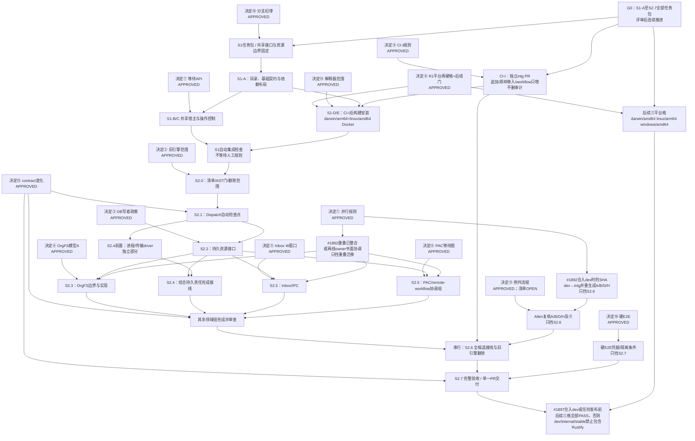

# 并行实施编排

状态：**第四轮R1–R4已落实，待研发负责人复核；最终BASE与基线实测清单仍OPEN**。只保留单一总goal，G0一次交付全部任务包，原G1/G2作为PAC内部里程碑自动连续推进。本goal平台硬格为darwin/arm64和linux/amd64 Docker，后续三格硬挡dev合入/发布。本轮没有启动Rustify实施agent、goal或PAC执行图。

原执行计划只说明S2.3/S2.4等可在底层稳定后独立推进；本附件补齐角色职责、14项决定前置门、文件归属和合入规则。

## 1. 角色职责

| 角色 | 工作范围 | 不能代替什么 |
|---|---|---|
| 规划/设计收敛 | 消化评审、资源/接口边界、风险反例、任务依赖和任务包；处理执行中发现的架构矛盾 | 不凭推断宣布语义/恢复已验证 |
| 常规执行 | 前置条件与文件范围清楚的包装、转换、已定接口接线、测试夹具、文档/构建脚本等切片 | 不独自改写事务/fence/恢复设计或扩大任务范围 |
| 复杂实现 | 共享宿主、操作责任、原子提交、OrgFS边界、进程fence和高耦合调用链 | 仍需另一独立上下文评审，不能自审自批 |
| 独立审查 | 按精确head审查源代码、测试敏感性、边界/失效路径和集成结果，给可核验反例 | “看起来正确”不能代替真实测试与产物验证 |
| 集成与任务控制 | 固定基线、分配文件、接收证据、合入顺序、集成验证、对研发负责人交付 | 不绕过分支保护或自行把BLOCKED改PASS |

分工依据是本项目的事务、fence、恢复和独立评审约束，不依赖外部模型选型文案。事务/fence/恢复相关切片必须由能够提供独立审查证据的配置承担；实现者不能自审。

每个任务的实际harness、provider、model和参数记录在PAC节点`launch`与交接记录中，不写死为仓库级事实。指定配置不可用时报告，不静默替换。子任务不自行扩展委派树，额外执行或评审需求交研发负责人安排。

使用新的独立上下文和完整任务包，不把旧任务的未验证结论当作新任务事实。遇到接口歧义、需要改变提交/fence/恢复机制、越出文件范围或反复修复仍不能通过负对照时，保留证据并升级给规划/复杂实现角色，不降低验收。

## 2. 并发与积压控制

实际并发由PAC图的依赖、可用执行资源和独立评审容量决定，不引用某个会话的固定上限。

- 规划与实施可以分开调度；规划结论未形成稳定任务包前，不开启依赖它的实施节点。
- 同一authority只有一个写入owner；独立审查者与实现者使用不同上下文。
- 其他任务占用同一批执行资源时必须计入调度，不假设Rustify独享资源。
- 待审/待集成变更积压超过审查容量时先收敛，不无限增派写入任务。

## 3. 依赖图与并行窗口

决定和裁定记录见[G0决定与验收附录](actor-rustify-g0-decisions-and-acceptance-2026-10-25.md)。G0一次交付S1-A至S2.7全部任务包，原G1/G2仅为自动内部里程碑。外部等待只有三类：#1892只挡重叠迁移和最终BASE；Allen复核A/B/D/H及⑪只挡S2.6；硬E2E凭据只挡S2.7。S1集成与S2.1检查自动推进，不等待人工再规划。

CI-I的交付物是机械审计：对`NATIVE_ORIGINS`、`registry-union.json`、`HISTORICAL_ROWS`的diff只接受“新增条目”或“原样移入”，workflow只增不删，其余一律FAIL；S1-D/E和S2.6都以CI-I为前置。图表示可调度依赖，不承诺所有分支同时运行；测试和独立评审随切片完成，不留到最后统一调试。

| 窗口 | 可以并行 | 必须串行或同一owner |
|---|---|---|
| #1892收尾 | G0全部任务包、S1及S2非重叠工作 | 重叠迁移须已整合#1892或有两线owner书面协调；最终BASE和Allen复核只挡S2.6 |
| CI-I | 可与S1-A/B/C并行 | 独立intg PR先完成机械审计，再进入S1-D/E；S2.6复核同一审计 |
| S1基础 | 宿主/操作控制 与 构建/平台CI | 共享类型、ABI、workspace布局和依赖锁先固定；共同文件归集成owner；S1检查自动推进 |
| 后续三平台格 | 可与功能替换并行 | 不挡S2.7功能goal；#1897合入dev或任何发布前必须全部PASS |
| 资源实现 | 存储 与 不依赖新持久语义的进程/传输driver | 同一个driver、公共Outcome/控制协议、同一数据库迁移文件 |
| 领域迁移 | 前置满足且写入不重叠的领域组，例如OrgFS与已就绪的Inbox服务 | Session/Agent/Harness共享生命周期链、PAC/remote-workflow/Routine等待链分别作为一个协调组，不能按文件数量随意拆散 |
| 代码审查 | reviewer审查已固定head，另一不相关执行任务继续 | reviewer不在被审branch同时实现；作者修复后必须重新确认新head |
| 最终切换 | 原则上不再并行业务改写 | bootstrap、公开导出、锁、Pykka删除、完整候选和发布产物一致性检查 |

## 4. 文件与状态所有权

每个任务有独立worktree/短分支、精确base SHA、允许写入文件集合、输入接口版本和测试范围；不在主工作树或另一agent的目录里写入。

共享文件由集成owner统一处理或显式预约单一作者：`crates/Cargo.toml`、`Cargo.lock`、公共types/lib导出、kernel/interface与__init__、pyproject/uv.lock、AGENTS及全局CI/公开快照配置。工作者提交所需变更，不能各自重生成整份锁或并发修改公共协议。

同一authority、同一schema迁移编号、同一receipt/fence协议只有一个写入owner。发生重叠时调整任务范围或串行交接，不依赖最后解决Git冲突来解决语义冲突。接口需要变化时回规划/评审并重新固定依赖，不能让其他执行者继续依赖已失效的接口。

任务交接必须包含：目标与非目标、base/head、实际model、源码范围、接口约束、RED/GREEN命令与结果、原始证据、未证明项、正在运行进程/会话及其所有权。接手者明确确认后旧owner停止监控，再移交唯一所有权；不能同时重跑同一长测。

## 5. 测试与测量的资源调度

并行开发不等于并行重负载。独立焦点测试可在有明确CPU/内存预算和独立home/socket/db/basetemp时并行；构建使用独立target目录，避免产物混用。

完整测试、平台构建和性能计时单独排窗口。冻结性能测量时停止同机编译/其他测试/基准；driver、负载、源SHA和先后顺序不得中途改。运行退出码与行为结论分开记录，exit0不自动代表负载成功。

每次合入后先运行受影响的集成检查；接口/schema/依赖变化触发相关下游验证。最终删除Pykka后在同一精确候选上完成整体矩阵，不能用几个不同head的局部绿色拼成整体验收。

## 6. 合入与授权边界

内部任务PR只面向`intg/actor-rustify`，由协调者按依赖和独立审查结果整合；最终只有#1897向dev交付。不直接推dev、不绕保护、不自行发布。后续三格未PASS前dev/internal/stable不得包含Rustify。算法线#1892与本线可并行收尾；最终`BASE_SHA`采用#1892合入dev时的SHA。

G0一次交付S1-A至S2.7全部任务包，后续按PAC自动推进，不设S1/S2人工规划等待。最终BASE与Allen复核只挡S2.6，硬E2E凭据只挡S2.7。这个附件只是调度方案，不改变总goal、不代表已获得实现或发布验收，也没有现在启动任何Rustify执行agent或PAC执行图。
