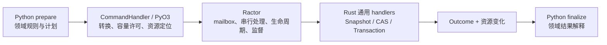

# Actor Rustify 框架决定：Ractor

状态：依据用户明确的维护成本优先级，在Ractor与Actix之间选择 **Ractor**。已完成库语义验证和下述Dispatch内存功能标定；尚未接入产品、证明整个daemon收益或通过完整迁移验收。接口见 [v0.2](actor-rustify-interface-v02-2026-10-24.md)。

后续进展：现有Dispatch内存功能的P0a标定已完成，[报告](../notes/ractor-dispatch-performance-2026-10-24.md)记录CPU、尾延迟、线程/RSS及回退；它不证明整个daemon收益。现进入 [正式实施规划](actor-rustify-implementation-plan-2026-10-24.md)，以分层与降低core维护成本为主。

当前规划的S2终态已经明确为全量生产替换及Pykka删除，包含旧S2–S5；本文件的早期原型范围不限制最终替换范围。详见[S2设计](actor-rustify-s2-design-2026-10-24.md)及[拟议goal](actor-rustify-s2-execution-plan-2026-10-24.md)。

## 1. 决定与优先级

采用 **Ractor + Tokio + PyO3 薄绑定**。Ractor 是唯一 actor 框架，Tokio 是其共享运行底座。通用 handler 通过普通 Rust 函数/trait 组合；首版不引入 Tower、Actix、actix-web 或自建 NativeExecutor 的消息循环/调度器。

排序依据：复用现成 actor 机制，让主要开发工作留在 Python；保持资源顺序、关闭和原有持久责任；减少特殊用法和易误用接口；最后验证端到端性能与部署成本。

此前 Tokio/Tower 自建执行器建议已撤回：Service 形状虽与 CommandHandler 相似，却把过多 actor 机制留给项目维护。此前因 Factory 多一次派发就降低其优先级，也不足以抵消复用现成 worker 管理的价值。

## 2. 为什么在两者中选择 Ractor

下表库行为已核对官方文档和隔离目录中的锁定源码；“适配成本更低”是结合需求的设计判断，不是测得的代码量或速度排名。

| 需求 | Ractor 0.16.5 | Actix 0.13.5 | 判断 |
|---|---|---|---|
| 一个资源的 async 操作串行完成 | 普通 async handle 返回前保留该 actor 的处理权 | 普通 ResponseFuture 可交错；AtomicResponse/Context::wait 可实现所需串行 | Ractor 默认形状更接近资源 owner；Actix 同样可实现 |
| 关闭前完成已接纳队列 | 提供 drain / drain_and_wait；stop 与 drain 不同 | 有生命周期和 stop，需组合应用接纳关闭、完成跟踪来落实本项目 drain | Ractor 可直接复用更多所需关闭机制 |
| 故障通知与状态重建 | linked actor、ActorFailed、独立 State/pre_start；普通监督策略由应用定义 | Supervisor 重启 context 并调用 restarting，不重新构造 actor；处理中的失败消息不能由它恢复 | Ractor 更贴合显式恢复；双方都不自动提供持久事务恢复 |
| 有界接纳 | 普通 mailbox 为 unbounded，需要封闭入口加标准容量许可 | 普通 Addr::try_send 可拒绝满队列；do_send 绕过容量；SyncArbiter 工作通道无界 | 此项 Actix 普通 actor 更直接；Ractor 必须补入口许可 |
| worker 池 | Factory 提供 key 路由、worker 替换、等待队列管理 | SyncArbiter 提供同步池，key 资源绑定和恢复还需对接 | 需要池时优先复用 Factory，不自行写 factory/worker 框架 |

来源：[Ractor Actor](https://docs.rs/ractor/0.16.5/ractor/actor/trait.Actor.html)、[ActorCell](https://docs.rs/ractor/0.16.5/ractor/actor/actor_cell/struct.ActorCell.html)、[Factory](https://docs.rs/ractor/latest/ractor/factory/index.html)、[Actix AtomicResponse](https://docs.rs/actix/latest/actix/struct.AtomicResponse.html)、[Supervisor](https://docs.rs/actix/latest/actix/struct.Supervisor.html)、[Addr](https://docs.rs/actix/latest/actix/struct.Addr.html)。锁定源码定位见实验 README。

## 3. 复用边界

- 不为每个 handler 建 actor；组合是普通函数调用，不再向另一个业务 actor 发 RPC。
- 资源 actor/worker 的消息循环、生命周期和运行调度归 Ractor/Tokio。CommandHandler 是调用门面，不是另一个全局串行 actor。
- 需要 worker 池时使用同一 Ractor 框架的 Factory；框架内部派发不成为第二套 actor model。是否用于具体资源，由资源所有权与故障测试决定，不先自建同等组件。
- 原始 ActorRef 留在适配层内，Python 与业务 handler 无法绕过接纳 gate。借助标准 Semaphore 等许可限制进入无界 mailbox 的业务工作量，不增加自管排队队列。
- 自有代码集中为：owned 值转换、容量/operation 关联、通用存储原语、既有回执/版本/变化适配及必要重启策略；不能每个领域再复制监督和重试机制。

**不能承诺零适配。** 普通 supervisor 的策略仍由应用决定。Factory 可替换 worker，但源码 `WorkerProperties::replace_worker` 放弃 curr_jobs 记录，不能视为在途事务的可靠重放器。默认不用自动重试包装，也不能在旧阻塞写仍可能运行时直接启用新 writer。

## 4. 隔离语义实验

锁定 Ractor 0.16.5、Actix 0.13.5、Tokio 1.54.1；macOS arm64，rustc/cargo 1.93.1。两套库仅在独立实验 crate 共存，产品只选择 Ractor。

| 实验 | 负对照 | 正确用法 |
|---|---|---|
| Ractor 接纳上限4，提交10个且首个暂停 | 原始 cast 接纳10、拒绝0，断言 RED | Semaphore 接纳4、拒绝6、完成4，许可全部返还 |
| Ractor 关闭时保留已接纳顺序 | stop 仅完成首个，断言 RED | drain 完成10/10，顺序0…9 |
| Actix async 完成顺序 | 普通 ResponseFuture 得到1,0，断言 RED | AtomicResponse 得到0,1 |
| Ractor drain 等待超时 | 无性能对照 | 10ms 等待超时后，已接纳工作仍继续完成 |
| Ractor child panic | 主动注入 panic | 父 actor 收到 ActorFailed；未实现自动重启策略 |

三项负对照各 exit 101；正确用法共 **5 passed / 0 failed / 0 ignored**。只证明基础库语义，不证明整个 v0.2、生产容量、故障期间许可保留或 Factory 完整恢复。日志、源码、Cargo.lock、脚本见 实验记录。（复现材料已于 2026-11-06 移出仓库，原件见 `cb2584a8b` 及之前的历史）

## 5. 后续实现边界

下一步按 Ractor 实现限定完整路径：Python prepare → native SQLite → scoped ChangeFeed → Python finalize。与同批量接口、容量和工作量的 Python 路径对照，计入 GIL、转换、提交和观察成本，不用空 mailbox 微基准推断 daemon 收益。

执行顺序、三组基线、负载、计量窗口与继续条件见 [性能验证计划](actor-rustify-performance-plan-2026-10-24.md)。P0a已实测，SQLite/ChangeFeed和隔离daemon验证仍未执行，随正式接线补齐。

完整验收仍须覆盖：跨线程接纳顺序、资源/全局/字节预算、取消与提交竞争、未开始责任、worker/daemon 重启、in-doubt reconciliation、关闭与慢订阅者。普通 actor 的队列不会在 panic 后自动成为持久队列；Factory 队列保留不等于跨 daemon durable acceptance。

如果接线需要自建通用消息循环、调度器、监督树框架或可编程工作流语言，就偏离了“少维护 core”的选择理由，必须回到评审调整，不能把新 runtime 藏在 adapter 名称下。选择 Ractor 也不允许削弱原有提交/恢复语义。

## 6. 范围与并行工作

首版 **node-only**。PyO3/Ractor内存原型已有数据；真实SQLite路径、完整恢复/daemon性能、Linux/Windows、移动包体/电量/真机均UNKNOWN。未来移动复用须考虑现有Go mobilebridge c-archive；独立Rust核心不等于移动集成已完成。

Inbox 第①项由独立 subagent 在 #1891/#1892 完成限定修复，证据 head `630c54fd019ddacc73b9d8f762eac5b6b14a4121`。25分钟 N24/M1000 对照 Inbox CPU 降94.88%、daemon CPU 降64.69%；完整 idle version 仍 FAIL，队列峰值/p50 有回退，生产 overload 未复现。这不证明 Rust 收益。

用户新安排的 #1892 第7项 PAC tick、第8项 macOS ps，由独立 agent 排在 inbox-fix 后处理：前者要求生产规模 RED 和 tick 决策一致；后者按同 PID/启动时间缓存，并兼容0.5.5持久身份标记，不直接删除 ps。已通知 inbox-fix subagent。DesiredStateIo diff 未自动纳入本轮实现。

最新安排已进一步落实为inbox-fix继续实施三项：Inbox残余收尾、PAC tick、macOS ps；最终仅通过#1892向主团队交接，#1891为内部实施PR。当前尚未完成，保持WIP。
