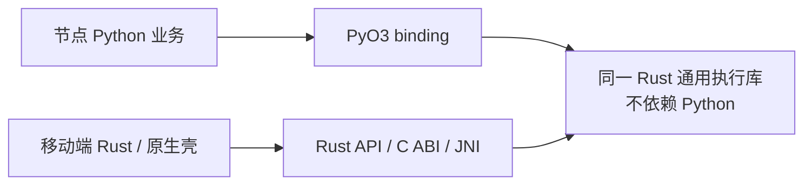

# Actor Rustify：Actix/Tower 组合与 BEAM 的移动端影响

日期：2026-10-24。状态：WIP 架构分析；未构建移动端，也未运行 Actix/Tower 或 BEAM 对照。主讨论 #1897，基点 `e384bba7b`。

当前决定为 **node-only，Ractor + Tokio + PyO3**，复用现成 actor 机制。Actix/Tower/BEAM 兼容性与移动复用内容是备选/后续研究，不是首版实现承诺。见 [框架决定](actor-rustify-runtime-decision-2026-10-24.md)。

## 1. Actix 和 Tower 可以组合

它们不在同一层：Tokio 提供 async 执行与 I/O，Actix 提供 actor/消息/生命周期，Tower 提供 request/response 的 Service 和可组合 middleware。组合不会因为引入 Tower 就多出一套 actor model。[Actix](https://docs.rs/actix/latest/actix/)、[Tower](https://docs.rs/tower/latest/tower/)

Actix 与 Tower 的组合在技术上可行；首版选择 Ractor。当前目标执行图是：

这里的 Actix 指 actor crate，不要求引入 actix-web。`Addr` 并非直接实现 Tower Service；需要一个请求/响应适配。Actix 生态的 `actix-service::Service` 与 `tower::Service` 也不是同一个 trait：前者 call/poll_ready 使用 `&self`，后者使用 `&mut self`。同用 Tokio 不等于接口天然可互换。[actix-service](https://docs.rs/actix-service/latest/actix_service/trait.Service.html)、[Tower Service](https://docs.rs/tower/latest/tower/trait.Service.html)

适配时要处理的具体事项：

- 使用长驻的正确 Actix System/Tokio 执行环境，不为每条命令新建 runtime。
- Tower readiness 与 native 接纳容量要一致。若 adapter 永远返回 ready，下游 mailbox 满并不会自动体现为 Tower 的上游背压。
- Tower 某些组合要求 Service/Future 可跨线程；应在 Addr/message 边界满足约束，不将 Actix 的线程局部 actor 状态直接搬到其他线程。
- 不无条件叠加 Tower Buffer 与 actor mailbox 两级积压。可以只用必要的普通 Layers，把唯一接纳/排队边界留在 native 执行器。
- 外部等待者超时与已接纳操作完成责任分开。Tower timeout 可以结束等待，但不能据此推断事务未提交或 native 操作已取消；Actix 的 request/drop 语义也需适配。
- 选择 Actix 的理由应是需要其资源所有权/监督/消息机制。纯 request→response 处理如果只用 Tokio/Tower 已足够，就没有必须再包 actor 的要求。

以上为源码/API 可组合性的判断，不是已完成本项目 adapter 的证据。

## 2. 将 actor 放到 BEAM：收益与新增边界

BEAM/OTP 直接提供成熟的进程调度、消息、监督和运行时诊断，能够减少自行实现 actor 生命周期机制的工作。它不自动提供 Hyprial 的 durable inbox、幂等、提交或 generation 语义。

在“业务仍由 Python 负责”的前提下，通常需要 Python 与 BEAM 通过端口/本地 IPC 等交换数据，而不能把 Python 对象当作 BEAM 内部状态直接使用。这是候选部署判断，本轮没有实现该桥接或测量开销。

| 方面 | Python + Rust/PyO3 | Python + BEAM |
|---|---|---|
| 运行形态 | 在已有 Python 进程中加载 native 扩展 | 通常增加 BEAM VM/进程及 Python↔BEAM 数据桥 |
| 数据交互 | Python↔Rust 值转换；可在 native 部分释放 GIL | 消息编码/解码和桥接；外部 Python 执行仍受其自身运行条件约束 |
| 生命周期 | native runtime 与 Python 生命周期整合，进程级失败域相同 | 可利用独立 VM/进程隔离，但要管理两端启动、退出、重连、未完成操作归属 |
| 分发 | 按平台构建扩展；需要现有 Python 环境 | 需要 ERTS/OTP 应用及可能的 NIF；Python 继续存在时还需其依赖 |
| 已有优势 | 较贴近当前 uv/Python 与 Tauri/Rust 路径 | OTP 的监督、消息和诊断机制可直接使用 |

Elixir release 默认包含 ERTS/VM，并按目标平台组装；不能把普通桌面 release 当作任意移动平台通用包。[Mix release](https://hexdocs.pm/mix/Mix.Tasks.Release.html)

上表不代表 BEAM 一定更慢、包体一定大多少或更耗电。需要相同工作量的端到端与包体/内存/电量实测；当前这些数值均 UNKNOWN。

## 3. 首先区分：手机是客户端，还是执行内核的宿主

当前仓库中，移动端是 Core 客户端，通过原生桥连接节点；不运行本地 daemon/harness/Agent。`app/src-tauri/src/lib.rs` 对 `power-pack + mobile` 明确 compile_error，Cargo 的 staticlib/cdylib/rlib 和 mobile-bridge 用于移动壳接入。

因此，如果 BEAM 只替换节点侧 daemon 的执行器，手机端不需要因此打包 BEAM。影响主要通过通信协议、鉴权、恢复和响应特性传递；只要端口语义保持，移动客户端的语言运行时选择可以独立。

如果未来要把同一通用执行库放到手机本机，差异才显著：

### Rust 原生库路线

- 将领域无关的执行库与 PyO3 binding 分成 crate/编译边界：Rust 内核不依赖 Python 对象或 libpython。
- 节点的 Python 业务经 PyO3 调用；移动端 Tauri/Rust 或 C ABI/JNI/Swift 适配直接调用同一 Rust 接口。
- 内核返回 NativeResult，PyObjResult 仅是 Python 绑定的表示；手机不必为了这个返回类型嵌入 CPython。
- Rust 有 iOS/Android 目标，但具体第三方依赖和本项目功能仍须跨编译及真机验证。[Rust iOS](https://doc.rust-lang.org/rustc/platform-support/apple-ios.html)、[Rust Android](https://doc.rust-lang.org/rustc/platform-support/android.html)

共享代码不等于在手机复制 daemon 的业务权威。移动端仍按其产品职责使用必要能力。如果要求手机也执行全部 Python 业务，则仍需打包 Python 解释器和扩展依赖；PyO3 本身不会消除这些成本。CPython 官方将 iOS/Android 使用方式描述为应用内嵌入解释器。[Python iOS](https://docs.python.org/3/using/ios.html)、[Python Android](https://docs.python.org/3/using/android.html)

### BEAM 路线

- 可行性不能简单判为“不支持手机”。Elixir Desktop 项目明确提供 Android/iOS 的 native host bridge 与打包示例，说明存在工程路径。[项目说明](https://github.com/elixir-desktop/desktop)
- 本次 Erlang 官方构建文档列出的测试 OS 未列 Android/iOS，且表明确不是穷尽清单；因此既不能据此证明绝对不可用，也不能当作本项目已经支持。[OTP 构建说明](https://www.erlang.org/doc/system/install.html)
- 移动集成需要处理 VM/boot/BEAM 模块、native library/NIF 的目标 ABI、宿主桥接、启动停止、JIT/代码加载与签名。OTP 支持禁用 JIT，但本轮未验证任何具体 iOS 配置。
- 桌面的常驻 daemon、子进程和热升级使用方式不能直接照搬到 App。App Store 对代码分发及后台服务用途有要求；这一点同样约束 Python 或其他嵌入语言。[Apple 2.5.2/2.5.4](https://developer.apple.com/app-store/review/guidelines/#software-requirements)
- Android/iOS 的后台暂停、资源回收与生命周期要求不因 actor runtime 改变而消失；Rust task 和 BEAM process 都不能独自提供手机后台常驻保证。[Android 后台任务说明](https://developer.android.com/develop/background-work/background-tasks)

## 4. 当前倾向与待证实项

首版已选择 node-only 的 Ractor/Tokio 与节点 PyO3 binding。未来复用现有 Rust/Tauri 移动壳时，还须处理已存在的 Go mobilebridge c-archive 链接与生命周期；独立 Rust 核心不等于移动集成已完成。Actix 可组合的事实保留为备选研究。

如果未来只在服务器部署执行器，BEAM 的成熟运行机制值得单独比较，移动薄客户端不构成排除理由；如果要求手机本地嵌入完整执行器，则 BEAM 是更大的运行时/打包选择，需要专门的移动原型验证。

未测：Actix/Tower 在本项目的可编译 adapter、BEAM↔Python 桥接、Android/iOS 构建与真机、包体/RSS/冷启动/耗电、暂停恢复。没有量化这些项目，也未因此变更产品方向或依赖。
