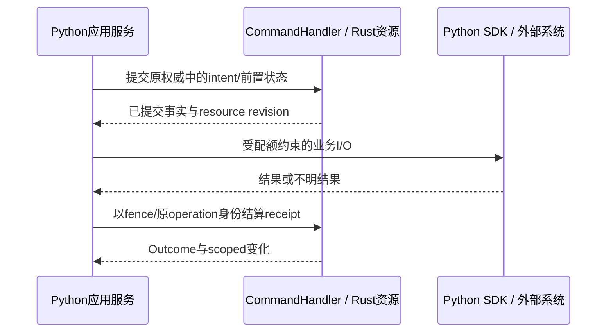

# S2真实替换设计：完全移除Pykka核心引擎

状态：**设计与实施规则已获Allen裁定，产品实现未开始；最终BASE和实测证据OPEN**。S2为完整替换阶段，包含旧计划S2–S5的全部生产迁移、切换及删除。Dispatch只作为S2的首个切片；不能以“一个native资源能运行”结束S2。

S0主成果为[目标分层图](actor-rustify-target-architecture-2026-10-24.md)，分发方案见[ADR](actor-rustify-build-distribution-adr-2026-10-24.md)。本设计保留Ractor、Python业务层、无反向业务callback和单一durable权威的决定。

## 1. S2完成时产品应是什么

- 生产actor执行机制只有Rust/Ractor：mailbox、资源串行执行、生命周期、共享timer及必要的执行设施不再由Pykka/Python guardian承担。
- Python提供普通应用服务、领域校验、SDK、CRDT计算、prepare/finalize和错误解释；不以每个服务一个私有actor/runtime/EffectLane来组织代码。
- `CommandHandler`公共面接受owned数据命令，Rust不接受Python `handler_factory`、SDK client、Doc对象或callable。PyO3的值转换与Future完成通知属于绑定层，不是core回调Python业务。
- 产品代码、根依赖/uv.lock、发布wheel和正常测试安装不再依赖Pykka。没有Python actor fallback，也没有删除包名后另造一套Python mailbox/guardian引擎。
- 原SQLite、文件、intent/receipt和fence继续是权威；不另建全局durable job数据库。所有生产功能都具备新路径，不能靠“未迁移暂不支持”通过S2验收。

历史WORM文档和独立旧版本基线允许保留Pykka文字/复现源码，不进入产品执行或默认测试依赖；“完全剔除”检验的是实现、依赖和实际运行路径，不是改写历史证据。

## 2. 代码边界

```text
Python identity / daemon / biz / shell 应用服务
  └─ hyprial.kernel 公共CommandHandler / 数据类型
      └─ kernel内的薄adapter → hyprial._core扩展
          └─ crates/hyprial-py：转换、await桥、错误映射
              └─ crates/hyprial-core：Ractor宿主与通用资源
```

core内部按资源/机制分模块，不能出现Inbox、PAC、Lark、Casdoor、Jev专用handler或业务状态机。SQL/schema/注册语句与业务判定在Python定义，native只执行有界注册操作及原子前置条件。原Python领域消息可以继续作为普通应用请求类型，但不能原样注册成Rust中的几百种领域消息分派。

共享宿主在bootstrap中显式创建，import契约类型不启动线程。一个进程内共用宿主，多资源按真实身份注册；同一物理数据库不因多个业务服务重复创建writer。fork后不复用父进程runtime/句柄，使用前检查进程身份；子进程应exec或显式建立新宿主，不能在子进程销毁父线程句柄时死锁。

多个façade访问同一物理资源时获得同一owner的能力视图；关闭一个客户端句柄不等于关闭所有客户的共享资源。活动操作持有执行lease，真正关闭须等待它们结算。资源别名、创建竞争和旧epoch句柄需要专门测试；不能仅凭展示name或路径字符串不同创建第二个writer。

## 3. 命令与结果接口

保留v0.2的单入口方向：Execute、Observe、Wait、Cancel、Shutdown以及受信任的资源注册/生命周期操作都经CommandHandler封装。业务层只见resource handle、operation id、epoch/revision和owned值；不见ActorRef、数据库连接或Python回调注册口。

主要操作族仍是State、Sqlite、File/Blob/Space写入边界、Transport、Process、Timer、原生effect执行和操作控制。每类先定义稳定的小操作面，再由Python组合；不增加可解释任意业务控制流的“计划语言”。一个native handler只访问自己的已界定资源，辅助driver是普通Rust函数，不发跨资源RPC。

Outcome必须分别表达：返回值、接纳责任、提交事实、资源版本、变化及错误。域内bool/非空列表不替代变更证明；普通reply不触发默认version bump/全表刷新/全局广播。Python façade负责映射既有公开结果/错误，语义变化独立提交并更新contract。

## 4. 顺序、容量与等待

- 资源身份使用完整scope或实际存储身份，不使用截断展示名。按资源/逻辑key保留必要顺序，不创造全局FIFO。
- 配额沿用已核对的真实口径，区分排队、执行中、观察者、字节预算及I/O并发；不能把所有原容量统一成128。Ractor原始引用封闭在adapter内部，所有业务入口经过接纳。
- native操作的执行责任独立于等待Future。Python取消await/连接断开，只撤销观察；不能因此释放执行中的许可、丢弃提交事实或杀死writer。
- Cancel只有在能证明尚未执行且不会执行时才返回已取消；执行中返回不可撤销/不明或驱动明确支持的结果。结果/取消/关闭控制不堵在满工作队列后。
- 关闭时先停外部接纳、排空Python应用步骤和native工作、结算或持久保存原责任，再释放资源。deadline到达仍有工作时报告incomplete，不Drop runtime伪造完成。
- worker/handler错误按资源隔离。未知在途提交先查询原receipt，确认旧writer已停止或fence有效后才能建立替代writer；Factory重建worker不等于恢复事务。

async应用服务使用await桥，不在其事件循环内阻塞等待需要同一循环执行的后续动作。桥接可复用现成工具，但必须把“观察Future被取消”和“资源操作被取消”分离；不自建第二个调度runtime。

## 5. Python SDK / saga如何继续工作

典型业务步骤保留以下显式边界：



Python SDK采用**外部操作ticket**模式：ticket只保存在native O内存中并按epoch管理，O承担进程内的接纳/完成责任，Python执行调用和回报事实；跨重启恢复始终属于原durable store/receipt，不新增全局job库。

1. Python向native O登记`operation_id + epoch + deadline + 配额身份`，O在当前epoch内存中记录已接纳后开始执行；原durable权威仍是既有store/receipt。
2. Python在[附录B](actor-rustify-g0-inventory-2026-10-25.md)允许的有界`concurrent.futures` executor中执行同步SDK；async adapter使用既有事件循环。executor不含私有接纳、重试、generation或receipt循环。
3. Python以同一`operation_id + epoch`回报`complete`或`unknown`；等待者取消只撤销观察，不撤销已接纳工作。旧epoch回报不得结算新epoch ticket。
4. **进程内**deadline到期、执行线程死亡或executor关闭时，O把ticket标为`in-doubt`并发数据事件，不得判失败、成功或自动重试。
5. 进程重启建立新epoch，旧内存ticket不再存在且O不声称能发现它们。业务服务把原store/receipt中未结算的操作按原协议置为`in-doubt`并reconcile；O不负责跨重启持久性或恢复扫描。
6. 晚到的complete/unknown只补充原operation事实；业务服务按原协议查询外部系统并reconcile，不覆盖已经确定的补偿/receipt。

等待API以同步等待并释放GIL为主，asyncio桥只用于原本async的adapter。Rust effect池仅执行原生通用工作，不持Python callable；Python SDK不持第二份业务真值，不维护私有guardian/重放引擎。

多资源saga没有一个虚假的总事务；每个原子步骤只操作其权威边界，补偿/恢复解释留Python。跨资源编排必须在PAC、remote workflow、registry管理、harness结算等路径上显式消除等待环；G0等待图和反例见[附录F](actor-rustify-g0-decisions-and-acceptance-2026-10-25.md)。

## 6. 持久资源与OrgFS的设计路线

### 6.1 原数据库/文件

按现有真实存储身份注册owner，保留SQL约束、PRAGMA、文件格式、fsync/rename和错误语义。每进程每物理库只有一个native writer；[附录D](actor-rustify-g0-inventory-2026-10-25.md)列全进程内与CLI/PAC remote等跨进程写者。资源前置条件必须在同一`BEGIN IMMEDIATE`事务内检查真实存储事实，不能只检查可能绕过直接writer的内存revision。跨进程写入继续使用SQLite事务和`busy_timeout`；`SQLITE_BUSY`映射为可重试错误，不能返回成功、丢失receipt/fence或无限阻塞控制/关闭路径。

desired state与lifecycle journal共享StateDatabase；routine两个库、OrgFS space journal与blob refs库、文件型profile和delivery ledger保持各自事实边界。若要改变这些存储拓扑，必须另行评审迁移，不能混在Rustify里。

### 6.2 选择(A)：Python space锁 + native事务原语

Allen已裁定选择**(A) Python space锁 + native事务原语**，不选(B) native多段条件提交。授权、CRDT、writer注册和一次edit的2–3个journal事务仍是Python领域逻辑；(B)会把这些规则及多段业务计划搬进native条件，扩大改动与故障面。(A)的空间锁属于[附录B](actor-rustify-g0-inventory-2026-10-25.md)白名单中的单服务对象锁，不是mailbox或actor引擎。

每space一把Python写锁覆盖完整流程：读取绑定已提交revision的快照→CRDT/授权准备→一次或多次native事务→更新Doc缓存、projection、frontier并释放后续写入。锁不能伪造跨事务原子性；每个native事务独立保留原提交点，中间崩溃由重启流程按原intent/receipt恢复。锁释放前不得让import或另一本地edit穿过提交后副作用窗口。

native事务原语只执行注册SQL、真实存储前置条件、journal写入与fsync，不调用Python mutator。每次写入的前置条件必须同时覆盖**整个space的meta frontier和该doc的state vector**，不能只核对目标doc seq；所有数据库事实检查与写入位于同一`BEGIN IMMEDIATE`。前置冲突时不提交，Python丢弃/重建派生缓存后按原intent准备新尝试。原生attempt身份与业务幂等身份分开，未知提交先查原事实。

writer注册、doc提交、`_UnregisteredMutationClients`补注册重试与`commit_many`循环均按明确事务段表达；不得在native事务中执行Python mutator。space journal保留FULL提交点，checkpoint仍是派生文件。签名、writer seq和causal约束必须有等价测试。

blob文件和refs库归**同一个owner和串行域**，put/pin/delete/unlink顺序不得拆给两个能力owner。`global_checker` callable改为带版本的projection数据；purge只读取明确版本，不能在native中回调Python。replica读取source journal由Python编排快照步骤，native handler不跨资源RPC。

### 6.3 必须先关闭的风险

[附录F](actor-rustify-g0-decisions-and-acceptance-2026-10-25.md)冻结反例集合：成员移除TOCTOU、未注册writer多事务edit崩溃、`after_journal`/`before_state`故障、blob put/delete竞争、purge projection竞争、import重放seq冲突和replica读取。每项必须有真实nodeid、故障注入和重启证据；不能只验证最终文本一致。

若现有purge/权限/引用关系需要跨独立owner的原子判断，不能把检查提前后无条件提交。需要schema/接口变化时先交设计差异评审。无法保持语义时该里程碑BLOCKED，**整体S2也不能完成**；不保留Pykka、Rust回调Python或删除OrgFS功能来绕过。

## 7. 全生产路径的替换范围

| 领域包 | 目标 | 必须保留的行为 |
|---|---|---|
| Dispatch/Inbox/IPC | Python投递/准入服务 + State/Sqlite/操作控制 | W席位、receive/fetch/ACK、幂等、部分提交、等待与真实变更唤醒 |
| Session/Agent/Harness | Python生命周期服务 + State/持久资源/Process | incarnation、进程birth、完整旧标记兼容、启动/停止/恢复及settlement |
| PAC/Routine/管理 | Python应用服务/saga + Sqlite/Timer | deadline/alert/close、远端grant、补偿、原receipt和等待顺序 |
| OrgFS | Python CRDT/策略 + 受fence保护的storage/transport | journal、blob/refs、replica、checkout、retention及重建 |
| Lark/Casdoor/Provider/User | Python SDK/领域适配 + 原存储/操作控制 | 身份/权限、交互、发送未知结果、幂等和关闭 |
| Transport/Transfer/进程/日志 | 通用资源承接I/O，Python解释协议/业务 | query句柄、声明生命周期、P2 custody、PID复用、按文件写序和排空 |
| 定时/诊断包装 | 共享Timer、真实计量、普通方法/必要锁 | coalescing、停止竞争、正确诊断口径；不因删actor删掉fence |

61项表仅作为遗漏追踪和删除清单输入。每条生产入口必须有新路径和证据；目标是少数资源类型加应用服务，不是61个新的Rust业务actor。

## 8. 明确删除清单

最终候选至少需要处理以下当前存在的实现/依赖：

- `kernel/impl/actor_runtime/backends/pykka.py`及`runtime.py`中的Pykka backend创建。
- 旧`ActorRuntime`/`ActorBackend`、`ActorSpec.handler_factory`和Python业务handler注册路径；不能保留Rust执行器回调这些handler的兼容壳。
- 已被共享native机制替代的`guardian.py`、`scheduler.py`、`effects.py`执行循环/线程/timer和相应公共导出；仍有用的纯数据契约迁到新的契约模块，不保留旧引擎。
- 全部生产调用方的私有runtime构造、effect lane和手写reply所有权；普通SDK线程/应用锁按其真实职责保留，不靠改名隐藏旧actor。
- `pyproject.toml`的Pykka依赖、`uv.lock`包与依赖边、wheel元数据和默认测试依赖。
- 旧测试中“只允许backend导入Pykka”的正向要求改为“产品没有Pykka/旧引擎”；保留顺序、custody、重启和错误语义覆盖，不删断言逃避回归。

## 9. 切换、回退与观测

内部实施可以分提交/内部PR，全部进入`intg/actor-rustify`，但不发布混合后端产品。开发参考仅在独立旧工作树/进程中运行；候选没有按模块/平台回退Pykka的开关。

完整候选通过后一次切换产品bootstrap，重新生成锁、构建并检验所有分发变体。回退是回退到先前完整发布版本/事先证明可恢复的数据副本，不把旧引擎留在新包中。未批准的破坏性schema迁移不属于本goal。

共享worker后，`threadCpuMs`等字段须重新核对口径；不能用wall time或worker总CPU冒充单资源CPU。必要的新字段同步contract。验收既包括静态依赖/边界扫描，也包括真实CLI/IPC运行证明：只删import或输出`backend=ractor`字样不算完成。
