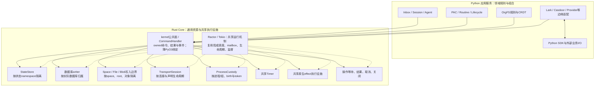

# S0目标分层图：资源权威与Python应用服务

状态：目标设计与实施规则已获Allen裁定，实际迁移和验证未完成，不能标S0/S2验收完成。顺序/配额/故障方案及[分发ADR](actor-rustify-build-distribution-adr-2026-10-24.md)按已裁规则执行；最终BASE清单仍按决定①另行冻结。问题是组件普遍actor化与基础设施重复，而不是start/tell/snapshot/stop/reset/drain这几个接口数量过多。

## 1. 目标结构

虚线表示框架提供运行机制，不表示资源之间互相发RPC。返回值、提交事实与变化事件经同一公共面回到Python；图省略返回箭头。SDK调用由对应Python服务执行，native handler内没有Python业务callback。

资源种类目标约6–8类，实际actor实例按资源身份创建；不能由旧组件类名决定，也不是全系统只剩8个actor。纯诊断/格式化/局部对象线程安全可用普通方法或锁，不必为代码组织再登记资源。

## 2. 对外收敛为什么接口

下面是操作形状示意，不是新增一套冻结ABI，也不要求每类恰好四个方法。open/close、错误与操作身份共用公共约定。

| 接口族 | 典型通用操作 | 留在Python的内容 |
|---|---|---|
| 内存状态 | snapshot、cas_batch、observe | 业务状态转移、字段解释、何时更新 |
| 数据库 | query、transaction、read_receipt、subscribe | schema/注册SQL、领域校验、业务决策 |
| Space/File/Blob写入边界 | read_snapshot、put_bytes、submit_write、observe_commit | CRDT计算、成员/retention规则、checkout规划 |
| 网络传输 | put、query、subscribe、reply | key/路由/消息含义、鉴权与业务ACK |
| 进程托管 | spawn、read/write、observe、stop | harness选择、输出解释、重启/补偿业务策略 |
| 共享定时 | schedule、reschedule、cancel、接收数据事件 | 到期后做什么、是否需要业务重试 |
| effect执行 | submit、observe、drain | 业务任务编排；Python SDK仍由Python执行 |
| 操作控制 | await、cancel、query-result/receipt、shutdown | 如何处理成功、失败与不明结果 |

两个边界必须明确：

- **同一进程内同一物理库只有一个native writer归属，跨进程写者显式共存。** 如果space写入owner已经持有其journal，Sqlite接口只能是同一owner的能力视图，不能再创建第二个进程内writer。CLI、PAC remote及迁移工具等跨进程写者列入[附录D](actor-rustify-g0-inventory-2026-10-25.md)，继续使用SQLite事务和`busy_timeout`；`SQLITE_BUSY`对调用方是可重试错误，不是成功、丢receipt或丢fence。native前置条件必须在同一个`BEGIN IMMEDIATE`中检查数据库事实，不得只比较内存revision。Space/Blob并不承诺跨journal、refs库和文件的统一事务。
- **effect池不执行Python SDK回调。** 适合Rust的通用I/O复用原生执行设施；Lark/Casdoor等Python业务I/O在应用服务层执行，保留其配额、操作身份与完成责任。共享池不是另一层业务actor。外部操作使用[附录B](actor-rustify-g0-inventory-2026-10-25.md)约束的ticket模式，不在Python重建接纳/重试/receipt引擎。

## 3. 旧结构怎样收敛

主团队给出的28/25/5/3是61个构造点的分类，约10个saga是横切观察，不额外相加；运行实例还随space、adapter、harness数量变化。它们用于解释重构方向，不作为最终资源实例数。

| 旧职责 | 目标处理 |
|---|---|
| 真正持有状态或稀缺资源 | 按真实资源/事务/生命周期收敛为上述资源owner，保留必要隔离 |
| 仅串行化I/O | 复用通用资源的有界执行或Python边缘I/O；不每项再带runtime、线程和reply表 |
| 仅定时 | 共享Timer发数据事件，业务动作由Python应用服务决定 |
| 轻量包装 | 普通方法/锁或既有资源操作，删除多余mailbox；原token/generation条件仍保留 |
| 业务编排/saga | 普通Python应用服务组合资源；跨资源步骤有明确提交点和补偿，不造Rust workflow引擎 |

不按61→61生成新的服务类或Rust handler类。相同领域的编排可以聚合为一个应用服务；同一服务也可使用多个资源。原有61项表只追踪遗漏、验证与删除，见[追踪附录](actor-rustify-entry-layering-proposal-2026-10-24.md)。

## 4. 合并与拆分的风险处置

| 风险 | 目标约束 | 需要的验证 |
|---|---|---|
| 顺序与队头阻塞 | 仅在必须共同序列化的资源内保序；不承诺跨资源全局FIFO。保留同key、log append、submit→completion因果顺序 | 同key并发、延迟I/O完成、提交后失败和跨资源进展；分开验证派生投影/通知顺序 |
| 背压和饥饿 | 共享执行设施仍有每资源/来源配额及全局上限；保留原64/128/4096及其他实际口径，不统一拍成128 | 热Lark/OrgFS负载下其他资源仍可进展；拒绝、控制/结果观察、排空不互相困住 |
| 死锁与worker饥饿 | native handler不调用另一资源、不回调Python；资源内辅助步骤是普通Rust函数。跨资源组合回到Python的明确步骤；async应用服务不阻塞其事件循环等待自身后续动作 | 优先画PAC/remote-workflow的等待图，覆盖满池、旧代完成、超时、取消与shutdown |
| 故障域扩大 | 共享线程/worker不合并资源generation、receipt和恢复事实；writer结果不明先reconcile | 一资源故障不盲重放其他资源；旧writer停止/fence前不能开第二writer；daemon重启与worker重启分开 |

这些是S0必须给出方案并在实施中验证的条件，不能只写一句“框架自带”。尚未闭合的路径保留BLOCKED；尤其OrgFS复合提交、共享库别名、Python-only SDK完成责任和PAC调用环。

## 5. S0的主交付与附录

主交付：本目标分层图、资源身份/能力目录、Python应用服务组合方式、上述风险处置、源码/分发ADR与可执行任务包。S0的完成判据是目标结构及关键边界已收敛，**不以61/61映射覆盖率作为完成判据**。

[G0清单与写者附录](actor-rustify-g0-inventory-2026-10-25.md)以五类站点并集替代单数61项的范围：kernel actor符号、全部EffectLane、手写lane/mailbox、线程/队列/Condition及SQLite写者。61项追踪表、静态分支CSV和原调用图仍是辅助证据。后续S1实现共享宿主与分发基础，S2按[全量替换设计](actor-rustify-s2-design-2026-10-24.md)完成全部生产迁移和Pykka删除；Dispatch只是首切片。当前没有产品源码改动，也没有宣称所有资源方案已验证。

## 6. 2026-10-27增补：进程语义、监督与monitor/link

Allen 2026-10-27原话：「可以直接改进设计文档，进程语义、监督策略、monitor/link 可以直接加入，独立进程请分析可行性，actor 风格的语法糖先不加」。以上§1–§5原文不变，本节只追加；细则、验收门与张力见[进程语义、声明式监督与monitor/link](actor-rustify-otp-semantics-2026-10-27.md)。

- **进程语义**：资源实例可按稳定领域key分键（每收件agent、每org、每session一个），每key独立的有序提交流、epoch/revision、失败域与配额；无跨key全局FIFO，一个key的异常、挂起或慢I/O不延迟其他key。这是§4“仅在必须共同序列化的资源内保序”与“故障域扩大”两行的具体化，不新增资源种类，也不新建Python mailbox。
- **监督**：重启强度、退避、隔离与升级（key→资源组→服务→节点）是按组/key声明的数据，由端口/kernel执行，不注册Python回调；“重启”=新epoch重开通用资源并从原durable权威读取，活动工作转in_doubt，绝不重执行已提交工作，不重启业务handler，不重新spawn harness。越级必须产生运维可见告警，告警不可由策略关闭。
- **monitor/link**：以`observe`读取另一key的生命周期数据事件（down/restarted/quarantined/execution_lost）；link为成对的失败策略数据，只能触发端口自身的生命周期动作。P1的`ExecutionLoss`保持operation级，key级以`DownCause`包住。
- **独立进程**：仅做可行性分析，不进入实施范围；若后续采纳，先做Lark出站。
- **不加actor风格语法糖**：数据边界保持不变。
