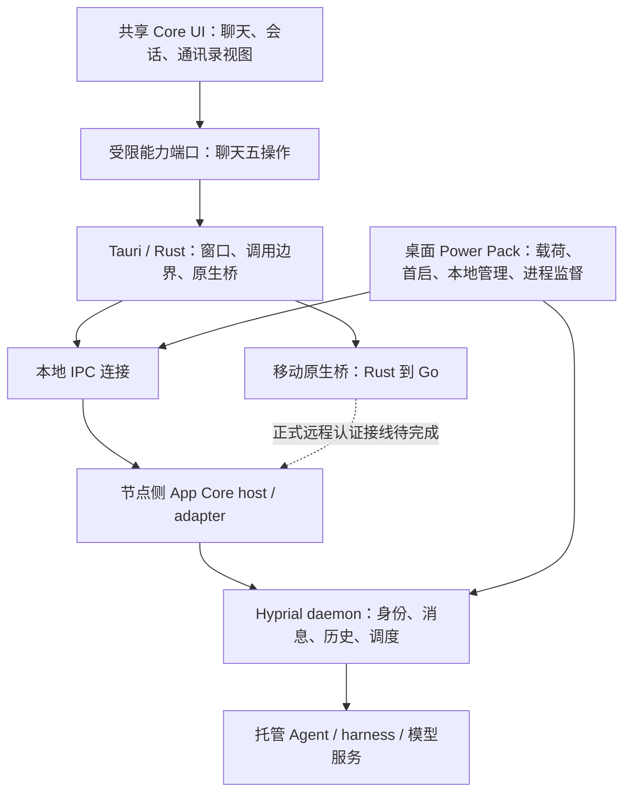

# Core / Power Pack 当前架构说明

日期：2026-10-19。范围：官方 harness-bridge 的五端客户端。
源码快照：`intg/gui-app-core-20261008` @ `b02b3b13273978dc07e86dd1ed8ab04c2a66cd5e`。
本文是当前实现与目标差距的说明，不修改接口、身份协议或本地工作流规则。
相关文档：[多端通信架构](multiplatform-communication-architecture-2026-10-19.md)。

## 1. 结论与状态口径

Core / Power Pack 已有实际代码和编译边界，不只是目录规划。Core 是跨端聊天客户端；Power Pack 是桌面本地运行环境与管理扩展。手机不运行本地 daemon、harness 或 Agent。

但“已分层”不等于“可分别安装的全部产品形态已交付”：当前桌面发行脚本仍构建 `power-pack` 版本，正常首启与打包仍有缺口；纯 Core 的远程生产认证链路也未完成。

本文区分四个层次：

- **代码已有**：快照内存在实现，不能自动推导所有平台可用。
- **实测通过**：有指定平台、指定路径的执行证据；不能外推其他平台。
- **待接线/验收**：接口或局部实现已有，实际产品链路未闭合。
- **目标/后续**：产品意图，不能当作现有 API。

## 2. 分层与依赖方向

图中的 App Core **host 是节点侧服务**，不是放进手机的 Python 运行时。Core UI 是业务状态的展示层，不另建消息存储或执行调度权威。Power Pack 在组合入口装配本地能力，Core 不反向依赖 Power Pack。

## 3. 各层职责

| 层 | 当前职责 | 不承担 |
| --- | --- | --- |
| Core UI | 展示会话/历史/进度，文本发送、重试、分页，聊天与通讯录视图 | 模型调用、任意 shell、业务身份自报、第二套持久 inbox |
| Tauri / Rust | 原生窗口和权限、`app_core_call`、可信端点持有、移动桥 | 自行生成 agent 回复、让页面传入凭据或任意操作名 |
| App Core adapter / host | 五个聊天操作映射至 daemon，解析固定会话绑定，本地/远端服务组合与认证接口 | 替代 daemon 成为消息持久化或 Agent 执行权威 |
| daemon | 真实身份边界、消息投递、会话历史、sender copies、托管 Agent 执行 | 把“已受理”当作模型已完成 |
| Power Pack | 本地载荷选择、首启、账号窗口、daemon/host 启动、自己创建的子进程监督、更新和本地 Agent 管理 | 移动端运行、所有主机的任意进程管理 |
| harness | 在主机上执行模型回合与工具调用 | 在手机上复制一套运行环境 |

功能语义以实际 Hyprial CLI/API 为准；v11 原型指导布局，不作为不存在能力的证明。

## 4. 编译与发行形态

| 形态 | 当前代码入口 | 状态与限制 |
| --- | --- | --- |
| 纯 Core | Cargo `default = []` → `core::run()` | 不编译载荷/首启/本地进程管理；静态 Core 页面可运行，未配置连接时明确不可用 |
| 桌面 Power Pack | `--features power-pack` → `power_pack::run()` | 当前桌面发行默认路径；主窗口使用同一 Core 页面 |
| Android / iOS | Core + 可选 `mobile-bridge` | 通过原生桥访问节点，不携带本地 Agent；启用 Power Pack 的移动构建会编译拒绝 |
| Android 自动构建 | `npm --prefix app run android:build` | #1600 已合入：产出 ARM64 Debug APK，自动构建 Go bridge、放入 JNI、校验包内库与导出符号；不等于远程认证已通过 |
| iOS | Tauri 生成工程 + iOS 原生桥与 Xcode 工具链 | 模拟器链路有实测；签名 IPA、真机与 TestFlight 不由模拟器通过推导 |

Core 的运行时不依赖 Node/Python；桌面 Power Pack 的载荷与构建工具仍可能使用它们。不能把“运行时无依赖”写成“构建不需要工具链”。

## 5. Core 的真实能力边界

浏览器只拿到五个明确操作，见 `src/gui/core/README.md`：

| 操作 | 当前作用 |
| --- | --- |
| `capabilities.get` | 能力查询 |
| `sessions.list` | 当前 host 配置的会话列表 |
| `sessions.history` | daemon 持久历史的分页投影 |
| `sessions.events` | 执行进度投影，不等于持久历史 |
| `sessions.send` | 发文本与幂等键，收到受理回执 |

这不是通用 CLI 执行通道。页面不能选择 sender 身份、凭据、shell 或任意服务地址。

当前通讯录展示上述会话与可选本地管理能力提供的 Agent 信息；不能称为完整全网 Agent 目录。动态 agent 发现、权限过滤、选择 agent 后建立新会话尚需产品接线。任务入口、角色/模型等未具备的数据不能用演示值伪装成真实能力。

## 6. Power Pack 如何向 Core 提供本地连接

桌面正常链路是：载荷选择与校验 → 必要账号/设备配置 → daemon 就绪 → App Core host 就绪 → Rust 保存端点 → 主窗口载入内嵌 Core 页。

- macOS/Linux：本地 Unix socket。
- Windows：本地 loopback TCP，并带每次启动的请求 token。
- 端点保存在 Tauri managed state；页面不持有 socket 路径或 token。
- 本地 Agent 管理使用独立 `core-management` 窗口，具名入口为状态、创建、启动；以窗口标签和 URL 校验调用方。
- 当前代码存在创建/启动入口，不表示全部 harness 的安装、授权、启动、停止与升级体验均已打通。尤其不能把关闭整个 Agent 与取消一条聊天当作同一操作。
- 主窗口能显示 Core 页面不代表首启成功；绕过登录的 smoke/fixture 只能证明它覆盖的部分。

## 7. 当前验收与缺口

| 项目 | 截止本文的证据口径 |
| --- | --- |
| Core / Power Pack feature 分离 | 代码已有，移动构建拒绝 Power Pack |
| v11 主窗口与真实桌面聊天接线 | #1587 已合入；有隔离本地真实聊天证据，不能外推三个正式安装包 |
| sender 持久历史 | #1590 已合入；手机读回历史还取决于实际运行 daemon 版本 |
| iOS 本机测试聊天 | 既有模拟器包经 Mini 测试 host 与真实 Agent 收发、刷新/重连读回通过；不是正式远程入网 |
| Android 构建 | #1600 已补自动原生桥打包；新包的聊天与冷启动验收需单独记录 |
| 三端桌面正常首启 | 已发现载荷导入路径使 tailcat 不可见、报 `SIDECAR_MISSING`；修复分支尚不能当作本快照已交付 |
| 共享 UI 修复 | 连接状态、面板遮挡、空消息、历史失败提示的修复在独立分支；本快照未包含，不借后续测试冒充已集成 |
| 移动生产 tailnet | 本快照仍拒绝启用，认证与连接装配待完成 |
| 独立 Core / Power Pack 安装选择 | 代码能力与产品分发需区分，尚不能承诺完整可选安装体验 |

## 8. 后续实施次序

1. 修复桌面载荷与正常 first-run，原生安装包能进入真实 Core 窗口。
2. 集成共享 UI 修复，分别验收浏览器布局与原生平台。
3. 按通信文档补生产身份、远程连接、Agent 发现与会话创建。
4. 验收会话恢复和双端续聊，再扩大 Power Pack 管理范围。

每次交付记录源码 SHA、包 hash、运行节点版本和真实/fixture 范围；“编译成功”“能看页面”“已登录”“真实聊天可用”分别报告。

## 9. 源码与既有契约

以下路径相对仓库根，均应对照本文快照读取：

- 编译边界：`app/src-tauri/Cargo.toml`、`app/src-tauri/src/lib.rs`。
- Core 原生入口：`app/src-tauri/src/core/mod.rs`。
- Core UI：`src/gui/core/README.md`、`connection.mjs`、`chat.mjs`、`views/`。
- 本地管理：`app/src-tauri/src/power_pack/{mod,management,agents}.rs`。
- 桌面启动与进程：`app/src-tauri/src/runtime/`、`startup/`、`supervisor/`。
- 节点适配：`src/hyprial/shell/impl/gui/adapter/{chat,host,envelope}.py`。
- 移动桥：`app/src-tauri/src/bridge/mobile.rs`、`sidecar/hyprial-tailcat/mobilebridge/`。
- Android producer：`app/scripts/build-android.cjs`。
- [最小聊天原始方案](app-core-chat-mvp-2026-10-08.md)、[host 配置与认证契约](app-core-host-address-config-20261017.md)。旧文档中的实施状态可能早于本文，具体状态以快照与实测证据为准。
