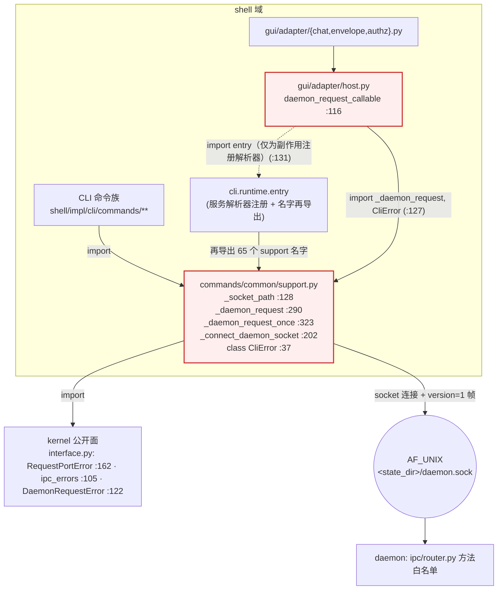
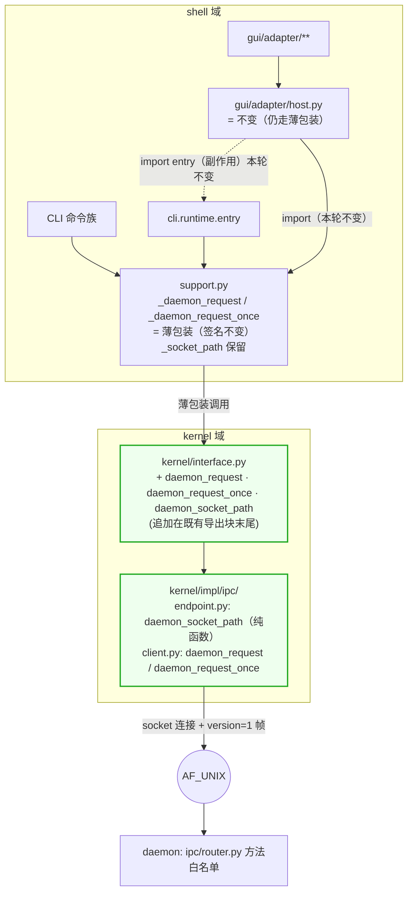
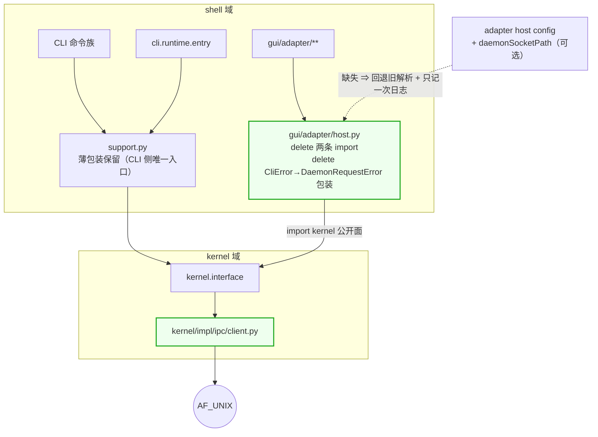

# daemon IPC 客户端的依赖对比图（改动前 / 改动后）

**rev2**（1792995429）· supersedes rev1（sha256 `6c506ff5…`）。
rev2 的改动只有一处：新增「六、actor-rustify 之后」。原因：业主指出 rev1 只画了"现在"，
没有说明 actor-rustify（`intg/actor-rustify-split @ db348caca`）落地之后这张图是否还成立。

对象：`_daemon_request` 从 `shell/impl/cli` 搬到 `kernel/impl/ipc`。
本文件是**依赖关系图**，不是设计文档；每一根线都带坐标，坐标一律写 `{branch, commit, line}`
（行号随分支变：同一函数在 `dev@8a183d210` 是 290，在 `intg/actor-rustify@42f8e0ecc` 与
`intg/actor-rustify-split@db348caca` 是 325；`host.py` 的 import 块在 `dev` 是 127-131，在 split 是 195-199）。

基准坐标：`dev @ 8a183d21003f2b8cdfc0b87c60a1aa1859f0dc1f`；PR-A 的 base 是
`intg/daemon-ipc-client @ 8209512d90c5ab5dd78c989e1d5e7469ba0f3e9c`（#1892 候选头）。

---

## 一、改动前（现状）



**问题（红框的两条边）**

```
① HOST → SUPPORT（跨前端目录 import 私有函数）
   shell/impl/gui/adapter/host.py:127  from ...cli.commands.common.support import CliError, _daemon_request
   ⇒ GUI 依赖 CLI 的下划线私有 API；CLI 内部重构会直接打断 GUI
② HOST -.-> ENTRY（导入副作用）
   host.py:131  from ...cli.runtime import entry as _entry  # noqa: F401
   ⇒ "GUI 能不能连 daemon" 取决于"有没有 import 过 CLI 的 entry"——这是隐式契约
③ 错误类型错位
   host.py:136  except CliError as error: raise DaemonRequestError(...)
   ⇒ CLI 的用户面向错误类型被塞进 GUI 的适配层做翻译
```

统计：`grep -rn 'from hyprial.shell.impl.cli.commands.common.support import' src` = **65** 处，
其中**只有 1 处**在 `shell/impl/cli` 之外，就是 `gui/adapter/host.py:127`。

---

## 二、改动后 · PR-A（这一期：只搬位置）



**PR-A 改变了什么 / 没改变什么**

```
改变：socket 客户端与帧逻辑的**实现位置**（shell → kernel），错误族改抛 kernel 的
      (RequestPortError / ipc_errors.*)，socket 路径与时钟改为参数注入
不变：CLI 的调用面（_daemon_request 签名与默认值）、GUI 的 import、adapter host config、
      _socket_path 的 env 优先级（HARNESS_STATE_DIR/HYPRIAL_HOME 优先于 HARNESS_SOCKET_PATH）、
      251 处 monkeypatch.setattr(cli, "_daemon_request", …)
```

---

## 三、改动后 · PR-B（0.5.6：剪掉越层）



**PR-B 的验收判据**

```
grep -rn 'shell\.impl\.cli' src/hyprial/shell/impl/gui → 0
daemonSocketPath 缺失时：仍能连（回退旧解析）+ 日志恰好一条（⛔ 每次调用都打）
```

---

## 四、这张图**不**声明的事

```
· 不声明 operation 层已经存在（GUI 与 CLI 的用户操作组合/投影仍是两份：
  gui/adapter/chat.py 的 sessions.history vs CLI message/read.py + outbox.py）
· 不声明 contract/ 已覆盖 GUI（387 个语料文件里无 GUI 语料：
  grep app_core / adapter.host / sessions.history = 0 命中）
· 不声明两法一致等于语义一致：图只画"谁 import 谁"，不画"谁语义对不对"
```

---

## 五、坐标汇总（供复核）

```
dev                                  8a183d21003f2b8cdfc0b87c60a1aa1859f0dc1f
support.py _socket_path              dev:128
support.py _daemon_request           dev:290   (intg/actor-rustify@42f8e0ecc:325 · -split@db348caca:325)
support.py _daemon_request_once      dev:323
support.py class CliError            dev:37    (= class CliError(RequestPortError))
support.py _connect_daemon_socket    dev:202
host.py daemon_request_callable      dev:116
host.py 跨域 import                  dev:127-130
host.py 导入副作用                   dev:131
host.py except CliError              dev:136
kernel RequestPortError               kernel/impl/contracts/ports.py:8 · interface.py:162 · __all__:434
kernel ipc_errors                     kernel/impl/contracts/daemon/ipc_errors.py · interface.py:105 · __all__:387
kernel DaemonRequestError             interface.py:122 · __all__:331
```

---

## 六、actor-rustify 之后（业主 2026-10-26 指出 rev1 缺这一节）

**它改的是什么**（实测 `git diff e384bba7 db348caca`：122 files, +6905/−327）：
```
改动集中在 daemon/impl/application/actors/**（sessions/registry · agents_registry ·
lifecycle_ops · agents_admin/migration）与 harness 相关目录
**未改** src/hyprial/daemon/impl/ipc/**（含 router.py）
⇒ actor-rustify 改的是 daemon **内部**"谁持有状态、经谁到达"（每个 actor 独占状态，
  只经 mailbox 访问，handler 由 kernel actor runtime 的 CommandHandler 承接），
  ⛔ 不是"谁可以被调用"——IPC 方法面与两个客户端都不变
```

**对我们的四个接缝文件，逐个比对 base 与 split 的 blob**（`git rev-parse <rev>:<path>`）：
```
                                                     8209512d9     db348caca    关系
shell/impl/gui/adapter/host.py                       834068ebd     834068ebd    SAME
kernel/__init__.py                                   e591db454     e591db454    SAME
kernel/interface.py                                  1b4cf415a     1b4cf415a    SAME
shell/impl/cli/commands/common/support.py            273680c5c     9c8fcb629    DIFF
```
⇒ **PR-A 要追加三个名字的两个公开面文件，在 split 上与我们的 base 完全相同** ⇒ 零重叠；
⇒ `host.py`（PR-B 要改的那个）在 split 上也完全相同 ⇒ 零重叠；
⇒ 唯一有差异的是 `support.py`，而且差异方向是「**split 比我们旧**」：
```
split 缺 #1892/#1913 的探测预算改动（_daemon_probe 的 budget = max(0.0, timeout)、
_wait_for_daemon 里按 remaining 封顶）—— 这些在我们的 base 上已有
而 split 的 _message_claim_params（from hyprial.biz import worker_binding + PAC_PRINCIPAL_UNVERIFIED）
在我们的 base 上**已经存在且逐字相同**
⇒ 结论：两边的 support.py 差异不是"两边改同一段"，而是"split 落后一段"
   ⇒ rebase 时不会产生需要裁决的冲突，只会把落后的那段带过来（或由 dev 提供）
```

**所以这张图在 actor-rustify 之后是否仍然成立**：
```
成立，且**越层依然存在**：split@db348caca 的 host.py:195-199 仍然整块 import CLI
  from ...cli.commands.common.support import ( ... _daemon_request ... )
  from ...cli.runtime import entry as _entry  # noqa: F401
⇒ PR-A（搬客户端到 kernel）与 PR-B（剪掉 host.py 的三条依赖）在 actor-rustify 之后
  **仍然必要，且内容不变**
```

**与共享 operation 层的关系（rev1 §四 那条"不声明"在这里补一句）**：
```
actor-rustify 把 daemon 内部从"若干服务对象"改成"若干 actor + mailbox"，
但它发生在 IPC 面**之下**，因此：
  · 对第三层（共享 operation 定义 + 两个渲染层）不构成任何约束——它住在 IPC 之上
  · 也不会顺手造出第三层：CLI 与 GUI 的用户操作组合/投影依旧是两份
    （gui/adapter/chat.py 的 sessions.history vs CLI message/read.py + outbox.py）
⇒ actor-rustify 与本改动**不是同一层的两件事**，可以并行；唯一接触点是 support.py，且如上所述是"落后"而非"冲突"
```

**三条顺序提醒（给排期用）**：
```
1. 若 actor-split 先合入 dev，PR-A 从 dev 起的 base 会包含 split 的 actors/**——与本改动无交集
2. 若 PR-A 先合入 intg/daemon-ipc-client 再并入 dev，split 的 rebase 只需处理 support.py 的"落后段"
3. 无论哪种顺序，kernel/{__init__,interface}.py 与 host.py 都不会成为冲突点（blob 相同）
```
