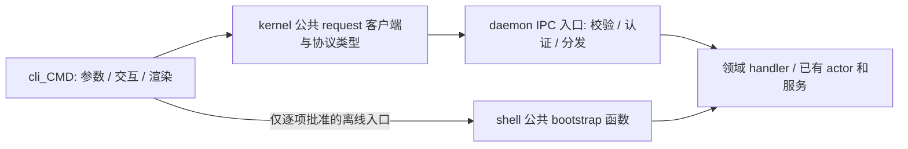

# daemon request / CLI 拆分设计（A 公共基础与 C / 0.5.6，待审）

> 2026-10-28 执行更新：用户已批准 A 开工；五卡已建、DeepSeek Flash Max 开发、协调者验收。最新状态以 [执行记录](execution-2026-10-28.md) 为准；下文原审批描述保留作来源，B/C 审批边界不变。

- 状态：**设计提案；A 留档后由用户明确批准开工，C 保留 Allen 设计审阅要求。尚无实施授权。**
- 2026-10-28 协调状态：用户认可先统一梳理 CLI 命令面，再协调 daemon request / agent move 两线。
  codex-sw 已转达用户选择 R4 不可变迁移单/八动作，活动命令表已同步；具体方法契约继续对齐。
  A 的 5 卡/5 PR 任务提案见 A 文档 §7，尚未建卡或获得产品实施批准。
  见[跨线协调记录](coordination-2026-10-28.md)。
- A 的范围、与 B/C 的依赖和具体开工门见 [CLI 命令面与最小公共基础提案](cli-surface.md)。
- 日期：2026-10-27。
- C 集成目标：`intg/daemon-request` → `dev`，目标版本 0.5.6；A/B 面向 0.5.5.2，分别交付公共基础和 move。
- 源码盘点基线：`4a51775186e3e6087bde7c5826980d195333ed65`。
- 本次交付：总体设计、A 提案、两份逐项清单与协调记录；不改产品代码、不实施命令迁移。
- 入口：[CLI 逐项清单](cli-inventory.md)、[IPC 逐项清单](ipc-inventory.md)。
- 背景：[交接](handoff-2026-10-27.md)、[旧客户端依赖图](dep-map-daemon-ipc-client-2026-10-26.md)、[仓库规则](../../../AGENTS.md)。

## 1. 已确认的目标及本次范围

Allen 的拆分要求：把现在 CLI 里的子模块拆成 daemon request 实现和
`cli_<CMD>.py`；完成职责拆分后，将 CLI 部分统一移出，后端留下纯业务/request 实现。

本设计采用用户随后明确的约束，优先于交接中不同的过渡安排：

1. **先完成 CLI 的干净拆分。** GUI 页面、网关实现、GUI 目录选择及其联调排期不属于本批，
   也不是本线开工条件。保留可导出 OpenAPI 的契约能力。
2. **允许修改受影响的仓内调用方。** 不为旧调用方式保留兼容包装、旧 import 路径、
   旧入口别名或测试专用重导出；同一行为只有一个实现和一个状态所有者。
3. **严格单向依赖。** backend 不 import CLI，不调用留在 CLI 里的业务函数；
   CLI 不绕过 request 直接消费领域实现。引导/离线操作仅按第 5 节的逐项白名单开放。
4. **先拆职责，最后搬目录。** 现在不冻结全仓；最后为 CLI 及相关入口安排一次短冻结。
5. **每任务一个 PR，按 A/B/C 的归属汇入对应 intg。** A 先接入 import 棘轮和契约 CI，
   现有违规只减不增；新迁移部分零违规，C 最终将剩余违规清零。
   棘轮不提供产品兼容面，也不能变成永久豁免；失败继续修代码。

本线不重写 actor runtime、mailbox 或 durable inbox；命令树的改变在 A/B 设计中逐项审定。
未经明确审定的业务语义和用户输出保持不变。删除内部兼容面与改变用户命令行为分开记录。

## 2. 基线事实、盘点口径与缺口

基线的 CLI 有 **25 个源码命令族**，不是 25 个顶层 Typer 组。
完整注册树有 **223 个叶子命令、4 个可无子命令执行的组 callback**，共 227 个盘点入口。
其中 `gui` 的 1 个入口标记为本批范围外；其余 24 个源码命令族进入本批任务。

例如 `work` 注册在 `org work`，`transfer` 注册在 `agent move` 和隐藏的
`agent transfer`，`upgrade` 注册在 `daemon upgrade`，`squire` 还包含 `user-proxy`。
不能只枚举顶层 help，或把文件夹名直接当用户命令名。

现有 **195 个 IPC 方法名**已经按 router 比较分支、前缀家族的下游分发、
常量及 org 分发表交叉核对。统计集合 `_IPC_STATS_METHODS` 只作为交叉检查：
182 个名字有方法比较分支，另外 13 个由 org network/ACL 分发表路由；
逐项来源见 [IPC 清单](ipc-inventory.md)。这是静态路由覆盖证据，不是 195 个方法的运行验收。

主要缺口：

- `config`、`log`、部分 agent secret、adapter 和 org context 等操作仍在 CLI 中执行业务。
- 已调用 IPC 的命令也可能经 `common/support.py`、`services.py`、`runtime/entry.py`
  或其他命令族执行本地业务；“找到一次 daemon_request”不能判定该命令迁移完成。
- `agent destroy` 已有 preview，但执行请求只传名字，没有绑定 preview 的 operationId。
- 现有 socket 协议为一次请求、一份 JSON 响应；CLI 的循环输出不等于 socket 已支持流式协议。
- `message read` 会记录 fetched，不能当作无副作用查询；read 后仍需 reply/ack 才结算。
- 交接举例的 `adapter downgrade-state`、`org repin` 在此基线没有注册。
  实际注册的是隐藏的 `agent transfer runtime downgrade-state`，不能照抄旧名字放行。

PR #1967 的候选提交为 `aa014fd80db9ac1e69fd626fc7bef23ab1264ca2`，原 base 是
`intg/daemon-ipc-client`。只复用其中已审查的传输实现；新方案不继承旧 CLI 的兼容包装。
目标基线已删除旧 `post_install_surface.json`，不得为解决移植冲突将其恢复。
旧 ACK 不是新提交、新合并树的测试结果。

## 3. 拆分单位与单向依赖



图中的分发到领域 handler 是运行时装配关系，不授权低层 import 高层。
维持 `kernel ← identity ← daemon ← biz ← shell` 的源码依赖方向；
上层把业务 handler 经既有 port 注册给 daemon，daemon 不为调用它而 import biz/shell。

| 代码职责 | 拆分后的所有者 | 允许的输入/输出 |
| --- | --- | --- |
| 命令注册、argv 解析、TTY 检测、提示和确认、文本格式 | `cli_<CMD>.py` 及 CLI output | CLI 输入与 JSON 结果；不接触业务 store |
| socket endpoint、帧、超时、传输错误 | kernel 的公开 IPC client | 显式 endpoint、method、params、调用预算 |
| 业务参数规则、授权、状态读取/更新、跨步骤业务编排 | hyprial 对应领域 handler | JSON 参数、可信 RequestContext、JSON 结果或领域错误 |
| 启动装配、不能依赖运行中 daemon 的引导操作 | shell 的受控公开 bootstrap 面 | 明确的命令参数和 JSON 结果；不接收任意函数/模块名 |

拆一个子模块时，先将现有 operation 函数中的业务搬到其领域，再留下参数组装与 renderer。
已有 handler 直接复用，不复制一份“新 request 业务”。后端不得返回 Typer Context、
CliResult、Rich 对象、可调用闭包或未定义的 Python 对象。

每个命令迁移 PR 同时处理它使用的业务 helper、异常映射、测试和已知调用方。
纯渲染 helper 留在 CLI；共享业务 helper 移到唯一的领域实现。
`CliServices` 不能成为无限扩张的服务定位器，最终删除仅为旧入口 monkeypatch 保留的绑定。
测试改为替换明确的 request port 或领域 port，不维护第二套产品调用路径。

## 4. 目录与冻结窗口

总体架构目标仍是 `src/hyprial`、`src/cli`、`src/gui` 三部分，CLI/GUI 经 daemon request 消费后端。
本批落实 CLI 侧；GUI 实现与实际目录对齐由 GUI 线处理，不作为 A 的开工前置。

最终本批目录目标：

```text
src/
  hyprial/                     # kernel/identity/daemon/biz/shell 后端领域
    kernel/                    # 公共 IPC client、协议词汇；不塞入业务实现
    daemon/                    # IPC 接入和属于 daemon 的 handler
    biz/                       # 属于 biz 的业务；由上层装配注册
    shell/                     # 后端装配、受控 bootstrap，不保留 CLI 业务
  cli/
    __init__.py
    __main__.py
    runtime/                   # 注册命令、构造客户端
    output/                    # CliResult/CliStream 和唯一输出层
    commands/<family>/
      cli_<CMD>.py
```

这不是现在执行的批量 rename 清单。实现期间 `cli_<CMD>.py` 可先放在现有 CLI 命令族下；
request 的业务实现必须已经位于正确后端域，不能等搬目录时才消除反向依赖。
`cli_<CMD>` 按现有子模块拆，不把一个大型命令族强塞成一个超过 1000 行的文件。

DR-31 才进行物理搬迁：

1. 确认全部范围内命令完成职责拆分，共享兼容入口已清理。
2. 公告受影响路径和短冻结窗口：CLI、入口引用、包资源、构建与 CI 路径。
3. 一个搬迁 PR 更新 wheel packages、console script、内部生成 argv、测试和活动文档。
   CLI console script 仍叫 `hyprial`，新目标入口为 `cli:main`；`python -m cli` 可用。
4. 删除旧 `hyprial.cli` 和旧 CLI 路径，不加转发 shim。后台内部进程入口仍属于后端，
   不为复用 CLI 再引入后端到 CLI 的依赖。
5. 安装产物验证通过后合入、解冻，其他工作线更新到新的 intg/dev 基线。

不为本批选择或移动 GUI 目录。已存在的结构规则照常生效，搬迁时将 `src/cli`
同步加入源码扫描、打包和 CI 路径分类；WORM 历史证据不改原字节。

## 5. 引导/离线白名单（提请审定）

这里批准的是“命令路径 + 调用的公开能力 + 运行条件”，不是命令组，也不是整个模块。
实现时每行展开为精确符号清单，提交到门禁；CLI 不 import bootstrap 的 impl。
公开函数拟由 `hyprial.shell` 导出，名称分别表达能力，禁止通用 `call(module, function)`。
在线失败时不能自动切到本地业务实现。

| 编号 | 精确命令/阶段 | 准许的本地后端能力 | 限制 |
| --- | --- | --- | --- |
| B01 | `init` 的最小 home 初始化、daemon 首启阶段 | 创建初始化目录、必要身份配置、启动进程 | 后续 org/agent/adapter 配置回到 request；不因此放行 onboarding 全组 |
| B02 | `login`、`logout` 的身份引导/切换阶段 | OIDC 引导、凭据落盘、身份切换时停机和重启协调 | 保留唯一身份权威；在线 org 操作走 request；不在 CLI 实现凭据 store |
| B03 | `daemon run/start/stop/restart` | daemon 装配、进程/服务生命周期、停机证明 | 能经 socket 执行的 shutdown 仍使用 request；restart 需要旧进程 exit proof |
| B04 | `daemon service status/install/uninstall` | 查询或修改本机服务管理器配置 | 不借此开放业务状态读写 |
| B05 | `daemon upgrade`、`daemon upgrade apply`、隐藏 `daemon upgrade run` | 安装替换、锁、停止/启动和失败恢复 | 在线 scheduler 查询/触发使用已有 IPC；`daemon upgrade status` 不获本地业务 fallback |
| B06 | `doctor` 中的离线只读检查 | daemon 不可用时读取诊断事实 | 在线检查走 request；本行不批准修复/写状态选项 |
| B07 | `profile list/show/use/create` | 启动前发现、选择或创建 home/profile | 四个路径逐项登记；use 只返回 export，不持久化第二个全局 selector |
| B08 | `version` | 读取安装版本、来源、依赖锁等本机安装事实 | 只读，无网络升级探测，不要求 daemon 在线 |
| B09 | 隐藏 `agent transfer runtime downgrade-state` | 停机后的状态降级/导出 | 校验 daemon 确实停止和目标归属；不能与在线写操作并发 |

`help`、裸 `service` 的帮助，以及明确的 `COMING_SOON` 占位错误属于纯前端行为 P，
不需要虚构 IPC，也不是业务直调白名单。
未注册的 `adapter downgrade-state` / `org repin` 不预留空白豁免；若以后重新引入，
必须在对应 PR 重新说明运行条件并更新设计和门禁。

`routine plan/templates`、`workflow events/overview`、普通 `config set`、普通 `log`
等本地业务操作本提案迁入 IPC；原先能离线执行的部分将明确报告 daemon 不可用。
这是 0.5.6 的有意边界改变，迁移 PR 必须记录旧/新结果并更新契约，不能伪称全场景字节不变。

## 6. 方法声明、校验与 OpenAPI

### 6.1 单一声明来源

建议使用不可变 `MethodSpec` + JSON Schema 2020-12，复用项目已有 `jsonschema` 依赖。
不用函数注解推测所有 wire 语义，不引入另外一套业务模型框架。
声明是纯数据，能在不启动 daemon、不读 home、不加载凭据的情况下导出。

```python
# 设计示意，不是已存在的 API；完整 schema 必须有真实字段，不能用空对象代替。
MethodSpec(
    name="link.list",
    owner="daemon.links",
    params_schema=LINK_LIST_PARAMS,
    result_schema=LINK_LIST_RESULT,
    errors=(INVALID_ARGUMENT, CALLER_NOT_AUTHORIZED, DAEMON_NOT_READY),
    mode="unary",                 # unary / cursor-poll
    mutates=False,
    retry="safe",                 # safe / idempotency-key / never
    audience=("local-operator", "bound-agent"),
    http_exposed=True,
    confirmation="none",         # none / preview / execute
)
```

每项声明至少包含：方法唯一名、领域所有者、参数/结果 schema、领域错误码及 error.data schema、
调用者类型、是否有副作用、重试条件、是否逻辑流式、cursor/取消语义、确认配对方法。
例如 `message.read_body` 必须声明会记录 fetched；`hosts` 的 refresh 选项也不能丢失副作用语义。

handler 与声明在后端装配时显式绑定；声明和 handler 任一缺失、重复名字或未知方法均拒绝。
不保留“新 registry 没找到再调用旧 router”的兼容分发链。
迁移过程中的既有分发分支逐项替换，最终公开方法集合与声明集合相等。

运行时先校验参数、认证并构造可信 RequestContext，再调用 handler。
可信身份、peer PID、worker session/epoch 来自现有认证边界，不能由业务 params 自报。
既有 `from`、`actor`、`sessionRef` 等业务参数仍按各方法契约传递，但必须校验其与可信上下文的关系，
不能因为字段存在就把它当作认证证明，也不能机械删除这些参数破坏现有语义。
schema 默认值不自动写入输入；需要的默认值由方法明确声明并由对应 handler 处理。
未知字段策略逐项声明，不能用统一的忽略策略掩盖拼写错误。

使用显式 `Draft202012Validator`；schema 先 `check_schema`，外部 `$ref` 不进行联网解析。
格式约束不能只写 `format` 却不启用验证；业务 URI、身份与授权仍由领域规则检查。
现有 `INVALID_ARGUMENT` / `INVALID_PARAMS` 等错误差异逐方法保留，不能机械归一后改变契约。
结果校验必须覆盖 contract corpus；若运行时发现无效结果，返回不含原始秘密数据的内部契约错误。

### 6.2 传输与错误保持分层

现有 v1 IPC envelope 继续表达一次调用：

```json
{"version":1,"id":"request-id","method":"link.list","params":{"from":"agent:owner:node:name"}}
```

响应是 `{"version":1,"id":...,"result":...}` 或
`{"version":1,"id":...,"error":{"code":...,"message":...,"data":...}}`。
公共 client 解包后把领域结果交给 CLI；CLI output 再生成原有用户输出。
IPC error、CLI 的 `{ok:false,code,error,...}` 和 HTTP 状态不是同一个结构，不能直接混用。
错误码已有定义就复用；新增码统一进入现有公共错误词汇及契约快照。

request id、幂等 key、确认 operationId、工作流 requestId 各有语义，不互相替代。
保留 message.send 使用 request id 作为缺省幂等 key 的现有约束。
写操作断线不等于未执行；client 不盲目重试，按声明查询已有结果或报告未知结果。

### 6.3 OpenAPI 是契约投影，不是本批启动 HTTP 服务

导出器生成固定格式 OpenAPI 3.1.0 JSON，使用同一份参数、结果和错误 schema。
建议投影为每方法一个 `POST /daemon/request/<method>`：requestBody 为 params，
成功 response 为解包后的 result，错误 response 为有类型的 `{code,message,data?}`。
错误码仍决定领域含义；HTTP 状态映射集中声明，不能由未来 GUI 各自发明。

`operationId` 在 OpenAPI 中是稳定的方法标识；第 7 节响应中的 `operationId`
是一次预览的随机实例 ID，两者不可混淆。
导出排序、schema 名称及引用稳定，不包含时钟、绝对路径、真实 home 或运行中身份。

完整 IPC catalog 包含全部方法；HTTP 投影只包含显式 `http_exposed=True` 的方法。
worker channel、内部 session/transfer 等入口不能因“有 schema”被自动发布给浏览器。
本批不决定 HTTP 服务运行进程、浏览器登录或部署位置，也不把导出文件当已上线网关。
未来接线必须维持可信身份边界，不能从 HTTP body 接受 operator/peer PID 等权威字段。

生成物计划归 `contract/daemon-request/`，按家族分文件；OpenAPI snapshot、参数/结果语料、
错误语料由同一次生成/校验覆盖。不能以 schema 放宽来通过旧输出；字段改变须明确审查。

标准依据：[OpenAPI 3.1.0](https://spec.openapis.org/oas/v3.1.0.html)、
[jsonschema 校验接口](https://python-jsonschema.readthedocs.io/en/stable/validate/)。
这里固定版本用于可重复导出，不声称它是最新标准。

## 7. 预览 → 确认必须绑定 operationId

以 `org remove` 为例，目标交互为：

```text
cli_org → org.remove.preview({org, user})
        ← {operationId, expiresAt, summary, ...}
CLI 展示 summary 并询问确认
cli_org → org.remove({operationId})
        ← 该次操作的结果
```

执行方法只接受 operationId 及明确的协议控制字段，不同时接受另一份 org/user 供执行。
`agent.destroy.preview` / `agent.destroy` 和其他破坏性操作采用同一绑定规则。
`--yes` 只省略用户交互，CLI 仍先获取新预览再提交其 ID；JSON stdout 只输出最终命令结果。
未确认、取消、非交互缺少 `--yes` 均不得提交执行请求。

daemon 内的预览记录绑定：方法、规范化参数、可信调用者及会话、目标资源标识和版本、
daemon epoch、签发时间、过期时间。ID 不可预测，不承载可修改的明文业务参数。
摘要不包含凭据；客户端传回的摘要或 digest 不能覆盖 daemon 保存的记录。

状态为 `previewed → executing → succeeded/failed/unknown`；取消和过期是独立终态。
确认时重新检查授权，在同一领域所有者的事务/串行化边界内校验资源版本并认领执行权。
不能“先检查版本，释放锁后再按旧计划执行”。

必须测试并定义这些结果：

| 场景 | 处理 |
| --- | --- |
| ID 不存在、来自其他 epoch 或已经清理 | 明确拒绝，要求重新预览；不按命令参数猜测原操作 |
| ID 属于其他调用者/会话 | 拒绝，不泄露目标资源详情 |
| 参数被修改、方法不匹配 | 拒绝；执行接口不接受替换参数 |
| 授权撤销、目标版本改变 | 拒绝旧计划，要求重新预览 |
| 同一 ID 并发确认 | 只有一次执行取得认领权，其他请求返回处理中或相同终态结果 |
| 执行后响应丢失 | 在记录保留期内查询/返回同一结果，不重复副作用 |
| 进程重启或外部副作用结果不确定 | 报告未知/失效；按领域已有幂等记录核查，不能自动重做 |

首版建议预览有效期 5 分钟、内存记录有容量上限，epoch 改变即失效。
预览记录由 daemon 对应领域持有，不在 CLI 写确认文件，也不新增一套 durable 业务权威。
有跨重启幂等要求的操作沿用其领域已有 journal/receipt；没有这种记录的操作不能承诺 exactly-once。
新拒绝码（拟 `PREVIEW_EXPIRED`、`PREVIEW_STALE`、`OPERATION_IN_PROGRESS` 等）
在 DR-04 定义并进入公共错误表及 corpus，不在 CLI 各自拼字符串。

## 8. 文件、流式、终端与长操作

首版保持 v1 单请求单响应，通过**有界 cursor-poll**表达持续输出，不暗中把一个响应改为 NDJSON。
声明中记录逻辑流式能力、cursor、最大批量、等待上限、结束和取消条件；OpenAPI 表达每次 poll 的 JSON。
CLI 可逐批渲染 CliStream，等待超时不是业务失败，用户中断后的处理必须明确。

- `workflow events`：新增有界查询入口，返回条目、nextCursor、结束/等待状态；不得直接 tail daemon 文件。
- `fs watch`、消息等待：复用已有 polling/游标语义，不能因迁移让观察操作变成消费/ACK。
- 文件和 stdin：CLI 可读取用户明确选择的输入并展示输出；格式/业务校验在后端。
  大内容走已有 blob/staging 能力或有界分块，不无限塞入单个 JSON 帧。
  本地 IPC 文件路径必须明确是调用者输入还是 daemon 拥有的资源；未来 HTTP 不把路径当授权。
- secret：stdin 的读取与输入格式提示留 CLI，secret 的校验、写入、轮换与审计归 request。
  请求正文、异常和测试快照不得记录真实秘密值。
- `agent start`：受管 worker 和前台交互模式分别建模。启动决策、配置与 session 权威归后端；
  CLI 只附着终端 I/O。拟由 request 返回会话绑定的 attachment ID，使用
  `agent.terminal.read`、`agent.terminal.write`、`agent.terminal.resize`、`agent.terminal.close`
  传递有界输出、输入和终端控制；不能退回 CLI 执行业务启动。
  attachment 绑定 principal/session/epoch；只认该会话所拥有的进程，不按名称发现或杀进程。
  具体平台终端实现沿用现有 harness 能力，不能把 UNIX PTY 测试当 Windows 验收。
- 长操作复用现有领域 operation receipt；request 超时、用户取消、后台执行结束是三个不同事件。
  不增加用于所有命令的通用 operation/workflow 引擎。

DR-18 必须覆盖 Ctrl-C、EOF、异常断连、退出码和无遗留子进程；如某平台无法满足此边界，
明确 BLOCKED 并提交具体方案修订，不能登记成“仅渲染例外”绕过目标。

## 9. 逐项迁移清单

[CLI 清单](cli-inventory.md) 对 227 个入口逐项列出：源码命令族、真实命令路径、
可见性、已有 IPC 调用线索、目标分类、拟新增方法/处理方式、任务号和 callback 来源。

分类：I = 已有 IPC 可复用；N = 需要新增 IPC 或把本地业务编排迁入 request；
B = 精确引导白名单；P = 纯前端帮助/占位；D = GUI 本批不迁。
I+N 表示已有 IPC 加上仍需移走的本地业务，不能算已完成。
所有拟新增方法均是待审提案，不是已注册的能力。

[IPC 清单](ipc-inventory.md) 覆盖 195 个已存在的方法，不把无 CLI 直接调用的方法丢掉。
每项标注分发来源和负责迁移/契约收口的任务；内部方法也必须声明，不能依赖未登记的字符串分支。

## 10. 旧版任务索引与重新规划的边界

下表保留首版 33 项的编号，供附录追溯；**已不作为当前联合实施台账或实际 PR 总数承诺**。
2026-10-28 用户确定 A/C 由本线负责，A/B 面向 0.5.5.2、C 面向 0.5.6。
前置 a/b/c 归入 A 的公共基础交付，b 同时保留本线的总体设计，具体对应见 [A 提案](cli-surface.md)。
DR-01/03 和 DR-05 的样板、DR-32 的早期门禁不得继续全部留到 C；B 的 move 业务及其薄 CLI 不在 C 重做。

当前只交付设计，未执行 #1967 移植、产品迁移、OrgFS 登记或 PAC 派工。
顺序是设计 PR 留档 → 用户确认 A → 明确任务/依赖并登记 Kanban 与 OrgFS → PAC 实施；
**A 不额外等待 Allen，C 的设计审阅要求不变。** 用户确认流程不等于已经批准某个设计 head 开工。
批准后形成新的任务 PR 清单；实现 PR 均指向所属 intg，总集成 PR 再交付 dev。

统一完成条件：范围内调用方同步更新，无兼容包装；对应正反例与 CLI 输出测试通过；
契约/文档同步；PR 写清动机、改动、验证命令、实测结果与 UNKNOWN/BLOCKED。

| 任务 | PR 内容 | 前置/重点验收 | 当前状态 |
| --- | --- | --- | --- |
| DR-01 | 接回 #1967 公共 IPC client | 新 intg 基线复验；移除旧 client 兼容面，直接更新调用方 | 待实施 |
| DR-02 | 本设计、完整清单与任务台账 | Allen 审定方法声明、白名单、确认和流式方案 | 本 PR 待审 |
| DR-03 | MethodSpec、绑定与 OpenAPI 导出 | DR-01/02；纯数据导出、schema 验证、生成快照 | 待实施 |
| DR-04 | operationId 预览确认协议 | DR-03；绑定、过期、并发与未知结果测试 | 待实施 |
| DR-05 | link | 首个完整命令族样板；先验证 list/stats，再覆盖 add/drop | 待实施 |
| DR-06 | service | 连接、断开、查询和网络暴露均走 request | 待实施 |
| DR-07 | host | 查询与占位语义分别验收 | 待实施 |
| DR-08 | user | 身份查询/变更、绑定发布及可信调用者检查 | 待实施 |
| DR-09 | meta | help 纯展示、version 受控离线检查 | 待实施 |
| DR-10 | log | 查询筛选归 request，CLI 不读取 daemon 日志库 | 待实施 |
| DR-11 | config | 设置校验、持久化和生效时机归后端 | 待实施 |
| DR-12 | profile | B07 四个入口；无第二个持久化 home selector | 待实施 |
| DR-13 | message | fetched/pending/reply/ack、附件和观察语义保持 | 待实施 |
| DR-14 | fs | OrgFS、文件输入输出、游标与取消 | 待实施 |
| DR-15 | work | DR-14；工作项编排与权威状态归后端 | 待实施 |
| DR-16 | workflow | 计划、控制、事件及 overview 无本地业务旁路 | 待实施 |
| DR-17 | routine | DR-16；plan/templates 和生命周期统一契约 | 待实施 |
| DR-18 | agent | DR-04；secret、配置、创建、销毁、启动及终端生命周期 | 待实施 |
| DR-19 | adapter | 配置、授权、路由、身份与媒体；无 CLI store | 待实施 |
| DR-20 | squire | DR-18/19；setup/user-proxy 编排归后端 | 待实施 |
| DR-21 | daemon | B03/04 与在线管理分开；停机/重启证明保持 | 待实施 |
| DR-22 | init | DR-21；B01 与 onboarding 在线操作分开 | 待实施 |
| DR-23 | login | DR-08/12/21；B02、身份切换和取消 | 待实施 |
| DR-24 | doctor | 只读离线诊断、在线检查和错误来源明确 | 待实施 |
| DR-25 | upgrade | DR-21；B05、安装替换、退出证明和失败恢复 | 待实施 |
| DR-26 | socialware | 保持现有 COMING_SOON，无假成功或兼容入口 | 待实施 |
| DR-27 | org | 相关工作线落定后迁；DR-04；context 与成员操作 | 待实施 |
| DR-28 | transfer | 最后迁；相关工作线落定；内部进程/状态/凭据入口 | 待实施 |
| DR-29 | 其余 IPC 契约收口 | 所有内部、非 CLI 方法也有声明/语料，无漏登记分发 | 待实施 |
| DR-30 | 共享 helper 与入口清理 | 24 组完成；清理 services/entry、重导出及全部仓内消费者 | 待实施 |
| DR-31 | CLI 目录和安装入口搬迁 | DR-30；短冻结；源码与安装产物一致，旧路径不存在 | 待实施 |
| DR-32 | 全量严格边界收口 | 棘轮已提前归 A；C 完成后零非白名单违规，故意违规能被检测 | 待重新规划 |
| DR-33 | 最终 intg 验收与证据 | 全部任务及后续具体修复卡完成；最终 head/产物验收 | 待实施 |

旧表的依赖只供识别待迁移范围。A 骨架将声明、导出、棘轮与 2–3 个简单方法样板一起交付；
样板优先来自 link 同一组，必要的组内改动在同一 PR 完成，不为凑样例跨命令组改业务。
某组需要多个实现者也不改变一个命令组的验收边界；本表不自动授权派出代理或创建 PAC 图。

执行时在 `group-internal` 登记对应 OrgFS 工作项，记录 ID、PR、依赖和精确验收证据。
看板状态为待办 → 可开始 → 实施中 → 审查/CI → 完成；阻塞原因单独记录。
每张卡只有合入 intg 且证据成立才完成。新发现的问题新增具体修复卡，不塞入“修复杂项”。
总集成 PR 保持 WIP，最终独立验收后由质检合入 dev，执行者不自行合并自己的交付。
进度同步研发负责人；需要 Allen 裁决的设计问题直接交 Allen。A 的用户开工批准按上述最新约定执行。

## 11. 门禁与最终验收

现有结构门、领域方向门和测试照常执行。A 骨架先将精确 import 棘轮、方法声明和契约检查接入 CI，
新违规拒绝，旧违规只减不增；已迁移命令零违规。C 最终将旧引用账本清零，
只允许第 5 节明确批准的能力边界。账本必须可审查、不可用目录级永久豁免扩容；具体规则见 A 提案。

新增检查至少包括：

1. CLI 只消费公开 request/client/协议词汇和精确 bootstrap 符号；不消费任意 kernel 业务 helper。
2. backend 不 import CLI；CLI 的共享 helper/重导出不能代理被禁止的领域 import。
3. 覆盖绝对/相对 import、alias、函数内 import、TYPE_CHECKING、显式 importlib 及可识别反射。
   无法静态证明的动态业务加载进入失败清单，不能自动放行。
4. 所有可达 IPC 方法与声明/handler 绑定一致；OpenAPI 可重复生成；方法名、字段、错误和语料相符。
5. bootstrap 清单按命令与符号匹配，无通配整个目录、动态调用器或在线失败后的本地 fallback。
6. backend 不引入 typer/click/rich；CLI 输出仍只经 output。新增 `src/cli` 纳入 7 文件/1000 行门。
7. 新增故意违规样例时 CI 必须失败；删除或改成合法 request 后通过。

每组的行为验收覆盖适用的以下维度：

- 参数、默认值、错误、授权和实际状态变化；不只比较 handler 返回值。
- 固定时钟/ID/环境后的 stdout 字节、stderr 字节、退出码；文本/JSON、TTY/非 TTY、
  失败、取消和流式结束；时间、UUID、PID 不能在断言时一概删掉来伪造相等。
- 新旧边界的非法请求、未授权身份、重复请求、连接丢失；写操作不得因通用 retry 重复执行。
- 预览确认配对及 state/version fencing。
- 安装后 console script、包资源、后台生成的 argv、harness/hooks 等真实消费者。

验证顺序（在相应实现 PR 和最终 intg 上执行，不是声称本设计 PR 已通过）：

```sh
uv run --no-project --python 3.12 python scripts/ci/check_structural_limits.py
uv run --no-project --python 3.12 python scripts/ci/check_module_boundaries.py
uv run pytest <本组焦点测试>
uv run --with libcst==1.9.0 pytest tests/
uv run ruff check .
./contract/run-all.sh --isolated-only
```

随后验证构建安装产物及相关 daemon/harness 场景；按 E2E skill 和 ROADMAP 选择必要真实环境场景。
全部 home、socket、缓存、端口与日常环境隔离。缺真实环境报 BLOCKED，不以 skip 代替。
GUI 功能本批不承诺；既有测试若因真实依赖变化失败，应修复相应调用方，不能恢复旧 CLI 兼容面或删测试遮掩。

CI 基线比较按具体测试 ID 和相同事件类型进行，只用于定位故障，不豁免本设计的最终验收条件。
单 PR 绿不等于 intg 绿；最后同步 dev 后在将要合入的确切 intg head 和产物上重验。

## 12. 与 actor-rustify 的约定及审阅点

actor-rustify 可改变 IPC 以下的状态所有者和 mailbox 组织。本线可增加必要的方法，
但既有方法名称、参数、结果、错误及副作用由 contract 快照约束；双方不能各自维护一套业务语义。
发生接口变更时，在同一 PR 更新声明、消费者和契约，不以兼容 handler 承接旧路径。

请审阅本设计的具体提案：

- 第 5 节逐项白名单，特别是 profile、身份引导与 version 的离线能力边界。
- 第 6 节声明与 OpenAPI 投影，第 7 节确认绑定和过期/重启行为。
- 第 8 节终端与持续输出使用 request 的方式，以及对应平台验收。
- 附录中拟新增的方法及明确的离线行为改变。

GUI 页面实现不在本批；A 提前提供契约/调用检查供 GUI 自查。零兼容层、单向依赖和最后搬目录保持。
A 按用户最新要求完成设计留档并取得其明确同意后实施；C 仍先交 Allen 审。
本 PR 当前只有设计，不能把消息讨论或文档推送当作已经获得开工批准。
