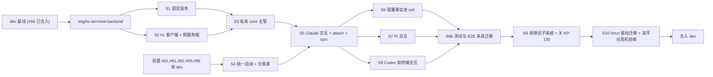

# hc 终端后端实施计划（`intg/hc-terminal-backend`）

- 日期：2026-11-27
- 设计依据：`docs/design/hc-terminal-backend-2026-11-27.md`（裁决 R1–R30、提议 P1–P27、冲突处理 C1–C7）
- 代码基线：`dev` @ `d1d1cfb63be794c8b28ce4de56fb3a7bf25d29c9`（前置 PR `#59` 已合入）
- 集成分支：`intg/hc-terminal-backend` → `dev`（按集成分支工作流推进，全部切片与真机验收完成后一次性合入 `dev`）

---

## 1. 执行分期与前置条件

本计划将定稿设计拆为 11 个可独立测试、可逐片合入 `intg/hc-terminal-backend` 的工作包（`S1`、`S2`、`S3`、`S4`、`S5`、`S6`、`S7`、`S8`、`S8b`、`S9`、`S10`），分为两个阶段推进：

1. **第一阶段（立即开工，不触碰启动路径）**：
   - `S1`（固定副本获取、锁文件与安全解包）与 `S2`（纯本机 IPC 的 hc 客户端、事件流与门内假服务端）互不依赖，从 `intg/hc-terminal-backend` 并行拉出短分支实现；
   - `S3`（私有 core 主管、白名单环境、版本切换与空闲回收）在 `S1`、`S2` 合入集成分支后紧接实现。
2. **第二阶段（启动路径收敛、三套交互 connector、测试迁移与旧子系统拆除）**：
   - 按裁决 R21、R30，`S4` 在模型连接前置 PR `#61`、`#81`、`#82`、`#83`、`#96` 全部合入 `dev` 后，先将最新 `dev` 前向合并入 `intg/hc-terminal-backend` 再开工（不等 `#84`–`#86`，也不等模型网关替代实现 PR）；
   - `S5`（Claude 交互 connector、`agent.tui.attach`、成员级 turn / carrier 接口、TUI 终止与基础设施丢失分支）依赖 `S3 + S4`；
   - `S6`（OSC 7501 阻塞事实接入 cell 可观测性）、`S7`（Pi 交互 connector）、`S8`（Codex 双终端交互 connector 与 daemon 内 carrier）均依赖 `S5`，可并行开发后按序合入；
   - `S8b`（非 tmux 测试与 E2E 夹具清点迁移，零测试后门，裁决 R27）依赖 `S5 + S7 + S8`；
   - `S9`（旧交互会话子系统三向拆分与删除、删除本机 IPC 调用者归类并关闭 `KP-130`、契约与迁移文档同步，裁决 R17、R29）依赖 `S8b`；
   - `S10`（4 个 tmux E2E 驱动迁移、macOS 与 Linux 双平台第 10.3 节实机验收、集成分支收口）依赖 `S9`。

---

## 2. 仓库结构上限与门禁预检结论

针对基线 `d1d1cfb63b` 逐项核实 `scripts/ci/check_structural_limits.py`、`check_module_boundaries.py`、`check_windows_portability.py`、`check_network_reachability.py`、`check_inline_comments.py`、驻留模块清册与自升级尾段门禁，定下如下硬约束：

### 2.1 7 个直接文件与 1000 行硬门（`scripts/ci/structural-baseline.json` 零新增）

1. **`kernel` 路径辅助位置**：
   - `src/hyprial/kernel/impl/primitives/` 当前已有 **7 个直接文件**（`backoff.py`、`duration.py`、`git_environment.py`、`managed_harness.py`、`node_identity.py`、`outbound.py`、`uri.py`），不可新增第 8 个文件。
   - `managed_harness.py` 当前仅 **185 行**，且已位于 `tests/shell/cli/installation/restart/post_install/post_install_surface.json` 的 `primedModules` 列表中。将 `<home>/state/hc/` 纯路径与私有会话名计算函数放入 `managed_harness.py` 并经 `src/hyprial/kernel/interface.py`（现 807 行）与 `src/hyprial/kernel/__init__.py` 导出，既保持 `primitives/` 为 7 个直接文件，又不改变 `post_install_surface.json` 的预加载模块集合。
2. **`daemon/impl/terminals/` 包与子包拆分**：
   - `src/hyprial/daemon/impl/` 当前已有 **7 个直接文件**（`__init__.py`、`alias_resolver.py`、`api.py`、`desired_state_io.py`、`forwarding_config.py`、`inbox_watch.py`、`state_db.py`）和 49 个子目录；新增子目录 `terminals/` 不增加父目录直接文件数。
   - 注意结构门规则：一旦目录内存在代码文件（如 `__init__.py`），同目录的数据文件（`hc-lock.json`）同样计入 7 个直接文件上限。因此 `src/hyprial/daemon/impl/terminals/` 根目录只放 **2 个直接文件**（`__init__.py`、`hc-lock.json`），实现按职责拆为 4 个子包：
     - `src/hyprial/daemon/impl/terminals/acquisition/`（S1，4 个直接文件：`__init__.py`、`lock.py`、`download.py`、`extract.py`）
     - `src/hyprial/daemon/impl/terminals/client/`（S2，4 个直接文件：`__init__.py`、`protocol.py`、`rpc.py`、`events.py`）
     - `src/hyprial/daemon/impl/terminals/supervisor/`（S3，4 个直接文件：`__init__.py`、`environment.py`、`naming.py`、`supervisor.py`）
     - `src/hyprial/daemon/impl/terminals/connectors/`（S5/S7/S8，不超过 6 个直接文件：`__init__.py`、`base.py`、`claude.py`、`pi.py`、`codex.py`、`codex_app_server.py`）
   - 每个目录直接文件数均 ≤ 6，每个文件行数控制在 150–450 行以内。
3. **存量近千行文件避让红线**：
   - 基线上以下目标文件已接近 1000 行上限，修改时必须只做最小委托调用或净删减，新增逻辑一律放入子包：
     - `src/hyprial/daemon/impl/application/wiring/transport.py`：**980 行**（7/7 直接文件）
     - `src/hyprial/daemon/impl/application/actors/agents_registry.py`：**985 行**（S9 删除交互会话播种与规整后净减）
     - `src/hyprial/daemon/impl/desired_state/sqlite.py`：**978 行**（S9 删除 `interactive_sessions` 表后净减）
     - `src/hyprial/daemon/impl/application/actors/lifecycle_ops.py`：**971 行**（S4 统一 `agent.start` 编排放入已有子包 `src/hyprial/daemon/impl/application/actors/agent_start/`，该子包当前仅 `__init__.py` 1 个文件、229 行）
     - `src/hyprial/daemon/impl/application/shutdown.py`：**964 行**（S5 交互成员停机豁免只做窄条件分支，复杂判定放 `terminals/`）
     - `src/hyprial/daemon/impl/application/__init__.py`：**931 行**（7/7 直接文件）
     - `src/hyprial/daemon/impl/desired_state/store.py`：**923 行**（S9 净减）
     - `src/hyprial/daemon/impl/application/restore.py`：**884 行**（S5 接管编排抽入 `terminals/supervisor/`，在 `restore.py` 仅留薄调用）
     - `src/hyprial/daemon/impl/composition/cells/reconcile.py`：**878 行**（7/7 直接文件；活动侧摘要读取放入仅 2 个文件的子包 `composition/cells/member_rows/`）
4. **CLI 与请求目录满额目录处理**：
   - `src/hyprial/shell/impl/cli/commands/agent/` 已有 **7 个直接文件**，`hyprial agent tui attach` 放入新子包 `src/hyprial/shell/impl/cli/commands/agent/tui/`（`__init__.py`、`attach.py`）。
   - `src/hyprial/daemon/impl/request_catalog/agent/` 已有 **7 个直接文件**，新增 `agent.tui.attach`、`agent.member.carrier.hello`、`agent.member.turn.*` 放入新子包 `src/hyprial/daemon/impl/request_catalog/agent/tui/` 与 `src/hyprial/daemon/impl/request_catalog/agent/member/`（每包 ≤ 4 个直接文件）。
5. **测试目录组织**：
   - `tests/daemon/` 当前仅 1 个直接文件（`__init__.py`）；新建 `tests/daemon/terminals/`，其根仅放 `__init__.py`，用例按 `acquisition/`、`fake_hc/`、`client/`、`supervisor/`、`connectors/` 子目录分装，每目录 ≤ 6 个直接文件、单文件 ≤ 600 行。

### 2.2 模块归属清册、五域边界、本机 IPC 与注释纪律

1. **`NATIVE_ORIGINS` 分片登记**：
   - `tests/integration/native_harnesses/test_native_resident_inventory.py` 要求 `src/hyprial/daemon/` 下所有实时 `.py` 文件精确匹配 `NATIVE_ORIGINS - HISTORICAL_ROWS`。
   - 按 `partition_letter` 规则，`daemon/impl/terminals/...` 取第 3 段首字母 `t`，统一追加在 `tests/integration/native_harnesses/resident_metadata/native_origins_s_z.py` 字典末尾（现 159 行），严禁重排或改动存量行；`request_catalog/agent/{tui,member}/...` 取 `r`，追加在 `native_origins_p_r.py`；`application/actors/agent_start/...` 取 `a`，追加在 `native_origins_a.py`。
   - S9 删除已登记的 `daemon/` 模块（如 `session_actor/*`、`desired_state/sessions.py`、`request_catalog/session.py`）时，原行保留在 `native_origins_*.py` 不动，将路径加入 `tests/integration/native_harnesses/resident_metadata/__init__.py` 的 `HISTORICAL_ROWS` 并在模块 docstring 增补退场记录。
2. **五域分层与公共面（`check_module_boundaries.py`）**：
   - 依赖方向保持 `kernel → identity → daemon → biz → shell`；CLI（`shell`）不导入任何 `hyprial.daemon.impl.*`，所有请求经 `daemon_request` 发起，确需共享的纯常量或辅助仅经 `kernel` 或 `daemon/interface.py` 暴露。
3. **跨平台接缝与本机 IPC 门禁（`check_windows_portability.py` W011/W013/W015/W020）**：
   - `PLATFORM_SEAMS` 仅豁免 `src/hyprial/kernel/impl/manysys/`；其外任何 `sys.platform` / `os.name` / `platform.system()` 分支（`W015`）、POSIX 绝对路径字面量（`W011`）、直接创建符号链接（`W013`）均被阻断，且 `W020`（原始本机 IPC）为零基线硬门。
   - 因此：本机平台目标名解析（`macos-aarch64` 等 5 目标）、macOS `lsregister -u` 注销调用、Linux 运行时目录环境变量保留与 `hc-*` 残留子目录清理放入已有的 `src/hyprial/kernel/impl/manysys/process/ports.py`（现 130 行），`.app` 包内相对文件符号链接创建放入已有的 `src/hyprial/kernel/impl/manysys/fs/links.py`（现 66 行），统一保持纯标准库实现（`intra/manysys-leaf`）并经 `manysys/interface.py` → `kernel/interface.py` → `kernel/__init__.py` 导出；两文件均已在 `post_install_surface.json` 的 `primedModules` 中，零新增模块。
   - `daemon/impl/terminals/client/` 与门内测试 `tests/daemon/terminals/fake_hc/` 一律走 `hyprial.kernel.connect_local_ipc`、`hyprial.kernel.listen_local_ipc` 与 `hyprial.kernel.local_ipc_path_limit`，禁止出现任何 `AF_UNIX` 或原始命名管道调用；`windows-portability-baseline.json` 零新增。
4. **网络可达性门禁（`check_network_reachability.py`）**：
   - 固定副本下载器运行于 `PrivateCoreSupervisor` 持有的后台工作线程（提议 P5），IPC 请求处理函数只等待内存事件/Future，不在请求调用图上直接调用 `urllib`。S3 与 S4 落地时实跑 `check_network_reachability.py` 验证 `network-reachability-baseline.json` 零新增；若保守静态分析仍命中，则按设计第 7.4 节单列报批。
5. **Wheel 打包与注释纪律**：
   - `pyproject.toml` 的 `[tool.hatch.build.targets.wheel]` 打包整个 `src/hyprial`，`src/hyprial/daemon/impl/terminals/hc-lock.json` 自动随 wheel 分发，不触碰 `hyprial/_bin/` 或 `hyprial/_core/`，不影响 `verify_tailcat_wheels.py`。
   - 所有新增与改动代码遵循代码注释纪律：禁止行内 `#` 注释，设计依据与取舍统一写入文件头连续注释块或模块/函数 docstring（`scripts/ci/check_inline_comments.py --strict` 自检零告警）。

---

## 3. 固定副本锁文件（`hc-lock.json` `0.1.22`）精确规格

`src/hyprial/daemon/impl/terminals/hc-lock.json` 固定 `hc` `0.1.22`（协议代数 `generation: 1`），五个发布目标的精确校验值如下：

```json
{
  "version": "0.1.22",
  "generation": 1,
  "targets": {
    "linux-aarch64": {
      "url": "https://releases.herdr.dev/core/0.1.22/herdr-core-linux-aarch64.tar.gz",
      "sha256": "98757985245d45f8d73dd85e68b139b7f167c28488bb89edd9834c3f5a5cf4cf",
      "size": 3039707
    },
    "linux-x86_64": {
      "url": "https://releases.herdr.dev/core/0.1.22/herdr-core-linux-x86_64.tar.gz",
      "sha256": "3054ec3992ce80c5715d721caa9dcefa6056721d15dc113f4750afce763ba5df",
      "size": 3298845
    },
    "macos-aarch64": {
      "url": "https://releases.herdr.dev/core/0.1.22/herdr-core-macos-aarch64.tar.gz",
      "sha256": "90798daadefa8d126b90ef0bcdbe9c7dda9c6cfbf011a247065ab5da348f350e",
      "size": 5404856
    },
    "macos-x86_64": {
      "url": "https://releases.herdr.dev/core/0.1.22/herdr-core-macos-x86_64.tar.gz",
      "sha256": "35144041969e870ddb4edcd2fd08fd26dfe5cee7d18e6b48adb276f90a48aa19",
      "size": 5983849
    },
    "windows-x86_64": {
      "url": "https://releases.herdr.dev/core/0.1.22/herdr-core-windows-x86_64.zip",
      "sha256": "37cae9d6c522e205efcdb55a42d354285f41b8cbb4c6e60fb505b73b151966c9",
      "size": 3953341
    }
  }
}
```

各平台解包与可执行路径规则：
- **校验前置**：下载流先核对精确字节数 `size`，再核对 64 位 `sha256`；任一不符立即丢弃临时文件并报错，绝不进入归档解析。
- **安全边界**：归档内任何成员含绝对路径、`..` 段、设备节点、硬链接或指向目标根目录之外的符号链接一律拒绝；先解包至 `<home>/state/hc/bin/.staging-<uuid>/`，完成后原子重命名为 `<home>/state/hc/bin/<version>/`。
- **macOS（`macos-aarch64`、`macos-x86_64`）**：归档同时包含顶层裸 `herdr-core` 与 `Herdr Core.app/`，两者二进制不同；**只提取 `Herdr Core.app/**`**，原样保留包内字节、权限与内部相对符号链接（如 `Contents/CodeResources`），不剥离签名；可执行入口为 `<version_root>/Herdr Core.app/Contents/MacOS/herdr-core`。删除旧版本目录前先调用 macOS 系统 `lsregister -u <app_path>` 注销 Launch Services 记录（失败记状态不抛致命异常）。
- **Linux（`linux-aarch64`、`linux-x86_64`）**：只提取顶层 `herdr-core`（权限 `0o755`），可执行入口为 `<version_root>/herdr-core`。
- **Windows（`windows-x86_64`）**：只提取 `herdr-core.exe` 与 `conpty/**`（`conpty/conpty.dll`、`conpty/x64/OpenConsole.exe`），可执行入口为 `<version_root>/herdr-core.exe`。

---

## 4. 全量切片规格（`S1`–`S10`，含 `S8b`）

### S1：固定副本锁文件、校验下载与平台解包

- **目标与成果**：daemon 具备按仓库内置 `hc-lock.json` 获取、强校验、安全解包并定位本机固定版本 `hc` 副本的能力，以及旧版本目录回收（含 macOS Launch Services 注销）；`kernel` 暴露 `<home>/state/hc/` 纯路径与私有会话名计算原语。无用户可见行为变化。
- **前置依赖**：无（直接基于 `intg/hc-terminal-backend` 开工，与 `S2` 并行）。
- **精确文件清单**：
  - 修改：`src/hyprial/kernel/impl/primitives/managed_harness.py`（新增 `hc_state_root`、`hc_bin_root`、`hc_version_root`、`hc_core_root`、`hc_core_socket_path`、`hc_session_name`）
  - 修改：`src/hyprial/kernel/impl/manysys/process/ports.py`、`src/hyprial/kernel/impl/manysys/fs/links.py`、`src/hyprial/kernel/impl/manysys/interface.py`（新增纯标准库平台接缝函数：`host_hc_release_target`、`unregister_macos_app_bundle`、`posix_runtime_dir_environment`、`cleanup_stale_posix_runtime_dirs`、`create_relative_symlink`）
  - 修改：`src/hyprial/kernel/interface.py`、`src/hyprial/kernel/__init__.py`（导出上述纯路径与平台接缝函数）
  - 新建：`src/hyprial/daemon/impl/terminals/__init__.py`（仅一行模块 docstring `"""hc terminal backend internals."""`，与 `S2` 保持逐字节一致以避免并行合入冲突）
  - 新建：`src/hyprial/daemon/impl/terminals/hc-lock.json`
  - 新建：`src/hyprial/daemon/impl/terminals/acquisition/__init__.py`
  - 新建：`src/hyprial/daemon/impl/terminals/acquisition/lock.py`
  - 新建：`src/hyprial/daemon/impl/terminals/acquisition/download.py`（复用 `hyprial.daemon.impl.network.proxy_route.url_opener` 与 `hyprial.kernel.user_agent("daemon")` / `with_user_agent`，带指数退避有界重试）
  - 新建：`src/hyprial/daemon/impl/terminals/acquisition/extract.py`
  - 修改：`tests/integration/native_harnesses/resident_metadata/native_origins_s_z.py`（末尾追加 `terminals/__init__.py` 与 `terminals/acquisition/*` 共 5 行）
  - 新建：`tests/daemon/terminals/__init__.py`（仅一行模块 docstring `"""hc terminal backend tests."""`）
  - 新建：`tests/daemon/terminals/acquisition/__init__.py`、`test_hc_lock.py`、`test_hc_download.py`、`test_hc_extract.py`
- **门禁与台账影响**：
  - 预批清册同步：`native_origins_s_z.py` 新增模块登记；`post_install_surface.json` 无变化。
  - 第 7 节需负责人确认项：无（本片不改公开请求、错误码或任何冻结基线）。
- **先红后绿测试与验证**：
  - `hc-lock.json` 解析、未知平台拒绝、`hc_session_name` 永不为 `default` 且同路径幂等不同路径隔离；
  - 本地回环 HTTP 假服务器测试：一次超时/5xx 后有界重试成功、`size` 不符拒绝、`sha256` 不符拒绝、`ALL_PROXY` 经 `url_opener` 生效且带 `hyprial-daemon/<version>` `User-Agent`；
  - 合成归档测试：macOS 归档同时含裸 `herdr-core` 与含内部相对符号链接的 `Herdr Core.app` 时仅保留完整 `.app` 且二进制字节不变；Linux `herdr-core` 与 Windows `herdr-core.exe + conpty/` 正确解包；含 `../`、绝对路径或越界符号链接的归档在落盘前失败且不残留半成品目录；macOS 删除旧版本时触发 `lsregister -u` 桩调用。

### S2：hc 本机 IPC 客户端、事件流订阅与门内协议假实现

- **目标与成果**：daemon 具备不执行任何外部二进制、仅经 `hyprial.kernel.connect_local_ipc` 与私有 `hc` socket 对话的 JSON-RPC 2.0 客户端与 `events.subscribe` 有界超时流读取器，并在 `tests/daemon/terminals/fake_hc/` 提供基于 `listen_local_ipc` 的进程内协议假实现供后续所有切片门内单测复用。
- **前置依赖**：无（与 `S1` 并行；零 `kernel` 改动，只消费现成 `connect_local_ipc`）。
- **精确文件清单**：
  - 新建：`src/hyprial/daemon/impl/terminals/__init__.py`（与 `S1` 逐字节一致的单行 docstring）
  - 新建：`src/hyprial/daemon/impl/terminals/client/__init__.py`
  - 新建：`src/hyprial/daemon/impl/terminals/client/protocol.py`（`HelloResult`、`CoreStatus`、`HolderInfo`、`TerminalRecord`、`TerminalStatus`、`SubscribeSnapshot`、`HcStreamEvent`、`HcRpcError` 等类型化结构，优先按 `error.data.kind` 分类并兼容数值错误码）
  - 新建：`src/hyprial/daemon/impl/terminals/client/rpc.py`（`HcClient`：换行分隔 JSON-RPC 2.0 请求收发，`probe_socket_alive` 仅连 socket 探活，封装 `hello`、`server_status`、`server_stop`、`terminal_run`、`terminal_list`、`terminal_get`、`terminal_kill`、`terminal_rm`、`terminal_label`、`terminal_read`、`terminal_send`、`terminal_keys`；绝不暴露裸 `server.restart` RPC）
  - 新建：`src/hyprial/daemon/impl/terminals/client/events.py`（`HcEventSubscription`：`events.subscribe` 初始快照解析、`event` / `heartbeat` / `missed` 消息迭代、45 秒有界读超时、core 重启静默 EOF 转为显式流结束信号且不假设 `seq` 跨重连连续）
  - 修改：`tests/integration/native_harnesses/resident_metadata/native_origins_s_z.py`（末尾追加 `terminals/__init__.py` 与 `terminals/client/*` 共 5 行；合入集成分支时与 `S1` 取并集）
  - 新建：`tests/daemon/terminals/__init__.py`（与 `S1` 逐字节一致的单行 docstring）
  - 新建：`tests/daemon/terminals/fake_hc/__init__.py`、`server.py`、`test_fake_hc_server.py`（支持握手、终端生命周期、同名 live 终端拒绝、`server.stop` 令 `keep: false` 终端记为 `server_stop`、OSC 7501 状态变更推送、心跳、模拟 core 重启静默关闭连接且重连后 `seq` 重置）
  - 新建：`tests/daemon/terminals/client/__init__.py`、`test_hc_rpc.py`、`test_hc_events.py`
- **门禁与台账影响**：
  - 预批清册同步：`native_origins_s_z.py`；
  - `check_windows_portability.py`（W020）与 `unbounded-waits-baseline.json` 零新增；
  - 第 7 节需负责人确认项：第 7.5 节「`connect_local_ipc` 作为 hc socket 传输」（POSIX 零改 kernel，Windows 见冲突 C2）。
- **先红后绿测试与验证**：
  - socket 不存在时 `probe_socket_alive` 返回 `False` 且零子进程调用；
  - `hello`、`server.status`、`terminal.run`（直接传 `argv` 数组、`keep=False`、`no_parent=True`、`no_notify=True`、`env`、`labels`）、同名 live 终端冲突错误、`terminal.kill` + `terminal.rm` 往返；
  - `events.subscribe` 接收快照 → `created` / `status`（含 `blocked` + `permission`）/ `finished` / `removed` → `heartbeat` 保活 → 假服务端静默断开（模拟 core 重启）时客户端干净返回 EOF 结束标记、重连拿到重置后的小 `seq` 新快照；心跳超时抛出有界超时错误而非永久挂起。

### S3：私有 core 主管、白名单环境、版本切换与空闲回收

- **目标与成果**：daemon 拥有完整的 `PrivateCoreSupervisor`：与用户日常 `hc` 完全隔离的 `HC_SESSION` 与 `<home>/state/hc/core/`、不含任何密钥的白名单启动环境（保留 Linux 真实 `XDG_RUNTIME_DIR`）、socket 路径长度预检（计入同目录更长的 `.holder.<8hex>.sock`）、后台线程按需获取固定副本（P5）、连接时校验版本并经固定副本执行 `server restart` 升级/回滚（R12、R22、P14）、所有 holder 版本对齐后清理旧 `bin/<ver>/`（P15）、最后一个成员终端移除后 `server.stop` 停私有 core 并清理 Linux 运行时残留目录（P26）、daemon 有序停止时不断 core、以及确定性成员终端命名与标签匹配（P19、P11）。
- **前置依赖**：`S1`、`S2` 已合入 `intg/hc-terminal-backend`。
- **精确文件清单**：
  - 修改：`src/hyprial/daemon/impl/terminals/__init__.py`（导出主管、客户端与锁接口供 `daemon` 内部使用）
  - 新建：`src/hyprial/daemon/impl/terminals/supervisor/__init__.py`
  - 新建：`src/hyprial/daemon/impl/terminals/supervisor/environment.py`（白名单环境构造、私有 `config.toml` 写出、socket + holder 路径长度相对 `local_ipc_path_limit()` 校验、Linux `hc-serve-*` / `hc-hold-*` 运行时残留清理）
  - 新建：`src/hyprial/daemon/impl/terminals/supervisor/naming.py`（`<= 32` 位小写成员终端名生成、身份与配置摘要标签读写、接管匹配与无启动行残留终端判定 P11）
  - 新建：`src/hyprial/daemon/impl/terminals/supervisor/supervisor.py`（`PrivateCoreSupervisor`：启动/接管、每次连接 `hello` 比对版本与 `generation`、固定副本 `server restart` 切换、后台下载线程协调、事件流跟随与快照重建、空载 `server.stop`、daemon 停机仅断连、状态快照输出 `coreVersion` / `pinnedVersion`）
  - 修改：`tests/integration/native_harnesses/resident_metadata/native_origins_s_z.py`（追加 `terminals/supervisor/*` 4 行）
  - 新建：`tests/daemon/terminals/supervisor/__init__.py`、`test_environment.py`、`test_naming.py`、`test_supervisor_lifecycle.py`、`test_supervisor_version_switch.py`
- **门禁与台账影响**：
  - 预批清册同步：`native_origins_s_z.py`；
  - 实跑 `scripts/ci/check_network_reachability.py` 验证后台工作线程下载不触发 IPC→网络新路径（零基线新增）。
- **先红后绿测试与验证**：
  - 环境中注入模拟的 `ANTHROPIC_API_KEY`、`OPENAI_API_KEY`、`HYPRIAL_*` 凭据变量时，白名单环境彻底剥离密钥且保留 `HOME`、`PATH`、`LANG`/`LC_*` 与 Linux `XDG_RUNTIME_DIR`，同时强制覆盖 `HC_SESSION`、`HC_SOCKET`、`XDG_{STATE,CONFIG,DATA}_HOME`；
  - 超长 home 路径触发 `local_ipc_path_limit()` 预检拒绝（按 `hc.holder.<8hex>.sock` 余量计算）；
  - 无活跃交互行且 socket 不在时启动主管零二进制执行、零下载；
  - 发现运行中的旧版本 core 时经固定副本执行 `server restart`（不调裸 RPC `server.restart`），重连确认新版本且在全部 `holders[].current == True` 前保留旧 `bin/` 目录、全部对齐后清理旧目录；
  - 下载失败但旧 core `generation == 1` 时继续降级沿用并标记版本落后，`generation` 不符时拒绝新交互启动但不杀在跑终端；
  - 最后一个成员终端移除后自动 `server.stop`，而 `supervisor.close_for_daemon_shutdown()` 只断流不停 core。

### S4：统一 `agent.start`、启动行 `stopped` 状态与 `(harness, mode)` 分发表

- **目标与成果**：收敛无头与交互的启动入口为单一 daemon 请求 `agent.start`；将 CLI 侧的预检、按需建 agent、失败回滚全部迁入 daemon `application/actors/agent_start/`；`HarnessLaunchSpec` 支持 `headless=False` 与新增状态 `"stopped"`；成员配置摘要仅在交互模式下加入模式键（P17，保证存量无头摘要逐字节不变），策略摘要传入真实 `headless` 布尔值；`HarnessLauncher` 建立 `(harness, mode)` 分发表（P6），固化与模型网关改造线交汇的共享启动输入构造边界；实现裁决 R11 对交互模式 Key 类模型连接的明确拒绝与新错误码。无头成员外部行为保持不变。
- **前置依赖**：模型连接前置 PR `#61`、`#81`、`#82`、`#83`、`#96` 已合入 `dev` 并前向同步至 `intg/hc-terminal-backend`；本片触及的第 7.2 / 7.3 / 7.4 节条目获负责人逐项确认。
- **精确文件清单**：
  - 修改：`src/hyprial/error/codes.py`（新增第 7.2 节 P23 的四个交互拒绝错误码）
  - 修改：`src/hyprial/kernel/impl/facts/launch_spec/spec.py`（允许 `headless=False`，`status` 枚举扩为 `"running" | "failed" | "stopped"`）
  - 修改：`src/hyprial/daemon/impl/cells/reconcile/effects.py`（P17：仅 `not headless` 时向摘要混入模式字段）、`src/hyprial/daemon/impl/cells/reconcile/policy.py`（传入实际 `headless` 值而非硬编码 `True`）
  - 修改：`src/hyprial/daemon/impl/harnesses/runtime/launcher.py`（建立 `(harness, mode)` 分发表，封装现有 5 个无头工厂并预留 3 个交互 connector 槽位）
  - 修改/新建：`src/hyprial/daemon/impl/application/actors/agent_start/__init__.py` 及同目录拆分模块 `preflight.py`、`orchestrator.py`、`rollback.py`（承接原 CLI `runtime/start.py` 的预检、建 agent、回滚与 `stopped` 行手动恢复参数复用，不膨胀 971 行的 `lifecycle_ops.py`）
  - 修改：`src/hyprial/daemon/impl/request_catalog/agent/start.py` 及 `examples/`（扩展 `agent.start` 参数与响应契约：模式、`member`、`sessionRef`、`cwd`、参数、推理强度等）
  - 修改：`src/hyprial/daemon/impl/ipc/router.py`、`src/hyprial/daemon/impl/request_catalog/migration.py`、`scripts/ci/legacy-method-baseline.json`（删除已并入 `agent.start` 的 `lifecycle.start`、`lifecycle.resume.preflight`、`agent.start.preflight`、`agent.resume.restore`）
  - 修改：`src/hyprial/shell/impl/cli/commands/agent/runtime/start.py`（瘦身为纯 `agent.start` 请求渲染，移除 `--replace-interactive`，新增 `--member`）
  - 修改：`tests/integration/native_harnesses/resident_metadata/native_origins_a.py`（登记 `agent_start/` 新模块）
  - 新建/修改：`tests/daemon/harnesses/test_launch_dispatch_table.py`、`tests/daemon/lifecycle/test_unified_agent_start.py`、`tests/kernel/facts/test_launch_spec_interactive_and_stopped.py`
- **门禁与台账影响**：
  - 第 7 节需负责人确认项：`agent.start` 契约扩展、`lifecycle.start` / `lifecycle.resume.preflight` / `agent.start.preflight` / `agent.resume.restore` 4 个冻结旧方法删除、`--replace-interactive` 删除、P23 四个新错误码；
  - `daemon-request-architecture-baseline.json` 与 `import-ratchet-baseline.json` 随 `runtime/start.py` 瘦身只减不增。
- **跨线会合点**：
  - 与模型网关（Magpie）线会合于 `HarnessLaunchSpec` → `harnesses/runtime/launcher.py` 启动输入构造器：交互终端环境白名单显式放行非密钥本机网关地址变量、绑定模型 ID 变量与回环 `NO_PROXY` / `no_proxy`，不放行任何明文 API Key。
- **先红后绿测试与验证**：
  - 存量无头 `HarnessLaunchSpec` 配置摘要黄金值逐字节回归不变；交互行摘要随模式翻转而变化；
  - `status="stopped"` 的启动行在开机 `_restore_harnesses` 与 cell 成员 reconcile 中均保持搁置（`held`），不自动拉起；
  - 运行中成员再次 `agent.start` 明确拒绝并提示 `hyprial agent tui attach`；Key 类模型连接请求交互启动返回对应拒绝码；建 agent 后启动失败由 daemon 自动回滚。

### S5：Claude 交互 connector、`agent.tui.attach` 与成员级 turn / carrier 生命周期

- **目标与成果**：打通第一个完整的 hc 交互式成员：daemon 在私有 core 中以 `terminal.run`（直接 `argv`、`keep=False`）启动 Claude TUI；CLI `agent start` 在 TTY 下立即 attach，并提供 `hyprial agent tui attach` 重连与漂移跟随（P10）；实现 `agent.member.carrier.hello` 与 `agent.member.turn.{started,ended,refresh}`；实现 daemon 有序停止与孤儿进程回收双豁免（C7）、daemon 重启接管（4.3）、终端基础设施丢失自动带 `session_ref` 重拉（4.4，R7）、TUI 终止（无论退出码/信号）立即清理 hc 终端记录但保留启动行与 `session_ref` 并标为 `stopped` / `restart_pending` 等待用户显式 `agent start` 手动恢复（4.5，R23）、配置与策略漂移 `DRAIN_AND_RESTART`（4.6，R15、P13、P18）以及 issue #2 同名收尾成对用例（10.2）。
- **前置依赖**：`S3`、`S4` 已合入 `intg/hc-terminal-backend`；本片新增请求与 CLI 子命令获负责人确认。
- **精确文件清单**：
  - 新建：`src/hyprial/daemon/impl/terminals/connectors/__init__.py`、`base.py`、`claude.py`（从 CLI `runtime/claude.py` 迁入 Claude TUI 参数、MCP 配置、hooks 与策略参数组装，去掉 `--owner-pid` / `--owner-identity`）
  - 修改：`src/hyprial/daemon/impl/harnesses/runtime/launcher.py`（注册 `("claude", "interactive")` connector）
  - 修改：`src/hyprial/daemon/impl/harnesses/actor/io_port.py`、`src/hyprial/daemon/impl/application/shutdown.py`（C7：交互终端句柄不进 `orphan_processes`，daemon 有序停机跳过交互成员 `stop()`，保持 `shutdown.py` < 1000 行）
  - 修改：`src/hyprial/daemon/impl/application/restore.py`、`src/hyprial/daemon/impl/composition/cells/member_rows/rows.py`、`src/hyprial/daemon/impl/cells/reconcile/planner.py`（开机接管与 P11 残留清理；交互成员活动摘要读终端标签 P18；交互成员策略变更归入 `DRAIN_AND_RESTART` 且 `blocked` 期间有界挂起等待 P13）
  - 修改：`src/hyprial/daemon/impl/harnesses/capabilities.py`（交互 Claude 权限设置声明更新为经启动参数支持）
  - 新建：`src/hyprial/daemon/impl/request_catalog/agent/tui/__init__.py`、`specs.py`、`examples.py`（`agent.tui.attach`，仅限本机操作者，不暴露 HTTP）
  - 新建：`src/hyprial/daemon/impl/request_catalog/agent/member/__init__.py`、`specs.py`、`examples.py`（`agent.member.carrier.hello`、`agent.member.turn.{started,ended,refresh}`）
  - 修改：`src/hyprial/daemon/impl/mcp/channel/` 与 `harnesses/carrier/contract.py`（Claude stdio MCP 通道切至成员级 `carrier.hello` 与 `turn.*`，在 `intg` 过渡期保持对未迁移 harness 的兼容直至 S9 清理）
  - 新建：`src/hyprial/shell/impl/cli/commands/agent/tui/__init__.py`、`attach.py`（实现 P10 循环：先经 `connect_local_ipc` 探 socket，再用白名单环境 + `TERM`/`COLORTERM` 执行固定副本 `attach`，按前后终端地址判断脱离退出或跟随新终端），并挂载到 `src/hyprial/shell/impl/cli/commands/agent/__init__.py`
  - 修改：`native_origins_s_z.py`（`terminals/connectors/*`）与 `native_origins_p_r.py`（`request_catalog/agent/{tui,member}/*`）
  - 新建：`tests/daemon/terminals/connectors/__init__.py`、`test_claude_interactive.py`、`test_tui_termination_and_recovery.py`、`test_attach_follow.py`
- **先红后绿测试与验证**：
  - **issue #2 成对必测**：旧终端尚处于收尾阶段时同成员 `agent.start` 必须被拒绝；旧终端完成退出并移除后同一 `agent.start` 必须成功；
  - **C7 双豁免必测**：daemon 有序关闭再拉起后，假 hc 中的 live Claude 终端未被 `stop()` 杀死、亦未被新 daemon 孤儿回收器杀死，而是被原位接管且 `carrier.hello` 重新对齐；
  - **R23 vs R7 分支必测**：`reason="exited"`（覆盖 `exit_code=0`、`exit_code=1`、`signal=9`）与外部 `reason="killed"` 一律 `terminal.rm` 清记录、保留启动行与 `session_ref`、写 `status="stopped"` 与 `restartPending="terminated"`，绝不自动重拉，随后显式 `agent.start` 复用原 `session_ref` 恢复为 `running`；而 `holder_lost` / `server_stop` / `host_shutdown` / `stopped_by_restart` / `lost` 自动带 `session_ref` 重拉且不扣减无头失败预算；
  - **P10 attach 循环必测**：socket 不可达时不执行 `hc` 二进制（防意外拉起带用户 shell 环境的野 core）；用户 `Ctrl+\` 脱离返回同终端地址时 CLI 退出；漂移重启产生新终端地址时 CLI 自动跟随 attach。

### S6：OSC 7501 阻塞状态接入 cell 可观测性

- **目标与成果**：无人 attach 的交互成员停在权限、提问或认证提示上并通过 OSC 7501 上报 `blocked` 时，主管从事件流更新成员运行事实（状态、种类、起始毫秒），并合入 cell 可观测性归并器（P16），使成员状态与 cell 观测面准确呈现阻塞原因与起始时刻（通知路由归属 cell/conversation 线，按 R16 到此为止）。
- **前置依赖**：`S5`。
- **精确文件清单**：
  - 修改：`src/hyprial/daemon/impl/cells/observability/model.py`、`reducer.py`、`projection.py`（在既有 `permission-wait`、`provider-block` 基础上扩展 `question` → `question-wait`、`auth` → `auth-wait`，空状态按「未知」而非「空闲」处理）
  - 修改：`src/hyprial/daemon/impl/terminals/supervisor/supervisor.py` 与 `terminals/connectors/base.py`（消费 `type="status"` 事件，维护 `status`、`statusKind`、`statusSinceMs` 并推送至 cell 可观测性输入口；排空等待遇到 `blocked` 时投影「等待 turn 结束（阻塞中）」）
  - 新建：`tests/daemon/terminals/connectors/test_blocked_observability.py`
- **门禁与台账影响**：无新增模块文件（`cells/observability/` 保持 7 个直接文件不变），无公开方法变更。
- **先红后绿测试与验证**：
  - 从未发送过 7501 报告的终端 `status=None` 不误标为 `idle`；
  - `working` → `blocked(kind="permission" | "question" | "auth")` → `idle` 状态流转与 `statusSinceMs` 单调记录，归并器输出精确匹配的阻塞原因，解除阻塞后挂起的 `DRAIN_AND_RESTART` 在 turn 结束时立即执行。

### S7：Pi 交互 connector

- **目标与成果**：Pi 交互成员迁入 `terminals/connectors/pi.py`，具备与 Claude 交互成员一致的 daemon 启动、`attach` 重连、daemon 重启接管、基础设施丢失重拉、TUI 终止保留 `stopped` 启动行与手动恢复、配置漂移排空重启及成员级 turn / `carrier.hello` 上报（按冲突 C4，Pi 成员若声明策略仍与无头一致拒绝启动）。
- **前置依赖**：`S5`（与 `S6`、`S8` 可并行）。
- **精确文件清单**：
  - 新建：`src/hyprial/daemon/impl/terminals/connectors/pi.py`（迁入原 CLI `runtime/sessions.py` 的 Pi TUI 与 attach 扩展启动参数组装）
  - 修改：`src/hyprial/daemon/impl/harnesses/pi/resources/` 下 attach 扩展脚本及 `terminals/connectors/__init__.py`、`harnesses/runtime/launcher.py`（注册 `("pi", "interactive")`，扩展改调 `agent.member.carrier.hello` 与 `agent.member.turn.*`）
  - 修改：`native_origins_s_z.py`（追加 `terminals/connectors/pi.py`）
  - 新建：`tests/daemon/terminals/connectors/test_pi_interactive.py`
- **先红后绿测试与验证**：
  - Pi 交互启动参数、扩展加载与会话引用保持；
  - 覆盖实验证伪场景：Pi 收到 `SIGTERM` 以 `exit_code=0, reason="exited"` 结束时，不删启动行、不丢 `session_ref`，准确落入 `stopped` / `restart_pending="terminated"` 并在显式 `agent start` 时带原会话恢复。

### S8：Codex 双终端交互 connector 与 daemon 内置 carrier

- **目标与成果**：Codex 交互成员由 daemon 在私有 core 中协同管理两个终端（带角色标签区分的无查看端 `codex app-server` 终端与 `codex --no-daemon --remote` TUI 终端，R9），app-server 本机端点固定在 `<home>/state/hc/codex/<agent_id>/<member>/`（P7），carrier 线程由 CLI 迁入 daemon 进程内持有并补齐跨 daemon 换代的整会话 turn 刷新（U11），交互 Codex 会话生命周期能力声明升为原生支持。
- **前置依赖**：`S5`（与 `S6`、`S7` 可并行）。
- **精确文件清单**：
  - 新建：`src/hyprial/daemon/impl/terminals/connectors/codex.py`、`codex_app_server.py`
  - 修改：`src/hyprial/daemon/impl/harnesses/codex/carrier.py`、`app_server.py`（支持 daemon 内托管生命周期、固定状态路径重连、换代后 `agent.member.carrier.hello` + `agent.member.turn.refresh`）
  - 修改：`src/hyprial/daemon/impl/harnesses/runtime/launcher.py`（注册 `("codex", "interactive")`）、`src/hyprial/daemon/impl/harnesses/capabilities.py`（移除交互 Codex 重启不恢复降级声明）
  - 修改：`native_origins_s_z.py`（追加 `codex.py`、`codex_app_server.py`）
  - 新建：`tests/daemon/terminals/connectors/test_codex_interactive.py`
- **先红后绿测试与验证**：
  - 双终端按 `(agent_id, member, role)` 生成不同确定性名字与角色标签，`agent.tui.attach` 仅返回 TUI 角色终端地址；
  - `codex` `/quit` 返回 `exit_code=1` 或任一配对终端意外退出时，自动停掉并 `terminal.rm` 另一配对终端，保留启动行与回写的线程 `session_ref`，标为 `stopped` / `restart_pending="terminated"`；
  - daemon 重启后同时接管 `app-server` 与 `TUI` 两个 live 终端，按固定路径重连 `app-server` 并恢复 daemon 内 carrier 线程；基础设施丢失时成对重拉并续接线程 ID。

### S8b：非 tmux 测试与场景夹具迁移清理（零测试后门，裁决 R27）

- **目标与成果**：在删除外部会话登记接口前，清点并处理仓库中所有把 `session.register`、`session.register_guarded`、`session.heartbeat` 当作在线交互夹具使用的 **93 个 `tests/` 文件**、**12 个非 tmux `contract/e2e/` 脚本/辅助**与 **2 份场景文档**（`21-orgfs-forwarding-redial.md`、`31-group-conversation.md`）：纯测已退场外部登记/租约/心跳机制的用例直接删除（或随 S9 一起删除）；仍有真实业务覆盖价值（跨节点投递、群聊、升级连续性、origin 托管、路由可达）的用例按所测对象迁往 daemon 启动的受管桩 harness、`fake_hc` 交互成员或 `agent.attach`，**不留任何仅供测试的 `session.register*` / `session.heartbeat` 后门**。
- **前置依赖**：`S5`、`S7`、`S8` 已合入 `intg/hc-terminal-backend`。
- **精确范围**：
  - `contract/e2e/`（12 个非 tmux 文件 + 2 份文档）：`_daemon_runner.py`（顺带将其从 1004 行压回 ≤ 1000 行以内！）、`cli.py`、`phases.py`、`inbox.py`、`scenario.py`、`outbound.py`、`cc-channel-contract-probe.py`、`run-actor-registration-roundtrip.py`、`run-capabilities-dispatch-gate.py`、`run-orgfs-forwarding-redial.py`、`run-pac-cross-node.py`、`run-pac-graph-slice.py`、`run-pac-public-events.py`、`run-selfdrive-routine.py` 及 `21-orgfs-forwarding-redial.md`、`31-group-conversation.md`；
  - `tests/`：将非 `tests/daemon/sessions/` 的业务夹具调用（消息投递、路由、Lark 桥接、升级、迁移、群聊等约 65 个文件）迁至受管桩成员或 `fake_hc` 交互成员；专测旧 `InteractiveSession` / `SessionActor` 本身的约 28 个测试文件标记清单交 `S9` 随被测代码一并删除。
- **门禁与台账影响**：无产品代码后门；任何测试目录改动严守 7 直接文件与 1000 行硬门。
- **先红后绿测试与验证**：
  - `rg -n 'session\.(register|heartbeat)' contract/e2e/`（除待 S10 迁移的 4 个 tmux 驱动外）归零；
  - 迁移后的全部 `tests/` 分片与 `./contract/run-all.sh --isolated-only` 通过。

### S9：旧交互会话子系统三向拆分删除、本机 IPC 归类移除与契约同步

- **目标与成果**：按设计第 6 节完成三向拆分并彻底拆除旧交互会话子系统：
  1. **留 cell 并改以 `(agent_id, member)` 为键**：`interactive_admission`、`origin_custody`、`session_route_coordinator`、子进程调用会话引用栅栏；
  2. **彻底删除**：`interactive_sessions` SQLite 表、`InteractiveSession`、`desired_state/sessions.py`、整个 `daemon/impl/session_actor/` 包、`application/actors/sessions/{registry,routes,route_maintenance,route_retry}.py` 中的外部登记/租约/心跳/出生栅栏、CLI 前台启动（`runtime/{claude,interactive,sessions}.py`）与明文 `secretEnvironment`、`agent.runtime-launch.{acquire,custody,release}`、`session.{register,register_guarded,unregister,heartbeat,refresh}`、`session.turn.{started,ended,refresh}` 旧名、`tmux_session` / `tmuxSession`、时间线死常量；
  3. **按裁决 R29 删除本机 IPC 调用者归类**：删除 `ipc/router.py` 中的 `_interactive_identity_binding_peer` 与 `_identity_binding_operator` 及 9 个模块（`user_key/ipc.py`、`provider_keys/ipc.py`、`provider_keys/legacy.py`、`agents_admin/adapters.py`、`agents_admin/provider_credential.py`、`cell_admin/service.py`、`request_catalog/agent/cell/__init__.py`、`request_catalog/agent/harness_args/__init__.py`、`request_catalog/preview.py`）的本地非操作者拒绝检查，保留 `worker.channel.request` 15 方法白名单信封与 `local-bootstrap` / `local-gui` 表面隔离，在 `docs/reference/known-problems.md` 原位将 `KP-130` 更新为已关闭；
  4. **状态视图与文档契约同步**：`ps` 删除 `interactiveSessions[]`，在成员视图输出 `terminal` 对象（P20），更新 `hyprial doctor` 与恢复摘要字段；同步 OpenAPI、CLI `surface.json`、GUI 生成客户端与契约 mock、各棘轮基线、`GLOSSARY.md`、`docs/guides/migration-interactive-sessions-retired.md` 与 `CHANGELOG.md`。
- **前置依赖**：`S8b` 已合入 `intg/hc-terminal-backend`；第 7.1–7.4 节删除与改名项获负责人逐项确认。
- **门禁与台账影响**：
  - `legacy-method-baseline.json` 净删 14 个旧方法名（其余已在 S4 删的核对归零）；
  - `daemon-request-architecture-baseline.json`、`import-ratchet-baseline.json`、`import-ratchet-exceptions.json`、`unbounded-waits-baseline.json` 净删旧 CLI `runtime/*` 与 `sessions/routes.py` 条目；
  - 已删 `daemon/` 模块全部迁入 `resident_metadata/__init__.py` 的 `HISTORICAL_ROWS`；
  - 核查并重跑 `post_install_surface.json`（若 `desired_state` 函数计数变化，先向负责人展示精确 diff 获批后再落盘）；
  - 若需新增任何已知问题条目，编号须在合入前核对当时 `dev` 最大编号并取 `>= KP-174`（`KP-130` 为原位更新状态）。
- **跨线避让**：
  - R29 触及的 `provider_keys/ipc.py`、`provider_keys/legacy.py`、`agents_admin/provider_credential.py` 与模型网关改造线存在交集；后合入 `dev` 的一侧在 rebase 时消解这 3 处，并在合入 `dev` 前重新生成 `openapi.json`、`migration.py`、`surface.json` 与 GUI 客户端。
- **先红后绿测试与验证**：
  - 全仓 `rg -n 'InteractiveSession|interactiveSessions|tmuxSession|tmux_session|runtime-launch\.acquire|_interactive_identity_binding_peer|_identity_binding_operator' src/hyprial/` 归零；
  - `worker.channel.request` 信封越权方法仍被拒绝、`local-bootstrap` / `local-gui` 表面边界测试保持全绿；
  - `ps --json` 与 `doctor` 新 `terminal` 对象契约测试、GUI 客户端类型检查与契约 mock 自测全部通过。

### S10：4 个 tmux E2E 驱动迁移与双平台真机全量验收

- **目标与成果**：将 `contract/e2e/` 下剩余 4 个 tmux 驱动（`run-cc-tui-worker.py`、`run-codex-interactive-attach-gate.py`、`run-pi-interactive-attach-manual.py`、`run-tui-attach-manual.py`）以及 `scenarios.json`、`08-cc-tui-worker.md`、`codex-interactive-attach-manual-review.md` 全部迁为经 daemon `agent.start` 启动、经私有 `hc` 读屏与送键验证；在真实 macOS 与 Linux 机器上逐项跑完设计第 10.3 节 7 项实机验收清单并归档可复核证据；在 `intg/hc-terminal-backend` 头部跑通全量门禁与 GitHub Windows runner 检查，移除 WIP 交独立质检合并入 `dev`。
- **前置依赖**：`S9` 已合入 `intg/hc-terminal-backend`，且最新 `dev` 已前向合并、生成物已在容器头部重生。
- **精确文件清单**：
  - 修改：`contract/e2e/run-cc-tui-worker.py`、`run-codex-interactive-attach-gate.py`、`run-pi-interactive-attach-manual.py`、`run-tui-attach-manual.py`
  - 修改：`contract/e2e/scenarios.json`、`contract/e2e/08-cc-tui-worker.md`、`contract/e2e/codex-interactive-attach-manual-review.md`
  - 新增：`docs/notes/` 下本次双平台第 10.3 节验收证据记录（WORM，零私有主机名与个人标识）
- **验收与收口标准（设计第 10.3 节）**：
  1. Claude、Pi、Codex 在真实 macOS 与 Linux 上以原生 Auth 交互启动并 attach；
  2. `Ctrl+\` 脱离后重新 `hyprial agent tui attach`，屏幕与对话上下文完整保留；
  3. daemon 有序停止再启动，原位接管活跃终端，TUI 未中断；
  4. 模拟终端基础设施丢失（如停止 holder / core），运行中成员自动带 `session_ref` 重拉；
  5. TUI 终止（正常退出、异常断开或信号杀死）后不自动重拉，保留启动行与 `session_ref`，成员呈 `stopped` / `restart_pending="terminated"`，经显式 `hyprial agent start` 接续原会话；
  6. 切换固定版本后经固定副本 `server restart` 升级私有 core，活跃终端不断连；
  7. 停在权限提示上的 TUI 在成员状态与 cell 观测面呈现 `blocked` 事实；
  8. 全量 `uv run --with libcst==1.9.0 pytest tests/`、`uv run ruff check .`、`./contract/run-all.sh --isolated-only`、GUI 门禁与 GitHub `windows-smoke` 全绿（Windows 结论如实记录为托管 runner 构建与冒烟通过，不冒充 Windows 真机交互终端验收）。

---

## 5. 切片合入拓扑与并行规则



- **`S1` 与 `S2` 并行无冲突约定**：两片均创建逐字节相同的单行 `src/hyprial/daemon/impl/terminals/__init__.py` 与 `tests/daemon/terminals/__init__.py`，其余业务与测试文件路径完全正交；`S1` 先合入 `intg/hc-terminal-backend`，`S2` 合入前仅需将 `native_origins_s_z.py` 末尾追加的 4 行 `client/*` 接在 `S1` 的 `acquisition/*` 之后。
- **测试隔离硬纪律**：任何单测、契约测试与实机验收均使用独立临时 `HYPRIAL_HOME`，执行前清空环境中的 `CLAUDE_*`、`ANTHROPIC_*`、`HC_*` 与代理变量，绝不触碰开发者日常 `~/.hyprial` 或日常 `hc` `default` 会话。
