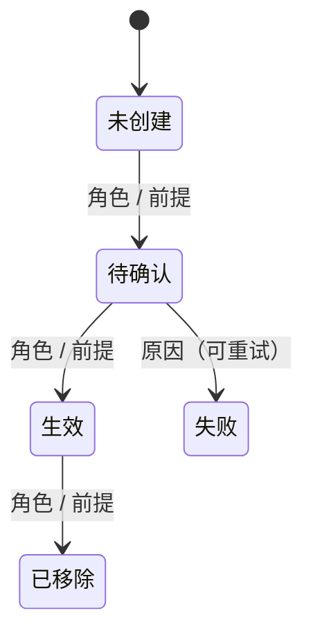

# <对象名> 生命周期

> 复制本文件为 `<对象>.md` 后填写。说明见 [README.md](README.md)。

## 定义

- 对象：一句话说明它是什么。
- 拥有者：谁能创建、谁能删除。
- 相关对象：与哪些对象有衔接（链接到对应文件）。

## 状态

| 状态 | 含义 | 用户看到什么 |
| --- | --- | --- |
| 待确认 | | |

## 旅程

### LC-<对象>-01 <旅程名>

前提：角色、已有状态。

| 步骤 | 角色 | 操作 | 预期结果（状态） | CLI 命令 | daemon 方法 | 现状 | 依据 |
| --- | --- | --- | --- | --- | --- | --- | --- |
| 1 | | | | | | | |

异常：

- 取消：
- 失败：
- 权限不足：
- 网络断开 / 并发冲突：

衔接：完成后进入 ……

## 需要决定的问题

- 
