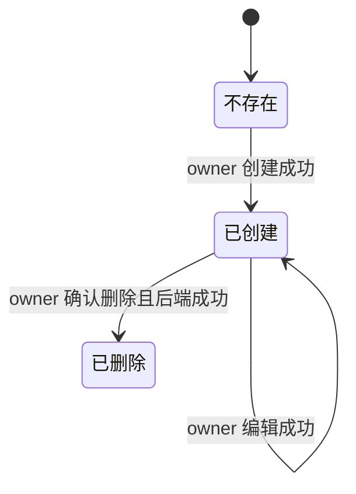

# Agent 生命周期

状态：Draft。身份、运行、模型凭据授权和组织归属分开记录；接口列由研发负责人对照。

依据：`intg/gui-init@365698612` 的 `gui/docs/modules/dev-02.md` §行为、§管理面板、§状态映射，以及 `gui/docs/org/prd.zh-CN.md` §2 B4、B9、§4.2 F10/F17。GUI 预览状态不能代替后端已实现能力。

## 定义

- 对象：由 owner 创建和管理的 Agent 身份。名称、职责、首选 harness 等是配置；实际运行工具和正在使用的模型取运行事实。
- 拥有者：Agent owner 创建、编辑、删除和管理自己的 Agent。组织归属和跨机迁移另受组织与目标机器权限约束。
- 衔接对象：[组织](org.md)、[设备](device.md)、[模型凭据](model-credential.md)。
- 边界：Agent 创建不依赖模型凭据；创建后才授予凭据。模型凭据连接状态、进程运行状态和渠道连接状态不能合成一个“在线”。

## 状态

| 维度 | 已有显示取值 | 含义与限制 |
| --- | --- | --- |
| 身份 | 不存在、已创建、已删除 | 删除前须确认；是否可恢复待研发核对 |
| 运行 | 在线、离线、状态未确认 | 来自运行态，不能由“启动请求已受理”推断在线 |
| 模型凭据 | 已授权、未授权、已撤销、等待原主人设备、解封失败、状态未确认 | 这是授权投影；真实模型可用性仍需运行结果验证 |
| GUI 可用性 | 可用、需绑定模型凭据、已停用、状态未确认 | 当前 GUI 按凭据连接投影；不代表进程运行态 |
| 组织归属 | 所属组织标签 | “至少属于一个组织”是组织模型在途目标，不能当作当前 Agent 存储字段 |

## 旅程

### LC-AGENT-01 创建、编辑和删除

前提：用户有 owner 权限；创建时名称和职责必填，服务商、模型、首选 harness 是可选偏好。

| 步骤 | 角色 | 操作 | 预期结果（状态） | CLI 命令 | daemon 方法 | 现状 | 依据 |
| --- | --- | --- | --- | --- | --- | --- | --- |
| 1 | owner | 创建 Agent | 后端确认后进入详情；未授权模型凭据也可存在 | `hyprial agent create --name <name>` | `agent.create` | 有差异 | dev@4d676ec37 `src/hyprial/shell/impl/cli/commands/agent/create.py:17-19`（name 为必填选项）；`src/hyprial/daemon/impl/application/actors/agents_admin/registry_ops.py:348-405`；契约：有差异：无契约（MethodSpec 未声明）；#2210 也未声明 create。行为/字段：支持独立身份和偏好，但不接收/校验职责必填 |
| 2 | owner | 编辑 Agent 配置 | 保存成功才更新详情；失败保留输入 | —（`hyprial agent config rebind` 仅配置根迁移，不是详情编辑） | —（无通用 Agent 详情更新方法） | 缺口 | dev@4d676ec37 `src/hyprial/daemon/impl/ipc/router.py:56-89`；`contract/cli/surface.json:33-76`：无职责/名称/偏好统一编辑入口；create 的 reuse 分支不是配置更新契约 |
| 3 | owner | 确认删除 Agent | 后端确认后从列表消失 | `hyprial agent destroy <name>` | `agent.destroy`（CLI 先调 `agent.destroy.preview`） | 有差异 | dev@4d676ec37 `src/hyprial/daemon/impl/application/actors/agents_admin/registry_ops.py:795-865`；契约：有差异：无契约（MethodSpec 未声明）。行为/字段：不可逆删除，preview 未绑定 operationId |

异常：名称或职责缺失时停在表单。详情目标不存在时显示“找不到该 Agent”。后端未接通时显示暂不可用，不使用开发预览的内存成功结果。

衔接：创建后可授权[模型凭据](model-credential.md)，再单独启动或配置消息渠道。

### LC-AGENT-02 授权模型凭据并启动

前提：Agent 身份已存在；用户持有可授权的模型凭据。服务商凭据授权与 Agent 自有服务秘钥是不同命令域。

| 步骤 | 角色 | 操作 | 预期结果（状态） | CLI 命令 | daemon 方法 | 现状 | 依据 |
| --- | --- | --- | --- | --- | --- | --- | --- |
| 1 | owner | 查看 Agent 的凭据授权状态 | 显示后端返回的授权或未知状态 | `hyprial agent secret ls <actor>`（不是 `secret list`） | `agent.secret.list`（PR #2210 有契约） | 有差异 | PR #2210@49d5f8dfe `src/hyprial/daemon/impl/request_catalog/agent.py:463-487`；dev@4d676ec37 `src/hyprial/daemon/impl/application/actors/agents_admin/registry_ops.py:258-279`：返回活动 grants，不含已撤销历史/待原主人/解封失败状态；不得补造统一状态 |
| 2 | owner | 授予服务商凭据 | 授权成功后更新 grant 记录；不回显 Key | `hyprial agent secret grant <actor> --source user-provider …`；`hyprial agent provider grant-key …` | `agent.secret.grant`（批量 CLI 还读取 `agent.secret.list`） | 有差异 | dev@4d676ec37 `src/hyprial/daemon/impl/application/actors/agents_admin/registry_ops.py:198-257`；`src/hyprial/shell/impl/cli/commands/agent/provider/grant_key.py:83-153`；契约（grant）：有差异：无契约（MethodSpec 未声明）。行为/字段：grant 已实现，批量防覆盖编排仍在 CLI |
| 3.a | owner | 启动 Agent | 运行态确认后显示实际 harness 与模型 | `hyprial agent start pi --name <name> --headless …` | `lifecycle.start`（启动前另做身份/配置预检） | 有差异 | dev@4d676ec37 `src/hyprial/shell/impl/cli/commands/agent/runtime/start.py:462-479`；`src/hyprial/daemon/impl/ipc/router.py:626-634`；契约：有差异：无契约（MethodSpec 未声明）。行为/字段：启动已有 IPC，后续运行态另查 |
| 3.b | owner | 启动 Agent | 运行态确认后显示实际 harness 与模型 | `hyprial agent list --json`（`ps` 无对应 CLI） | `agent.list` / `ps`（运行态读取） | 有差异 | PR #2210@49d5f8dfe `src/hyprial/daemon/impl/request_catalog/agent.py:442-461` 声明 list；dev@4d676ec37 `src/hyprial/daemon/impl/application/actors/agents_registry.py:731-776`；`src/hyprial/daemon/impl/ipc/router.py:478-479`（ps 仅 daemon 方法）；契约（ps）：有差异：无契约（MethodSpec 未声明）；list 已在 PR #2210 声明。行为/字段：harness/运行态来自 liveness，model 来自 Agent 记录，不能保证是进程内实际模型 |

异常：凭据已撤销、等待原主人设备或解封失败时，按后端结果分别显示。启动失败或状态未知时不显示在线。GUI 的启动、停止、授权和撤销按钮目前是占位动作，不表示生产写能力已接通。

衔接：与 Agent 对话还需有可达聊天目标；渠道连接状态另行判断。

### LC-AGENT-03 加入组织与迁移机器

前提：组织归属模型在途；工作组织中的审批状态未定。当前跨机迁移仅有同 owner 冷迁移能力。

| 步骤 | 角色 | 操作 | 预期结果（状态） | CLI 命令 | daemon 方法 | 现状 | 依据 |
| --- | --- | --- | --- | --- | --- | --- | --- |
| 1 | Agent owner | 发起加入或移出组织 | 以组织权限和后端确认结果为准 | — | —（`org.acl.grant/revoke` 不是 Agent 组织归属） | 缺口 | dev@4d676ec37 `src/hyprial/daemon/impl/ipc/router.py:56-89,246-266`；PR #2217@06a2aee3b `src/hyprial/daemon/impl/request_catalog/org/context.py:178-182`：无 Agent 加入/移出组织及最后组织约束的公开方法 |
| 2.a | Agent owner | 选择目标机器并确认迁移 | 成功后 owner 不变；目标机器接管运行 | `hyprial host list`；`hyprial agent move <name> --to <host> --dry-run --yes` | `hosts`；`transfer.plan` / `transfer.precheck`（编排预检） | 有差异 | dev@4d676ec37 `src/hyprial/shell/impl/cli/commands/transfer/move.py:48-74,122-161`；`src/hyprial/daemon/impl/ipc/router.py:637-645`；契约：有差异：无契约（MethodSpec 未声明）。行为/字段：SSH 冷迁移预检而非 GUI 目标选择 |
| 2.b | Agent owner | 选择目标机器并确认迁移 | 成功后 owner 不变；目标机器接管运行 | `hyprial agent move <name> --to <host> --yes` | `transfer.quiesce` / `transfer.receive` / `transfer.resume` / `transfer.complete` 等 | 有差异 | dev@4d676ec37 `src/hyprial/shell/impl/cli/commands/transfer/move.py:106-161`；`src/hyprial/daemon/impl/ipc/router.py:637-652`；契约：有差异：无契约（MethodSpec 未声明）。行为/字段：CLI/SSH 编排同 owner 冷迁移，非单一 GUI 迁移操作 |

异常：移出最后一个组织应拒绝，是在途约束。组织加入审批的状态与事件仍待确认；不能设计成已上线按钮。迁移失败时须以后端回滚或恢复结果为准，不从页面进度推断完成。

## 权限与不变量

- Agent owner 的操作权限与组织所有者的审批权限分开。
- GUI 不读取或显示模型 Key 明文；Agent 只持有授权记录。
- 首选 harness 是配置，实际 harness 来自运行态；启动不能覆盖首选值。
- GUI 未接入真实后端的写操作必须显示暂不可用，不产生模拟成功。

## 需要决定的问题

- Agent 加入工作组织的审批人、状态和事件：组织 PRD Q06，待上游确认。
- Agent 的删除、迁移与运行恢复对应哪些可观察后端状态：待研发接口对照。
