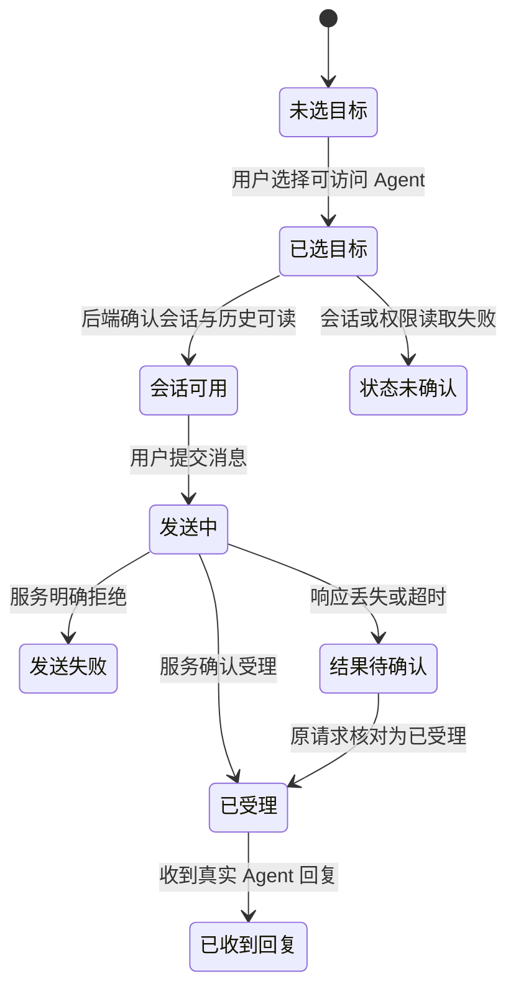

# 对话会话生命周期

状态：Draft。本文只整理用户能观察的会话与消息旅程；接口列由研发负责人对照。会话建立、消息受理、消息送达与 Agent 回复是不同结果。

依据：`intg/gui-init@365698612` 的 `docs/guides/gui-prototype-handoff/mvp-required-flows.md` M3、M4，`docs/design/dev-03-formal-integration-plan-2026-10-29.md` §聊天与未知结果，以及 `docs/design/dev-03-daemon-method-map.md` §方法表、§当前基线缺失。方法映射文档是旧基线的静态核对，不能直接判定现行契约已开放。

## 定义

- 对象：用户与选定 Agent 的对话会话。会话保存目标、消息记录和恢复历史所需的身份。
- 拥有者：发起对话的用户选择目标并发送消息；可信宿主绑定真实身份与会话目标。
- 衔接对象：[Agent](agent.md)、[消息连接](message-connection.md)、[模型凭据](model-credential.md)。
- 边界：本地聊天不以加入组织为前提；远端聊天要先确认账号、设备、可访问节点和 Agent。消息服务受理不等于 Agent 已读或已回复。

## 状态

以下是用户能观察的旅程阶段与单条消息结果。现有资料未给出一套可直接采用的会话持久化状态枚举；本图不新增后端字段。

| 阶段 | 用户看到什么 | 不得推断 |
| --- | --- | --- |
| 已选目标 / 会话可用 | 目标 Agent、会话列表、真实历史 | 目标存在不代表模型可用 |
| 发送中 | 原消息和发送进度 | 不显示已送达 |
| 服务已受理 | 服务确认接收请求 | 不显示 Agent 已读或已回复 |
| 发送失败 | 明确失败原因与可执行下一步 | 不把失败写成状态未知 |
| 结果待确认 | 保留草稿或原请求标识，提供核对入口 | 不自动生成新请求重发 |
| 已收到回复 | 真实 Agent 回复与真实时间戳 | 不用计时器生成假回复 |

## 旅程

### LC-CONV-01 本地创建或打开会话

前提：本地 Squire 已准备；模型凭据已保存并获授权。真正的模型可用性以真实回复确认。

| 步骤 | 角色 | 操作 | 预期结果（状态） | CLI 命令 | daemon 方法 | 现状 | 依据 |
| --- | --- | --- | --- | --- | --- | --- | --- |
| 1.a | 用户 | 选择本机 Agent 并打开聊天 | 展示目标、会话列表和历史，或明确不可用 | `hyprial agent list`（目标）；历史无专用 CLI | `agent.list`；`message.history`（需已有 conversationId） | 有差异 | PR #2210@49d5f8dfe `src/hyprial/daemon/impl/request_catalog/agent.py:442-461`；dev@4d676ec37 `src/hyprial/daemon/impl/application/messaging/inbox_surface/history/__init__.py:66-130`；契约（message.history）：有差异：无契约（MethodSpec 未声明）；agent.list 已在 PR #2210 声明。行为/字段：指定会话历史已有 IPC，不提供会话列表 |
| 1.b | 用户 | 选择本机 Agent 并打开聊天 | 展示目标、会话列表和历史，或明确不可用 | —（无会话打开/绑定命令） | —（无独立 conversation create/open/list 方法） | 缺口 | dev@4d676ec37 `src/hyprial/daemon/impl/ipc/router.py:114-124`；`src/hyprial/daemon/impl/application/messaging/inbox_surface/send.py:172-173`：send 可接收/生成 conversationId，但不是会话建立、目标绑定及列表契约 |
| 2.a | 用户 | 发送首条消息 | 展示发送中；收到真实回复后确认首次对话完成 | `hyprial message send --from <principal> --to <agent-uri> --summary 
 --conversation <id> <text>`（可信宿主身份） | `message.send` | 有差异 | dev@4d676ec37 `src/hyprial/shell/impl/cli/commands/message/send.py:212-285`；`src/hyprial/daemon/impl/application/messaging/inbox_surface/send.py:172-173,397-406`；契约：有差异：无契约（MethodSpec 未声明）。行为/字段：已有受理/幂等底层，CLI 不暴露 idempotencyKey；受理不代表回复 |
| 2.b | 用户 | 发送首条消息 | 展示发送中；收到真实回复后确认首次对话完成 | `hyprial message status --from <principal> …`；历史无专用 CLI | `message.status` / `message.history` | 有差异 | dev@4d676ec37 `src/hyprial/daemon/impl/application/messaging/delivery/status_queries.py:111-160`；`src/hyprial/daemon/impl/application/messaging/inbox_surface/history/__init__.py:66-130`；契约（两方法）：有差异：无契约（MethodSpec 未声明）。行为/字段：投递状态与真实回复历史分开读取；无首次设置完成方法 |

异常：模型或 Agent 未就绪时说明缺少的条件。历史不可读时不展示合成对话。首次对话的输入在未接通共享聊天时不得伪装为已发送。

衔接：首次真实回复后，首次设置才可标为完成；日常聊天继续沿用同一会话事实。

### LC-CONV-02 远端选择 Agent 并收发消息

前提：账号登录与设备身份已确认；用户能访问目标节点和 Agent。组织不是本地聊天的必要前提。

| 步骤 | 角色 | 操作 | 预期结果（状态） | CLI 命令 | daemon 方法 | 现状 | 依据 |
| --- | --- | --- | --- | --- | --- | --- | --- |
| 1 | 用户 | 查看可访问节点和 Agent，选择目标 | 会话目标保持一致 | `hyprial host list`；`hyprial message targets` | `hosts` / `targets` | 有差异 | dev@4d676ec37 `src/hyprial/daemon/impl/application/messaging/status/views.py:758-896`；契约（两方法）：有差异：无契约（MethodSpec 未声明）。行为/字段：返回可投递目标及主机观察投影，不持有 GUI 会话目标绑定 |
| 2.a | 用户 | 打开或建立会话并读取历史 | 真实历史可恢复；同一消息不重复展示 | —（无会话建立/打开命令） | —（无独立会话建立/目标绑定契约） | 缺口 | dev@4d676ec37 `src/hyprial/daemon/impl/ipc/router.py:114-124`；`src/hyprial/daemon/impl/application/messaging/inbox_surface/send.py:172-173`：会话 ID 随 send 传入/生成，不是可恢复的会话目录 |
| 2.b | 用户 | 打开或建立会话并读取历史 | 真实历史可恢复；同一消息不重复展示 | —（`message read` 是消费正文，不是历史查询） | `message.history`（conversationId、cursor、mode） | 有差异 | dev@4d676ec37 `src/hyprial/daemon/impl/application/messaging/inbox_surface/history/__init__.py:66-173`；契约：有差异：无契约（MethodSpec 未声明）。行为/字段：按可信参与者读取 tail/older/after，已有游标；客户端仍须按 messageId 去重 |
| 3.a | 用户 | 发送消息并等待结果 | 区分受理、失败、待确认和真实回复 | `hyprial message send --from <principal> --to <agent-uri> --summary 
 --conversation <id> <text>` | `message.send` | 有差异 | dev@4d676ec37 `src/hyprial/daemon/impl/application/messaging/inbox_surface/send.py:172-173,397-406`；契约：有差异：无契约（MethodSpec 未声明）。行为/字段：支持 idempotencyKey 派生 messageId，但 CLI 不暴露该键 |
| 3.b | 用户 | 发送消息并等待结果 | 区分受理、失败、待确认和真实回复 | `hyprial message status --from <principal> …`；历史无专用 CLI | `message.status` / `message.history` | 有差异 | dev@4d676ec37 `src/hyprial/daemon/impl/application/messaging/delivery/status_queries.py:111-160` 按 messageId 查结果，无 operationId 查询；`src/hyprial/daemon/impl/application/messaging/inbox_surface/history/__init__.py:66-173` 读取回复。契约（两方法）：有差异：无契约（MethodSpec 未声明）。行为/字段：响应丢失时原请求核对仍缺端到端契约 |

异常：网络断开时显示原因；恢复后刷新历史。发送超时或响应丢失时，按原消息标识核对权威结果。核对仍未知时保留未知，不生成新请求盲目重发。

衔接：消息平台切换参见[消息连接](message-connection.md)；切换不能改变会话目标或清掉草稿。

## 权限与不变量

- 发送者、会话绑定和目标由可信宿主确认；浏览器不能自报 principal、actor 或令牌。
- 历史记录中的消息时间来自真实时间戳；消息里的 HTML 和脚本只作文本显示。
- 服务受理、投递、Agent 已读和 Agent 回复必须分开；没有对应证据时只显示已知阶段。
- 结果未知时，接入层只按原请求标识核对；生产页面不能自行重复发送。

## 需要决定的问题

- 会话建立、发送结果查询和历史恢复是否已有正式 GUI 契约：由研发按最新 `dev` 对照。
- 远端组织权限与会话目标的关系：由后端授权事实和组织策略决定，页面不能按同 owner 推断可通信。
