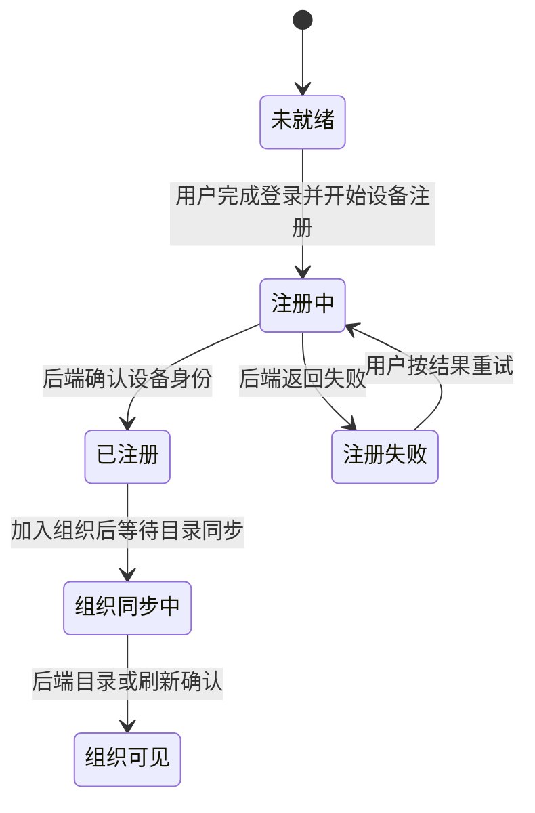

# 设备生命周期

状态：Draft。设备身份、组织成员设备记录与网络可达性分开记录；接口列由研发负责人对照。

依据：`intg/gui-init@365698612` 的 `gui/docs/org/prd.zh-CN.md` §2 B10、§4.2 F07/F12、§6、§10 Q11，`gui/docs/org/interaction-design.zh-CN.md` §10 P06–P08，以及 `gui/docs/modules/dev-05.md` §场景、§边界。

## 定义

- 对象：用户的一台本机设备。设备可加入组织网络，并在组织中展示机器记录。
- 拥有者：设备所属用户负责登录和注册本机设备；组织中的可见范围由后端成员关系决定。
- 衔接对象：[组织](org.md)、[成员](member.md)、[成员邀请](member-invite.md)、[Agent](agent.md)。
- 边界：设备已注册、目录已同步、网络在线是三个不同事实。“同步中”不是待审批。

## 状态

| 维度 | 当前取值或事实 | 用户看到什么 |
| --- | --- | --- |
| 本机设备身份 | 未就绪、注册中、已注册或失败 | 登录与设备准备结果；未确认时不显示就绪 |
| 组织目录 | 同步中或记录可见 | 目录未到达时显示“同步中”，不显示审批按钮 |
| 网络可达性 | `org network` 给 `unknown`；`host list` 给 `online` 或 `unknown` | 只呈现来源能证明的在线状态 |
| 规划可达性 | `online`、`offline`、`dormant` | 在途；休眠阈值仍待确认 |

说明：上图是设备加入组织时的用户旅程阶段，不声明这些名称都是同一个持久化状态字段。GUI dev-05 的合成机器只是开发场景，不是实际设备记录。

## 旅程

### LC-DEVICE-01 首次准备本机设备

前提：用户完成账号步骤；设备准备是首次设置账号步骤的子状态，不新增单独的首次设置步骤。

| 步骤 | 角色 | 操作 | 预期结果（状态） | CLI 命令 | daemon 方法 | 现状 | 依据 |
| --- | --- | --- | --- | --- | --- | --- | --- |
| 1 | 用户 | 完成账号登录 | 设备准备开始或返回明确阻断 | `hyprial login` | —（账号/设备引导在 CLI） | 仅 CLI | dev@4d676ec37 `src/hyprial/shell/impl/cli/commands/login/flow.py:24-39,812-849`：登录编排和设备准备非 daemon 登录方法；不把 `ping`/`ps` 当登录接口 |
| 2.a | 系统 | 注册或核对本机设备身份 | 后端确认后才允许依赖设备的加入操作 | `hyprial login`（设备准备阶段） | —（CLI 调 `ensure_device_key`） | 仅 CLI | dev@4d676ec37 `src/hyprial/shell/impl/cli/commands/login/flow.py:812-849`：返回 ready/error，非独立 daemon 设备注册方法 |
| 2.b | 系统 | 注册或核对本机设备身份 | 后端确认后才允许依赖设备的加入操作 | `hyprial doctor`（本机诊断） | `org.join` 仅在执行时校验；无独立设备就绪查询契约 | 有差异 | dev@4d676ec37 `src/hyprial/daemon/impl/org/network/service.py:757-765`：`DEVICE_RECORD_MISSING`；`src/hyprial/shell/impl/cli/commands/login/flow.py:776-806` 可重验设备阶段，但 GUI 的 `DEVICE_NOT_READY` 不是统一现行返回 |

异常：设备未就绪时，待处理邀请应提示先完成登录。身份状态未知时不把后续组织加入标为完成。

衔接：可以处理[成员邀请](member-invite.md)。

### LC-DEVICE-02 加入组织并显示机器

前提：用户有可用的邀请或成员关系；目标组织网络可访问。

| 步骤 | 角色 | 操作 | 预期结果（状态） | CLI 命令 | daemon 方法 | 现状 | 依据 |
| --- | --- | --- | --- | --- | --- | --- | --- |
| 1 | 用户 | 确认加入组织 | 加入流程包含注册设备与连接成员 | `hyprial org join -`；`hyprial org pending`（PR #2221 逐条确认） | `org.join` / `org.invites.accept`（PR #2221；HTTP 未开放） | 有差异 | dev@4d676ec37 `src/hyprial/daemon/impl/org/network/service.py:540-565`：直接 join 可跳过设备发布；PR #2221@92cede5c8 `src/hyprial/daemon/impl/org/membership/invites/service.py:116-142` 才在拾取路径回读完整性 |
| 2 | 系统 | 同步组织机器目录 | 目录到达后显示该设备；同步前不伪造记录 | —（加入与后台发布自动执行；`hyprial org network <org>` 仅观察） | `org.join` 触发发布；后台 `publish_self`（非独立 RPC） | 有差异 | dev@4d676ec37 `src/hyprial/daemon/impl/org/network/service.py:515-534,585-664`；接口覆盖：后台 publish_self 非公开 RPC，未提供目录同步完成查询。行为/字段：异步发布/重试，非请求完成即目录到达 |
| 3 | 用户 | 查看组织机器列表 | 显示主机名、系统、加入时间、连接状态 | `hyprial org network <org>`；`hyprial host list` | `org.network` / `hosts` | 有差异 | dev@4d676ec37 `src/hyprial/daemon/impl/org/network/status/view.py:30-36,55-68`；`src/hyprial/daemon/impl/application/messaging/status/views.py:860-905`；契约（两方法）：有差异：无契约（MethodSpec 未声明）。行为/字段：目录 presence=unknown，hosts 为 online/unknown，不是统一含系统/加入时间/离线状态的设备列表 |

异常：加入失败时机器区不额外显示一条假失败状态；由加入流程给原因和重试。第二台电脑如何加入“用户已是成员”的组织仍属 PRD Q11，不能直接复用一次性邀请作为已确认方案。

衔接：机器可见后，Agent 迁移仍需 owner 与目标设备的独立授权。

## 权限与不变量

- 组织成员身份不能由机器列表中的一行反推。
- 当前本机行不提供移除按钮；GUI dev-05 没有机器移除操作。
- 开发预览的合成机器不得进入正式产品数据。
- 没有实时数据时显示“状态未确认”或“暂不可用”，不把 `unknown` 翻译成确定离线。

## 需要决定的问题

- 第二台电脑加入既有成员组织的具体入口和后端能力：PRD Q11。
- 离线设备何时进入 `dormant`：PRD 待决 5，须由 Allen 确认。
- 设备身份、目录同步和网络在线各自的后端事件与完成证据：待研发接口对照。
