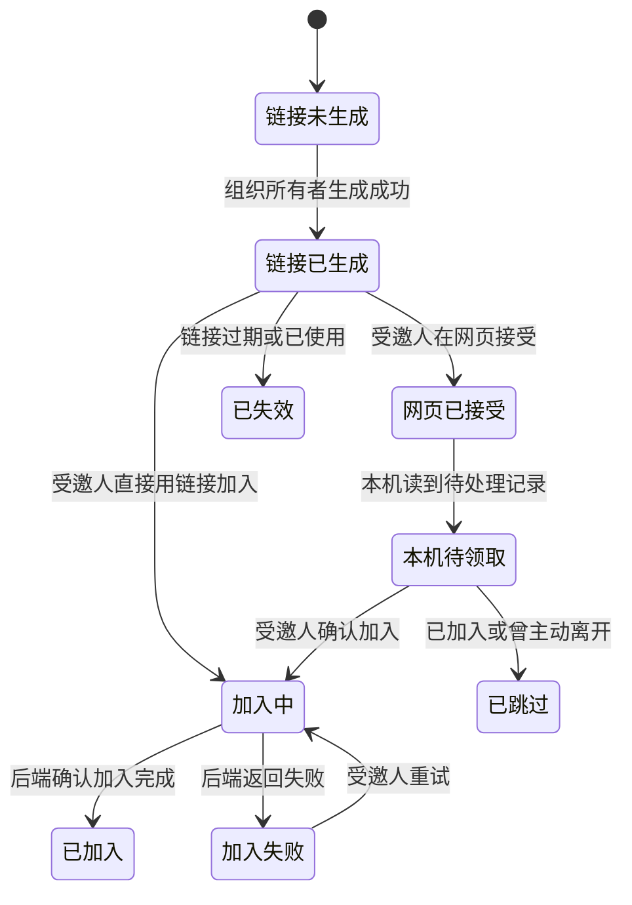

# 成员邀请生命周期

状态：Draft。产品侧只整理状态、旅程和权限；接口列由研发负责人对照。

依据：`intg/gui-init@365698612` 的 `gui/docs/org/prd.zh-CN.md` §2、§4.2、§6、§7，以及 `gui/docs/org/interaction-design.zh-CN.md` §10 P04–P07、§11.1、§16 UJ03。来源中的“已实现”“在途”“待决”沿用原标注。

## 定义

- 对象：组织所有者给受邀人生成的邀请，以及受邀人在本机处理邀请的过程。邀请链接含连接凭据，只能私发。
- 拥有者：工作组织的所有者生成邀请；受邀人决定是否接受并在自己的设备上加入。
- 衔接对象：[组织](org.md)、[成员](member.md)、[设备](device.md)。邀请链接生成、网页接受、本机领取和加入组织是不同结果。
- 边界：现有设计没有“发出的邀请”列表。链接复制或网页接受均不能证明本机已加入组织。

## 状态

当前可核对的是三个相邻阶段：生成邀请链接的结果、网页接受后的待处理记录、本机加入结果。下图表示旅程阶段，不声称后端已有一条统一的邀请状态字段。

| 阶段或结果 | 含义 | 用户看到什么 | 来源状态 |
| --- | --- | --- | --- |
| 链接已生成 | 生成动作返回邀请链接，有效期为 1 小时 | 结果对话框；提示仅私发 | 已实现 |
| 网页已接受 | 受邀人在网页接受，记录写入账号侧用户属性 | 本机待处理列表仍需读取 | 已实现 |
| 本机待领取 | 本机读到已接受、尚未加入的邀请 | 逐条确认“加入” | 已实现；登录时逐条确认的方式在途 |
| 已加入 / 加入失败 / 已跳过 / 待处理 | 本机领取动作的结果，不能等同邀请对象的统一状态 | 分别显示结果和原因 | 已实现的拾取结果 |
| pending / accepted / declined / failed | 规划中的邀请状态 | 待接口与事件定义后映射 | 在途；不得冒充现有字段 |

## 旅程

### LC-INVITE-01 所有者生成邀请

前提：登录用户是工作组织的所有者；受邀人有账号。个人组织能否邀请其他用户仍属待决 1。

| 步骤 | 角色 | 操作 | 预期结果（状态） | CLI 命令 | daemon 方法 | 现状 | 依据 |
| --- | --- | --- | --- | --- | --- | --- | --- |
| 1 | 所有者 | 输入受邀人的账号并生成邀请 | 返回邀请链接；不显示“成员已加入” | `hyprial org invite <org> --user <user>` | `org.invite` | 有差异 | dev@4d676ec37 `src/hyprial/daemon/impl/org/network/service.py:258-353`；契约：有差异：无契约（MethodSpec 未声明）。行为/字段：生成时已调用 `_invite_casdoor_first` 写成员，返回 member/aclMember，不能等同设备已加入 |
| 2 | 所有者 | 复制链接并私发给受邀人 | 只确认复制；链接关闭后不再展示 | —（邀请命令只输出链接） | —（剪贴板、关闭后清理属客户端） | 缺口 | dev@4d676ec37 `src/hyprial/daemon/impl/org/network/service.py:333-353`：仅返回 link/deepLink/command，无复制或清理接口；建议客户端实现，不新增消息自动发送 |

异常：账号不存在、账号服务不可用或额度已满时，保留账号输入并显示原因。没有所有者权限时说明所需权限。链接过期或已使用时重新生成；不得自动重发含凭据的链接。

衔接：受邀人可走 LC-INVITE-02 或 LC-INVITE-03。成员列表只在收到成员变化或刷新确认后更新。

### LC-INVITE-02 网页接受后在本机领取

前提：受邀人已在网页接受邀请；本机尚未加入组织。

| 步骤 | 角色 | 操作 | 预期结果（状态） | CLI 命令 | daemon 方法 | 现状 | 依据 |
| --- | --- | --- | --- | --- | --- | --- | --- |
| 1 | 受邀人 | 打开本机待处理邀请列表 | 显示可领取记录或状态未确认 | `hyprial org pending --json`（PR #2221） | `org.invites.list`（PR #2221；输入账号邀请快照） | 有差异 | PR #2221@92cede5c8 `src/hyprial/daemon/impl/request_catalog/org/invites.py:45-52,134-147`；`src/hyprial/shell/impl/cli/commands/org/member/commands.py:193-233`；契约：PR #2221 已声明，dev 无此方法。行为/字段：账号读取仍在 CLI，非无参端到端列表 |
| 2 | 受邀人 | 逐条确认加入 | 显示“正在加入”；成功后显示“已加入” | `hyprial org pending`（TTY 逐条确认，PR #2221） | `org.invites.accept`（`inviteId` + `link`；HTTP 未开放） | 已有（PR #2221，未合） | PR #2221@92cede5c8 `src/hyprial/daemon/impl/request_catalog/org/invites.py:149-166`；`src/hyprial/daemon/impl/org/membership/invites/service.py:89-142`：绑定邀请、单飞、检查实际加入结果；dev 尚无此方法 |
| 3 | 受邀人 | 决定是否设为当前组织 | 只有明确选择才改变当前组织 | `hyprial org use <org>`（PR #2217） | `org.use`（HTTP 未开放） | 已有（PR #2217，未合） | PR #2217@06a2aee3b `src/hyprial/daemon/impl/org/membership/context/resolver.py:52-58`；`src/hyprial/daemon/impl/request_catalog/org/context.py:160-182` |

异常：设备未就绪时提示完成登录。已加入或曾主动离开时显示“已跳过”及原因。失败时显示“未加入：原因”并允许按结果重试。拒绝邀请是规划能力，后端支持前不得显示已拒绝。

衔接：进入[成员](member.md)的成员关系确认，再刷新组织中的人、机器和 Agent。邀请状态不能替代成员列表的确认。

### LC-INVITE-03 用邀请链接直接加入

前提：受邀人持有有效邀请链接。链接含连接凭据。

| 步骤 | 角色 | 操作 | 预期结果（状态） | CLI 命令 | daemon 方法 | 现状 | 依据 |
| --- | --- | --- | --- | --- | --- | --- | --- |
| 1 | 受邀人 | 在密码输入框粘贴链接并提交 | 输入框清空；显示四步进度 | `hyprial org join -`（stdin，避免链接进 argv） | `org.join`（PR #2221 声明；HTTP 未开放） | 有差异 | PR #2221@92cede5c8 `src/hyprial/daemon/impl/request_catalog/org/join.py:61-87`；契约：PR #2221 已声明。行为/字段：unary 最终 steps 数组，不是四步实时进度流；输入框清空属客户端 |
| 2 | 系统 | 连接邀请人、加入组织、注册设备、连接成员 | 四步完成后才显示“已加入” | `hyprial org join -` | `org.join`（PR #2221 契约 HTTP 未开放） | 有差异 | dev@4d676ec37 `src/hyprial/daemon/impl/org/network/service.py:355-370,540-565`；行为/字段：register-device 可返回 skipped 而 steps.ok=true；契约：PR #2221@92cede5c8 `src/hyprial/daemon/impl/request_catalog/org/join.py:61-87` 声明契约不消除直接 join 的该语义 |
| 3 | 受邀人 | 决定是否设为当前组织 | 保持原组织或切换到新组织 | `hyprial org use <org>`（PR #2217） | `org.use`（HTTP 未开放） | 已有（PR #2217，未合） | PR #2217@06a2aee3b `src/hyprial/daemon/impl/org/membership/context/resolver.py:52-58`；`src/hyprial/daemon/impl/request_catalog/org/context.py:160-182` |

异常：过期、已使用、无效或格式错误时，请邀请人重新发送；旧版链接需重新签发。受邀人已被移出时，不提供原链接重试。75 秒超时只显示“加入未完成”，重试前须核对实际加入结果。

衔接：加入成功后刷新[组织](org.md)概览；同步完成前不推断成员和设备已出现。

## 权限与凭据

- 只有组织所有者能生成邀请。角色只分所有者和成员；管理员没有已分配身份。
- 受邀人只能处理发给自己的邀请。实际授权由后端判断，页面不能自报身份。
- 邀请链接、短链接和加入命令均按凭据处理：只私发，不写浏览器存储、地址或日志。
- 网络超时或结果未知时，不把“请求已受理”显示成“已加入”，也不盲目重发写操作。

## 需要决定的问题

- 个人组织是否禁止邀请其他用户：PRD 待决 1，须由 Allen 确认。
- 规划中的 pending / accepted / declined / failed 与现有领取结果如何对应：由研发对照接口和事件后确认。
- 网页接受、Casdoor 成员关系和本机设备加入的准确生效点：由研发核对后端证据。设计再确定完成提示。
