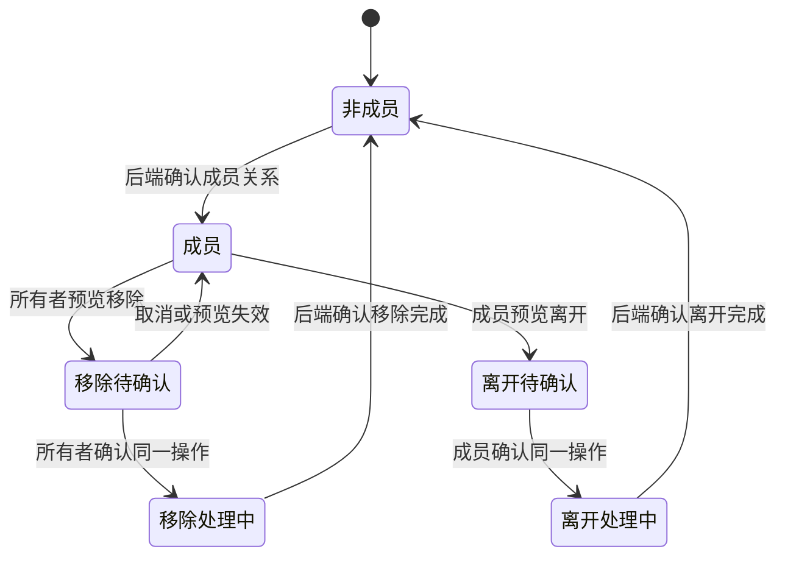

# 成员关系生命周期

状态：Draft。成员关系与邀请、设备加入分别记录；接口列由研发负责人对照。

依据：`intg/gui-init@365698612` 的 `gui/docs/org/prd.zh-CN.md` §2 B6、§4.2 F06–F09、§6，以及 `gui/docs/org/interaction-design.zh-CN.md` §5.3、§10 P05–P07、P16。

## 定义

- 对象：一个用户与一个组织之间的成员关系。Casdoor group 是成员关系的唯一事实源，OrgFS 保存组织空间中的成员投影。
- 拥有者：组织所有者邀请和移除成员；受邀人可接受邀请并加入，成员可离开组织。
- 衔接对象：[组织](org.md)、[成员邀请](member-invite.md)、[设备](device.md)、[Agent](agent.md)。
- 边界：网页接受邀请、本机设备加入、组织成员关系是三个不同事实。GUI 必须分别显示每个结果。

## 状态

| 状态 | 含义 | 用户看到什么 |
| --- | --- | --- |
| 非成员 / 成员 | Casdoor group 的成员事实 | 成员列表以已确认事实为准 |
| 待确认 | 移除或离开已生成预览，尚未执行 | 影响范围及确认入口 |
| 待 authority 或 OrgFS / 待 tailnet | 后端移除或离开仍在处理 | 具体阶段，不显示完成 |
| 完成 | 后端确认移除或离开结束 | 列表刷新后更新成员关系 |

说明：本图的“移除处理中”和“离开处理中”是流程阶段。实际分阶段名称以 PRD §6 为准；不能当作一个新持久化字段。

## 旅程

### LC-MEMBER-01 邀请后成为成员

前提：受邀人持有有效邀请链接，或本机读到网页接受后的待处理邀请。

| 步骤 | 角色 | 操作 | 预期结果（状态） | CLI 命令 | daemon 方法 | 现状 | 依据 |
| --- | --- | --- | --- | --- | --- | --- | --- |
| 1 | 受邀人 | 从待处理邀请或链接加入 | 加入结果由后端确认 | `hyprial org pending`（PR #2221）；`hyprial org join -` | `org.invites.accept` / `org.join`（PR #2221；HTTP 未开放） | 有差异 | PR #2221@92cede5c8 `src/hyprial/daemon/impl/org/membership/invites/service.py:89-142` 确认拾取完整性；dev@4d676ec37 `src/hyprial/daemon/impl/org/network/service.py:540-556` 直接 join 仍允许设备注册 skipped；两条路径完成语义不同 |
| 2 | 系统 | 刷新组织成员关系 | 成员列表在变化事件或手动刷新后更新 | `hyprial org fs member list <space-id>` | `orgfs.members`（OrgFS 投影） | 有差异 | dev@4d676ec37 `src/hyprial/daemon/impl/application/messaging/orgfs_bridge.py:591-601`；`src/hyprial/daemon/impl/org/network/ipc.py:548-606`；契约：有差异：无契约（MethodSpec 未声明）。行为/字段：Casdoor 后台同步，查询只返回 OrgFS 成员，不是 Casdoor 实时确认或 GUI 事件订阅 |

异常：邀请已接受但设备尚未加入时，不显示“本机已加入”。成员列表未刷新时，只显示“同步中”或“状态未确认”，不从邀请状态推断成员已出现。

衔接：组织中的机器和 Agent 列表独立刷新。

### LC-MEMBER-02 所有者移除成员

前提：操作人是组织所有者，且在允许的 authority 节点；被移除对象不是最后一个 authority。

| 步骤 | 角色 | 操作 | 预期结果（状态） | CLI 命令 | daemon 方法 | 现状 | 依据 |
| --- | --- | --- | --- | --- | --- | --- | --- |
| 1 | 所有者 | 请求移除预览 | 获得 operationId、影响设备与阶段 | `hyprial org remove <org> <user>`（交互确认前） | `org.remove`（`confirmed=false`） | 有差异 | dev@4d676ec37 `src/hyprial/daemon/impl/org/network/ipc.py:287-300`；`src/hyprial/daemon/impl/org/network/tailnet/__init__.py:72-94`；契约：有差异：无契约（MethodSpec 未声明）。行为/字段：同方法生成预览/阶段，不是独立 preview |
| 2 | 所有者 | 核对预览并确认 | 同一 operationId 的移除开始 | `hyprial org remove <org> <user>`（确认后） | `org.remove`（`confirmed=true`、`operationId`、`deviceIds`） | 有差异 | dev@4d676ec37 `src/hyprial/daemon/impl/org/network/ipc.py:287-300`；契约：有差异：无契约（MethodSpec 未声明）。行为/字段：参数已承载同一操作确认，未发现额外偏差 |
| 3 | 系统 | 更新 Casdoor、OrgFS 和 tailnet | 后端确认完成后才更新成员状态 | `hyprial org remove <org> <user>`（同一操作内部执行） | `org.remove` | 有差异 | dev@4d676ec37 `src/hyprial/daemon/impl/org/network/tailnet/__init__.py:72-94`；`src/hyprial/daemon/impl/org/network/service.py:400-414`；契约：有差异：无契约（MethodSpec 未声明）。行为/字段：返回 phase，但无独立 operation 状态查询，不能把任意返回当 complete |

异常：预览过期或版本冲突时重新取得预览，旧确认不能复用。非 authority 节点或最后 authority 的移除被拒绝。超时后先核对 operationId，不盲目重发。

衔接：后续成员写入被拒；已合并的组织文件内容保留。

### LC-MEMBER-03 成员离开组织

前提：操作人是当前成员。离开只改变该用户的成员关系，不删除组织。

| 步骤 | 角色 | 操作 | 预期结果（状态） | CLI 命令 | daemon 方法 | 现状 | 依据 |
| --- | --- | --- | --- | --- | --- | --- | --- |
| 1 | 成员 | 请求离开预览 | 显示影响设备与后续访问变化 | `hyprial org leave <org>`（交互确认前） | `org.leave`（`confirmed=false`） | 有差异 | dev@4d676ec37 `src/hyprial/daemon/impl/org/network/ipc.py:274-284`；`src/hyprial/daemon/impl/org/network/tailnet/__init__.py:72-94`；契约：有差异：无契约（MethodSpec 未声明）。行为/字段：同方法预览，confirmed=false 不是独立只读方法 |
| 2 | 成员 | 确认同一预览 | 后端完成后记录“已离开” | `hyprial org leave <org>`（确认后） | `org.leave`（`confirmed=true`、`operationId`、`deviceIds`） | 有差异 | dev@4d676ec37 `src/hyprial/daemon/impl/org/network/service.py:382-398`；契约：有差异：无契约（MethodSpec 未声明）。行为/字段：仅 phase=complete 写本机 left，不将中间阶段当完成 |

异常：预览版本变化时重新确认。曾主动离开的组织在待处理邀请拾取中会被跳过；持有效链接主动加入可清除该组织的“已离开”记录。

## 权限与不变量

- GUI 只使用“所有者”和“成员”两种已设计角色；管理员只是未分配的权限词。
- 只有所有者能邀请和移除成员。后端是授权事实来源，按钮可见性不能代替权限检查。
- Casdoor group 是成员关系的唯一事实源；OrgFS 和 GUI 列表是投影，不能反向认定成员已生效。
- 移除和离开均使用预览与确认。结果未知时不得显示完成。

## 需要决定的问题

- 网页接受、Casdoor 写入和本机加入之间的精确提交点须由研发核对。
- 登录后逐条确认邀请的接口仍在途；本文件不定义新的自动接受规则。
