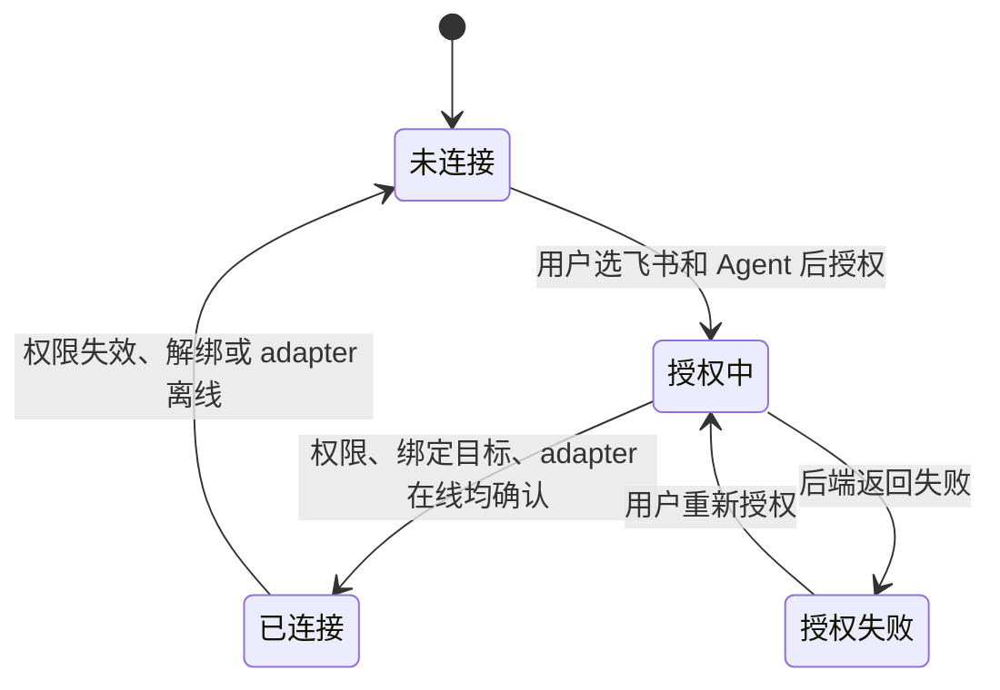

# 消息连接生命周期

状态：Draft。本文记录飞书连接与沟通方式；接口列由研发负责人对照。开发预览中的本地模拟不代表正式授权已接通。

依据：`intg/gui-init@365698612` 的 `gui/docs/modules/dev-03.md` §用户旅程、§状态与数据、§边界，以及 `docs/design/dev-03-formal-integration-plan-2026-10-29.md` §边界与组合、§飞书 App 授权与切换。

## 定义

- 对象：一个消息平台与指定 Agent 的连接。已有飞书 App 权限已授权、绑定为所选 Agent、adapter 在线三项同时成立，才显示“已连接”。
- 拥有者：有权绑定消息平台的用户选择平台和 Agent，并完成授权。可信宿主与后端确认实际绑定。
- 衔接对象：[Agent](agent.md)、[对话会话](conversation.md)。
- 边界：平台连接状态、绑定的 Agent、聊天沟通方式是不同数据。消息平台已连接不等于模型可用，也不等于某条消息已送达。

## 状态

| 维度 | 取值或阶段 | 说明 |
| --- | --- | --- |
| 消息连接 | `not-connected`、`connected` | dev-03 会话投影；正式“已连接”须同时核对权限、绑定目标、adapter 在线 |
| 绑定目标 | `messageConnectionAgentId` | 表示所绑定的 Agent，不是当前聊天收件人的替代字段 |
| 沟通方式 | `in-app`、`feishu` | 仅在已连接后可切换；切换不重复创建连接 |
| 授权流程 | 授权中、授权失败、不可用 | 是界面流程阶段，不作为连接成功事实 |

## 旅程

### LC-MSGCONN-01 绑定飞书与 Agent

前提：用户能访问连接页，并有可选择的 Agent。本轮复用已有飞书 App 的 scope 授权，不做用户 OAuth。

| 步骤 | 角色 | 操作 | 预期结果（状态） | CLI 命令 | daemon 方法 | 现状 | 依据 |
| --- | --- | --- | --- | --- | --- | --- | --- |
| 1 | 用户 | 选择“飞书”和要绑定的 Agent | 新目标尚未绑定；原连接状态保持不变，无原绑定时为未连接 | `hyprial agent list`；`hyprial adapter list`（读取候选，选择暂存于界面） | `agent.list` / `adapter.list` | 有差异 | PR #2210@49d5f8dfe `src/hyprial/daemon/impl/request_catalog/agent.py:442-461` 有 Agent 列表契约；dev@4d676ec37 `src/hyprial/daemon/impl/ipc/router.py:655-658`；契约（adapter.list）：有差异：无契约（MethodSpec 未声明）。行为/字段：选择不是 pin |
| 2.a | 用户 | 完成已有飞书 App 权限授权所需的审批 | 宿主重读授权结果；拒绝或过期不显示成功 | `hyprial adapter scopes authorize <name>` | —（授权编排在 CLI；审批在飞书） | 仅 CLI | dev@4d676ec37 `src/hyprial/shell/impl/cli/commands/adapter/authorize.py:138-186`；`contract/cli/surface.json:24`：无 daemon scope 授权方法，生成授权入口不等于审批成功 |
| 2.b | 用户 | 完成已有飞书 App 权限授权所需的审批 | 宿主重读授权结果；拒绝或过期不显示成功 | `hyprial adapter scopes check <name>` | —（CLI 直接查询平台权限） | 仅 CLI | dev@4d676ec37 `src/hyprial/shell/impl/cli/commands/adapter/admin.py:642-658`：`client.list_scopes` 后 `diagnose_scopes`，无 daemon 读取契约 |
| 3 | 用户 | 查看旧、新 Agent 并确认绑定或切换 | 确认前不改变现有绑定 | `hyprial agent list`（含 pinnedAdapters）；无独立 `adapter pins` CLI | `adapter.pins`；`agent.list`（确认只在界面） | 有差异 | dev@4d676ec37 `src/hyprial/daemon/impl/application/actors/agents_admin/adapters.py:200-205`；`contract/cli/surface.json:5-32`；契约（adapter.pins）：有差异：无契约（MethodSpec 未声明）。行为/字段：可读 pins，但无预览版本/确认令牌 |
| 4 | 可信宿主 | 带预期旧绑定提交 pin | 比较旧绑定后更新；冲突则保留原绑定 | `hyprial adapter pin <adapter> <actor>` | `adapter.pin` | 有差异 | dev@4d676ec37 `src/hyprial/daemon/impl/application/actors/agents_admin/adapters.py:141-180`；`src/hyprial/shell/impl/cli/commands/adapter/pins.py:31`；契约：有差异：无契约（MethodSpec 未声明）。行为/字段：仅 name/actor，无 expected-old CAS；UNIQUE 冲突不等同旧绑定比较 |
| 5.a | 系统 | 重读权限、绑定目标和 adapter 在线状态 | 三项均成立才显示已连接及绑定的 Agent | `hyprial adapter scopes check <name>` | —（权限读取） | 仅 CLI | dev@4d676ec37 `src/hyprial/shell/impl/cli/commands/adapter/admin.py:642-658`：scope 查询只在 CLI，不能仅凭 adapter 在线推出权限已授权 |
| 5.b | 系统 | 重读权限、绑定目标和 adapter 在线状态 | 三项均成立才显示已连接及绑定的 Agent | `hyprial adapter status <name>`；`hyprial agent list` | `adapter.status` / `adapter.pins`（绑定和在线读取） | 有差异 | dev@4d676ec37 `src/hyprial/daemon/impl/ipc/router.py:657-668`；`src/hyprial/daemon/impl/application/actors/agents_admin/adapters.py:200-205`；契约（两方法）：有差异：无契约（MethodSpec 未声明）。行为/字段：两项分开读取，未提供三事实一致快照 |

异常：审批未完成、拒绝、取消或过期时，不显示新连接成功，并说明原因。授权失败停在授权步骤，可重新授权。并发绑定冲突时重读并显示原绑定的真实状态，不把新目标标为已连接。绑定结果未知时只重读绑定，不盲目重发。正式接口不可用时显示暂不可用，不显示模拟成功。

衔接：已连接后进入[对话会话](conversation.md)；消息发送仍须单独确认。

### LC-MSGCONN-02 切换聊天沟通方式

前提：后端确认飞书连接已生效；聊天已有目标 Agent。

| 步骤 | 角色 | 操作 | 预期结果（状态） | CLI 命令 | daemon 方法 | 现状 | 依据 |
| --- | --- | --- | --- | --- | --- | --- | --- |
| 1 | 用户 | 在“应用内”和“用飞书沟通”之间切换 | 当前沟通方式变化，连接关系仍由后端事实决定 | — | —（会话沟通方式选择） | 缺口 | dev@4d676ec37 `src/hyprial/daemon/impl/ipc/router.py:48-55,114-124`；`contract/cli/surface.json:5-32,128-142`：无会话 in-app/feishu 选择接口；adapter.pin 不能替代会话渠道选择 |
| 2 | 用户 | 返回应用内沟通 | 草稿和消息记录保持原样 | — | —（切换/草稿保留；历史另见 conversation.md） | 缺口 | dev@4d676ec37 `src/hyprial/daemon/impl/application/messaging/inbox_surface/history/__init__.py:34-45,66-96` 只提供指定 conversationId 的历史读，不提供渠道切换/草稿保存；建议客户端保留草稿与目标，不新建第二份消息权威 |

异常：连接失效或状态未知时，隐藏飞书切换入口或说明不可用。不能把适配器在线当作授权成功，也不能把渠道选择当作消息已送达。

## 权限与不变量

- 浏览器不能自报可信身份；授权结果与绑定目标须由可信宿主和后端确认。
- 连接页与 Agent 详情读取同一连接事实，不各自保存一份状态。权限、绑定目标和 adapter 在线状态须分别显示。
- 开发预览的飞书授权只在内存中模拟，不发网络请求，也不写浏览器存储。
- 连接成功后，真实发送仍按会话与消息权限独立检查。

## 需要决定的问题

- 已有飞书 App 权限、绑定目标和 adapter 在线三项事实对应的现行接口与错误码：待研发对照。
- 解绑、授权过期和并发切换后的权威状态及恢复入口：待研发接口对照。
