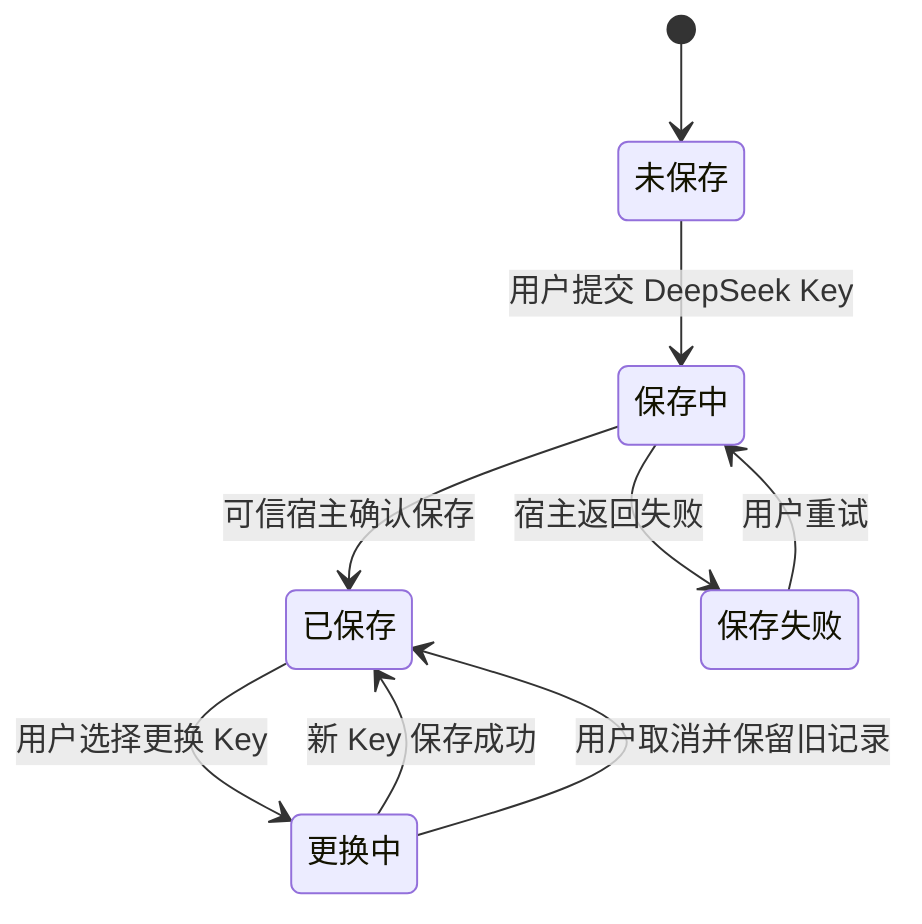

# 模型凭据生命周期

状态：Draft。本文以首次设置保存 DeepSeek API Key 为代表旅程。日常凭据管理和 Agent 授权分开记录；接口列由研发负责人对照。

依据：`intg/gui-init@365698612` 的 `docs/design/gui-pi-first-run-2026-10-29.md`，`gui/docs/modules/dev-01.md` §J10，以及 `gui/docs/modules/dev-02.md` §管理面板。10 月 29 日首次设置决定优先于更早的多服务商首次设置设想。

## 定义

- 对象：用户持有的模型服务商凭据。首次设置只录入 DeepSeek API Key；Agent 通过授权使用该凭据，不能查看 Key 明文。
- 拥有者：用户保存和更换自己的 Key。Agent 的服务商凭据授权由有权操作者管理。
- 衔接对象：[Agent](agent.md)。凭据已保存、已授予 Agent、Agent 已启动、模型实际可用是四个不同结果。
- 边界：首次设置第二步只保存 Key；随后 Squire 步骤才创建或核对实例、授权并启动 Pi。日常 J10 连接页管理是另一条旅程。

## 状态

| 维度 | 状态或结果 | 完成证据 |
| --- | --- | --- |
| 凭据记录 | 未保存、保存中、已保存、保存失败 | 可信宿主的保存结果；刷新后只恢复非秘密记录 |
| Agent 授权 | 已授权、未授权、已撤销、等待原主人设备、解封失败、状态未确认 | 授权记录及实际可用性由后端确认；不等于凭据已保存 |
| Squire 运行 | 准备中、已启动或失败 | 实例和运行态结果；启动不等于模型可用 |
| 模型可用 | 首次对话收到真实回复后确认 | 真实回复；不能由保存或启动回执推断 |

说明：图中只描述凭据记录。Agent 授权、Squire 运行和真实模型回复不是凭据对象的状态转移。

## 旅程

### LC-MODEL-01 首次设置保存 DeepSeek Key

前提：账号步骤已完成。当前首次设置固定 Pi + DeepSeek，不提供服务商、模型、端点或运行工具选择。

| 步骤 | 角色 | 操作 | 预期结果（状态） | CLI 命令 | daemon 方法 | 现状 | 依据 |
| --- | --- | --- | --- | --- | --- | --- | --- |
| 1 | 用户 | 输入 DeepSeek API Key 并点“保存并继续” | 保存中，禁止重复提交 | `hyprial agent secret provider-write <entry-id> --field <field>`（仅 stdin） | `agent.secret.provider-write` | 有差异 | dev@4d676ec37 `src/hyprial/shell/impl/cli/commands/agent/secret.py:669-698`；契约：有差异：无契约（MethodSpec 未声明）。行为/字段：已有非 argv 写入路径；固定 Pi/DeepSeek 动作和表单防重不在方法中 |
| 2 | 可信宿主 | 保存 Key 并返回结果 | 成功后只显示“已保存”，进入 Squire 步骤 | `hyprial agent secret provider-write <entry-id> --field <field>` | `agent.secret.provider-write` | 有差异 | dev@4d676ec37 `src/hyprial/daemon/impl/application/actors/agents_admin/registry_ops.py:174-197`；契约：有差异：无契约（MethodSpec 未声明）。行为/字段：写 user-provider，回执仅 entryId/fieldNames，不验证模型可用，也无 Squire 导航语义 |
| 3.a | 用户 | 在已有保存记录上继续或更换 Key | 继续不回填 Key；更换失败保留旧记录 | —（`agent secret list --agent` 查 Agent 自有条目，不是用户模型记录） | —（无 user-provider 非秘密保存记录查询） | 缺口 | dev@4d676ec37 `src/hyprial/daemon/impl/application/actors/agents_admin/registry_ops.py:174-197,258-279`；`src/hyprial/shell/impl/cli/commands/agent/secret.py:749-790`：写入回执、grant 列表和 Agent 自有条目均不能恢复该保存记录 |
| 3.b | 用户 | 在已有保存记录上继续或更换 Key | 继续不回填 Key；更换失败保留旧记录 | `hyprial agent secret provider-write <entry-id> --field <field>` | `agent.secret.provider-write` | 有差异 | dev@4d676ec37 `src/hyprial/identity/impl/agents/runtime/secrets.py:334-349`；契约：有差异：无契约（MethodSpec 未声明）。行为/字段：原子覆盖整条 entry，不是字段增量更新；待确认：GUI 保存记录与旧授权引用如何对应？ |

异常：保存失败留在本页并显示原因。结果未知时先核对非秘密保存记录，不因超时显示“已连接”。提交后清空输入框；Key 不进浏览器存储、URL、命令行或日志。

衔接：进入 Squire 步骤。宿主随后准备固定 Pi/DeepSeek 的 Squire；首次对话收到真实回复后才确认模型可用。

### LC-MODEL-02 授权凭据给 Agent

前提：Agent 已存在且用户持有可授权凭据。当前 Agent 管理页的授权写操作尚未接通正式后端。

| 步骤 | 角色 | 操作 | 预期结果（状态） | CLI 命令 | daemon 方法 | 现状 | 依据 |
| --- | --- | --- | --- | --- | --- | --- | --- |
| 1 | Agent owner | 查看模型凭据授权 | 区分授权、撤销、待原主人设备和状态未确认 | `hyprial agent secret ls <actor>` | `agent.secret.list`（PR #2210 有契约） | 有差异 | PR #2210@49d5f8dfe `src/hyprial/daemon/impl/request_catalog/agent.py:463-487`；dev@4d676ec37 `src/hyprial/daemon/impl/application/actors/agents_admin/registry_ops.py:258-279`：仅活动 grants，无撤销历史/待原主人/解封失败完整状态 |
| 2 | 有权操作者 | 授予或撤销服务商凭据 | 只在后端确认后改变授权状态 | `hyprial agent secret grant <actor> --source user-provider …`；`hyprial agent secret revoke <actor> <grant-id>` | `agent.secret.grant` / `agent.secret.revoke` | 有差异 | dev@4d676ec37 `src/hyprial/daemon/impl/application/actors/agents_admin/registry_ops.py:198-303`；契约（两方法）：有差异：无契约（MethodSpec 未声明）。行为/字段：授予/撤销当前化身 grant 已实现且不回显值；不能替换成 `agent.provider.logout`（删除原生凭据文件） |

异常：缺少凭据时提示前往连接页；解封失败或原主人设备未就绪时显示原因。授权操作不可用时不能显示成功。Agent 自有服务秘钥由另一命令域管理，不能合并为服务商凭据授权。

衔接：Agent 启动后，还需通过真实模型回复确认可用。

### LC-MODEL-03 日常管理模型服务

前提：用户已进入连接页。J10 旧文档描述添加服务、设置唯一默认服务、账号授权或 API Key 两种接入方式。

| 步骤 | 角色 | 操作 | 预期结果（状态） | CLI 命令 | daemon 方法 | 现状 | 依据 |
| --- | --- | --- | --- | --- | --- | --- | --- |
| 1 | 用户 | 查看现有模型服务 | 显示真实服务状态或暂不可用 | `hyprial agent provider default`（仅默认配置） | `agent.provider.default`（PR #2210；不是纯读方法） | 有差异 | PR #2210@49d5f8dfe `src/hyprial/daemon/impl/request_catalog/agent_provider.py:1-16,246-259`：无参也可能写入，mutates=true；不是 dev-01/J10 的模型服务列表或真实可用性检查 |
| 2 | 用户 | 添加服务或切换默认服务 | 后端确认后才显示新服务或唯一默认 | `hyprial agent provider login <harness> --actor <actor>`；`hyprial agent provider login claude --actor <actor> --setup-token --default` | `agent.provider.login` / `agent.provider.default`（PR #2210 契约） | 有差异 | PR #2210@49d5f8dfe `src/hyprial/daemon/impl/request_catalog/agent_provider.py:9-16,246-290`；dev@4d676ec37 `src/hyprial/shell/impl/cli/commands/agent/provider/commands.py:324-351`：原生 harness 凭据安装/默认配置，不是 dev-01/J10 的模型厂商服务 CRUD 或 OAuth；dev 只有旧 IPC |

异常：J10 文档明确当时未接真实后端；正式构建无模型服务时显示暂不可用。J10 的账号授权、多服务商选择不能带回当前首次设置第二步。

## 权限与秘密

- API Key 只在输入框和一次提交中短暂存在，提交后清空；刷新不回填明文。
- GUI 页面只向可信宿主提交固定动作，不能自行指定命令、路径、actor、provider 或 model。
- 当前首次设置开发接线由固定动作 worker 调用 daemon；不能从 CLI 命令存在推断页面直接执行 CLI。
- Agent 只持服务商凭据授权；用户的 Key 不在 Agent 详情中显示。

## 需要决定的问题

- 首次设置与日常 J10 是否共享同一凭据记录及其读取契约：待研发核对。
- 凭据更换后的旧授权如何处理：待研发给出现行后端语义；本设计不推断自动替换。
- 模型凭据授权的可观察结果与真实模型回复之间如何呈现：待研发接口对照和产品复核。
