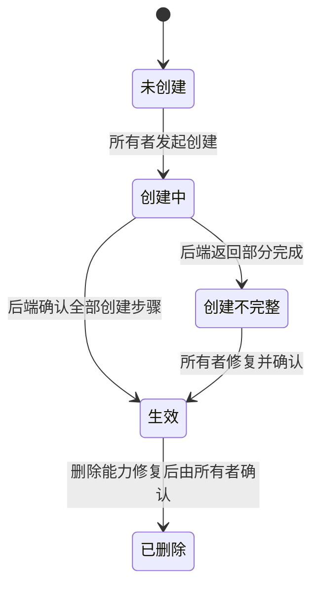

# 组织生命周期

状态：Draft。产品侧整理现有业务语义；接口列由研发负责人对照。

依据：`intg/gui-init@365698612` 的 `gui/docs/org/prd.zh-CN.md` §2、§4.2、§6、§10，以及 `gui/docs/org/interaction-design.zh-CN.md` §10 P01–P03、P16、P17。文中“在途”和“待决”不写成已实现。

## 定义

- 对象：一个组织由 Casdoor group 和 OrgFS 空间组成。一个用户的 home 可以同时属于多个组织。
- 网络能力：tailnet 是组织跨节点通信和同步的能力，不是组织本体；无 tailnet 的本地 org 可以存在，但不具备完整跨节点协作能力。
- 拥有者：组织所有者创建、设置和改名；只有所有者能邀请或移除成员。删除组织的后端能力仍在修复。
- 衔接对象：[成员](member.md)、[成员邀请](member-invite.md)、[设备](device.md)、[Agent](agent.md)。
- 边界：“当前组织”是 home 级本地选择，不是组织的生命周期状态；“已离开”是用户与组织的关系，不表示组织已删除。

## 状态

| 状态 | 含义 | 用户看到什么 | 来源状态 |
| --- | --- | --- | --- |
| `creating` / `partial` | 创建尚未完成；所有者可预览修复或同名重试 | “创建未完成”及修复入口 | 已实现 |
| `active` | 组织创建完成 | 组织概览及成员、机器等入口 | 已实现 |
| `legacy-active` | 旧组织仍可列出 | 显示旧组织的实际能力 | 已实现；具体迁移规则待研发确认 |
| `deleted` | 组织记录标为删除 | 删除结果须以后端事实确认 | 状态已存在；删除操作当前被拒绝 |
| `left` / `sync-problem` | 规划中的离开和同步问题表达 | 不作为当前组织状态字段使用 | 在途 |

## 旅程

### LC-ORG-01 首次进入和切换当前组织

前提：用户完成首次设置；个人组织由后端创建的能力在途。当前组织的持久化与默认归属也在途。

| 步骤 | 角色 | 操作 | 预期结果（状态） | CLI 命令 | daemon 方法 | 现状 | 依据 |
| --- | --- | --- | --- | --- | --- | --- | --- |
| 1 | 用户 | 查看可访问的组织 | 只显示后端确认的组织；状态未知时不造示例组织 | `hyprial org list` | `org.list`（HTTP 未开放） | 已有（PR #2217，未合） | PR #2217@06a2aee3b `src/hyprial/daemon/impl/request_catalog/org/context.py:150-182`；`src/hyprial/daemon/impl/org/membership/context/resolver.py:77-81`；dev 仅旧 IPC，未声明契约 |
| 2 | 用户 | 选择当前组织 | 只改变本 home 后续组织操作的默认目标 | `hyprial org use <org>`（PR #2217） | `org.use`（HTTP 未开放） | 已有（PR #2217，未合） | PR #2217@06a2aee3b `src/hyprial/daemon/impl/request_catalog/org/context.py:150-182`；`src/hyprial/daemon/impl/org/membership/context/resolver.py:52-58` |

异常：切换失败时保持原当前组织并显示原因。切换不改变运行中 Agent 的归属或通信权限。

衔接：进入成员、机器或组织配置旅程。

### LC-ORG-02 创建工作组织

前提：用户有创建组织的资格。组织名仅含小写字母、数字和连字符，最长 57 个字符，不能以 `-acl` 结尾。

| 步骤 | 角色 | 操作 | 预期结果（状态） | CLI 命令 | daemon 方法 | 现状 | 依据 |
| --- | --- | --- | --- | --- | --- | --- | --- |
| 1 | 用户 | 填写组织名并提交 | 创建中；阻止重复提交 | `hyprial org create <org>` | `org.create` | 有差异 | dev@4d676ec37 `src/hyprial/daemon/impl/org/network/service.py:162-202`；契约：有差异：无契约（MethodSpec 未声明）。行为/字段：同名创建可恢复且串行；表单防重由客户端负责 |
| 2 | 系统 | 正常路径建立组织的 Casdoor group、OrgFS 空间和 tailnet；隔离测试路径只建立本地组织数据 | 正常路径全部完成后显示组织可用；隔离路径只表示本地创建完成，不表示跨节点就绪 | `hyprial org create <org>`；`hyprial org repair <org>`（修复预览） | `org.create`；`org.repair` | 有差异 | dev@4d676ec37 `src/hyprial/daemon/impl/org/network/service.py:202-256`；契约（两方法）：有差异：无契约（MethodSpec 未声明）。行为/字段：`tailnetInitialized` 区分网络初始化；发布设备失败可返回 `devicePublished=false` 并写 active，非设计要求的整体失败 |
| 3 | 用户 | 决定是否设为当前组织 | 新组织不会自动覆盖当前组织 | `hyprial org use <org>`（仅明确选择时；PR #2217） | `org.use`（HTTP 未开放） | 已有（PR #2217，未合） | PR #2217@06a2aee3b `src/hyprial/daemon/impl/org/membership/context/resolver.py:52-58`；`src/hyprial/daemon/impl/request_catalog/org/context.py:160-182` |

异常：设备发布失败时整体创建失败，可用同名重试。隔离路径的 null 发布字段表示未尝试，不是失败。`creating` 或 `partial` 时显示“创建未完成”；修复先预览再确认。账号服务不可用或额度已满时显示原因并保留输入。

衔接：[成员邀请](member-invite.md)和[成员](member.md)。

### LC-ORG-03 改名、离开或删除

前提：组织已存在。改名由所有者操作；离开是成员关系变化；删除当前仍受后端限制。

| 步骤 | 角色 | 操作 | 预期结果（状态） | CLI 命令 | daemon 方法 | 现状 | 依据 |
| --- | --- | --- | --- | --- | --- | --- | --- |
| 1.a | 所有者 | 预览并确认改名 | 成功后列表与概览显示新名称 | — | —（改名预览） | 缺口 | dev@4d676ec37 `src/hyprial/daemon/impl/ipc/router.py:246-257`；`contract/cli/surface.json:190-200`：org 命令与分发无 rename/preview；PR #2217@06a2aee3b `src/hyprial/daemon/impl/request_catalog/org/context.py:178-182` 也不含改名 |
| 1.b | 所有者 | 预览并确认改名 | 成功后列表与概览显示新名称 | — | —（确认改名） | 缺口 | dev@4d676ec37 `src/hyprial/daemon/impl/ipc/router.py:246-257`；`contract/cli/surface.json:190-200`：无组织改名写入口 |
| 2.a | 成员 | 预览并确认离开 | 本用户的成员关系进入离开结果；组织仍存在 | `hyprial org leave <org>`（交互确认前） | `org.leave`（`confirmed=false`） | 有差异 | dev@4d676ec37 `src/hyprial/daemon/impl/org/network/ipc.py:274-284`；契约：有差异：无契约（MethodSpec 未声明）。行为/字段：同方法用 confirmed=false 预览，不是独立 preview 方法 |
| 2.b | 成员 | 预览并确认离开 | 本用户的成员关系进入离开结果；组织仍存在 | `hyprial org leave <org>`（确认后） | `org.leave`（`confirmed=true`、`operationId`、`deviceIds`） | 有差异 | dev@4d676ec37 `src/hyprial/daemon/impl/org/network/service.py:382-398`；契约：有差异：无契约（MethodSpec 未声明）。行为/字段：仅 phase=complete 写 left，不将中间阶段当完成 |
| 3 | 所有者 | 查看删除能力 | 后端修复前禁用删除并说明原因 | —（`hyprial org delete <org>` 是写请求，不作能力查询） | `org.delete`（仅拒绝写入；无能力查询） | 有差异 | dev@4d676ec37 `src/hyprial/daemon/impl/org/network/service.py:416-420`；契约：有差异：无契约（MethodSpec 未声明）。行为/字段：授权检查后报 `LAST_AUTHORITY_REFUSED`，没有只读可删除能力字段 |

异常：离开前的预览版本变化或冲突时重新预览并确认。网络超时不自动重发。删除组织时是否同步删除 Casdoor group 仍属待决 6。

## 权限与不变量

- 组织所有者才能改名、邀请成员、移除成员和设置组织配置。
- 成员可读写范围由后端授权决定；GUI 不提供额外的组织 ACL 授权界面。
- 个人组织只有本人作为成员，是在途目标。个人组织的显示名和邀请规则尚待确认。
- 后端未接通时显示“状态未确认”或“暂不可用”，不显示组织创建成功。

## 需要决定的问题

- PRD 的待决 1–6 尚待 Allen 确认；本文件没有将推荐值改成已决规则。
- `legacy-active` 的迁移和删除结果须由研发给出可核对的后端事实。
- 组织配置的部门与结构 schema 归研发负责人线；本文件只记录组织所有者的操作权限。
