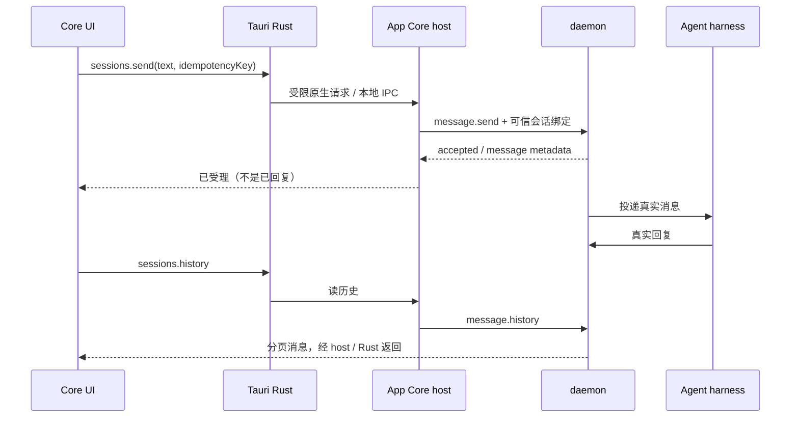

# 多端通信、身份与会话架构说明

日期：2026-10-19。源码快照：`intg/gui-app-core-20261008` @ `b02b3b13273978dc07e86dd1ed8ab04c2a66cd5e`。
范围：Windows/Linux/macOS/iOS/Android 客户端与 Hyprial 节点、Agent 的通信。
相关文档：[Core / Power Pack 分层](core-power-pack-architecture-2026-10-19.md)。

## 1. 先分清四个对象

- **客户端设备**：运行 Core UI。手机不是 Agent 执行主机。
- **Hyprial 节点**：运行 daemon，承载消息、历史与托管 Agent。
- **业务会话**：稳定的 conversation 标识关联一组消息；不是一条 TCP 连接。
- **harness 执行会话**：CC/Codex 等的模型上下文。它的 resume ID 不等于 App 的 conversation ID，也不应该由手机伪造。

手机断网、进后台或关闭 App，不应因此删除业务会话或停止主机上的 Agent。这个持久化方向已有实现；完整移动生命周期和多设备恢复仍需验收。

## 2. 当前能运行的链路

### 2.1 桌面本机路径



macOS/Linux 使用 Unix socket，Windows 使用带启动期请求 token 的 loopback TCP。本地 IPC 的用户身份形态，不能直接拿去当远程设备认证。

### 2.2 当前移动联调路径

```text
模拟器 Core → Rust → Go bridge → Mini 本机测试 TCP host
           → Mini daemon → Mini 上的真实 Agent → daemon 历史 → App
```

| 客户端 | 已有联调地址 | 必须保留的边界 |
| --- | --- | --- |
| iOS 模拟器 | `127.0.0.1:18752` | 指向模拟器联调宿主服务；真 iPhone 不能照搬 |
| Android 模拟器 | `10.0.2.2:18752`（既有轮次） | Android 模拟器访问宿主的专用地址；后续并行测试须避免抢占现有 iOS 服务 |
| 真机 / 异地客户端 | 未在本快照证明 | 需要正式身份与远程传输，不能改地址就算完成 |

测试 host 仅 loopback 监听，无移动设备认证，UI 必须注明“未认证测试面，非生产”。iOS 这一轮使用本机用户的合法 IPC 操作身份，并固定目标 `mini-gui-worker`；这证明真实消息往返，不证明手机已经作为独立设备加入网络。

## 3. 正式远程目标架构（尚未全链启用）


1. 客户端完成账号、设备身份准备，原生安全存储持有需要的秘密；页面不拿密钥。
2. 用户选择目标节点，原生层确认实际连接的节点身份。
3. 嵌入 tailnet 建立网络连接；网络成员资格不等于业务权限。
4. 请求经 N-A2 接口所需的派生/签名与设备行校验，再做会话/操作授权。
5. 有权请求才交给 adapter 和 daemon。未认证、设备未知或撤销、身份不匹配、重放、越权均拒绝，不降级匿名远端。

已有 `AuthGate`、请求信封校验及拒绝分支；生产 derive/设备行来源、目标 host 绑定和移动端装配仍不能视作完成。当前 `bridge/mobile.rs` 的 tailnet 分支明确返回缺失能力错误，不会真正拨号后继续聊天。

本文件不另定一套设备协议或新的会话授权矩阵。现有 [host / N-A2 契约](app-core-host-address-config-20261017.md) 中未决项，需要与身份接口 owner 对齐后再实现。

## 4. 两种网络路径不能混为一谈

| 路径 | 作用 | 当前证明了什么 |
| --- | --- | --- |
| 客户端到节点 App host | 聊天 API 访问 | 本机/模拟器直连有实测；生产移动认证 tailnet 待接线 |
| 节点之间的 Hyprial mesh | 节点发现、Agent 消息及回执传播 | tailcat 转发与 Zenoh 通道存在，但本机/Mini 曾出现可见节点不一致与会话失效 |

Tailscale SSH 能连接 Mini，只证明运维通道；它不证明嵌入 tailnet、Zenoh 发现或 App 认证可用。
`hosts` 是该节点当前观测结果，不应当作强一致的全网注册表。`doctor` 显示端点已配置，也不等于实际消息可达。网络恢复验收需要持续互见和双向 send/ack，不能只看一次列表。

当前本机与 Mini 的调度采用 operator 经 SSH 调用节点本地 Hyprial 作为临时补救；这不是产品的移动端通信架构。

## 5. 会话建立、标识与可见范围

| 标识 / 对象 | 当前含义 | 不能混用 |
| --- | --- | --- |
| App `sessionId` | adapter 对外的会话绑定键 | 不等于模型执行 session |
| `conversationId` | daemon 业务消息关联标识 | 不等于 TCP 连接、设备或 worker incarnation |
| `messageId` | 一条持久消息标识 | 不能以一条进度事件替代消息 |
| `idempotencyKey` | 同一发送请求的去重标识 | 超时重试不能改成新 key 盲目重发 |
| daemon-issued `sessionRef` | Agent 调用所需可信会话材料（适用时） | 不是手机自由填写的登录字段，也不是 UI 会话名 |

**当前建立方式**：host 配置 sender 与 `SessionBinding`，绑定 targets、conversationId 等；`sessions.list` 返回这些绑定。已有会话可以选择、发送、查看历史。

**待补的产品流程**：发现有权 Agent → 选择目标 → 创建或继续业务会话 → 返回稳定会话绑定 → 在其他获授权设备恢复。当前五操作端口没有通用 `sessions.create` 或全网 `agents.list`；后续必须先核对 CLI/daemon 的实际公共面与授权规则，不能由 UI 自造操作名或随意传 sender/target。

“通讯录能显示页面”不能证明“可以看到所有节点和 Agent”；模型、角色、在线状态若未由真实接口提供，应明确缺失。

## 6. 保持会话不等于保持长连接

| 场景 | 当前已有 | 待补 / 待验收 |
| --- | --- | --- |
| 前台聊天 | 手动刷新历史和进度；真实发送受理与回复分离 | 持续自动更新的完整产品体验 |
| 发送结果未知 | Core 在内存中保留原 key/payload，用户显式同键重试 | App 被杀后未决发送恢复；按 operation/idempotency 查询的公共接口缺口 |
| 网络断开 | 移动桥有有界重连尝试、失败状态 | 正式认证链的断网、网络切换、重认证及补拉联动 |
| App 冷启动 | 非秘密连接配置可保存；不是自动获得认证 | 自动恢复目标会话、未决发送与设备级游标 |
| 历史 | daemon 持久历史与 sender copies，cursor/limit/nextCursor | 当前用户、设备与会话访问范围的生产端到端验证 |
| 双设备续聊 | 共享同一 daemon conversation 的基础存在 | 独立设备身份、各自游标、重复/乱序处理、两端真实续聊验收 |
| 后台通知 | 不属于当前最小闭环 | 后续推送注册、唤醒语义、平台生命周期和 infra 中继 |

当前 Core 重试状态主要在内存中，不应宣传为持久离线队列。进度序号不应当成可跨重启/跨设备恢复的全局消息游标。首版采用前台恢复后补拉，不承诺后台永久在线、跨端已读同步或跨崩溃边界 exactly-once。

目标恢复流程是：重新连接并认证 → 重新读取允许的会话 → 按持久历史定位补拉 → 去重展示 → 对未决发送查询或以原 key 重试。这是需要补齐和验收的流程，不表示当前全部自动实现。

## 7. 数据与权限边界

- 权威消息与回复留在 daemon 的持久存储；发送者副本用于避免投递完成后发送侧历史消失。
- App host 是适配与访问控制层，不创建第二个消息权威数据库。
- Core 页面不持有可信 sender/设备密钥，不让客户端请求体自行指定权限身份。
- 网络配置保存地址与模式，不把 token、私钥写入页面存储或 URL。
- 撤销语义、设备行来源和目标节点绑定按身份契约实现；当前局部“行删除视作未知设备”的测试不代替生产撤销链。
- 手机不直接拿开发者 Forgejo token、模型 API key 或 verifier 凭据；模型服务由主机 harness 调用。

## 8. 当前验收矩阵与下一步

| 验收项 | 现状 |
| --- | --- |
| iOS 模拟器 UI 发真实消息、显示真实回复、刷新/重连读回 | 本机测试路径已通过；使用既有模拟器构建，不代表本文新 SHA 全部重建验收 |
| Android 真实发送与独立 Agent 回复 | 旧轮次已通过；当时 UI 历史被旧 daemon 缺接口阻塞 |
| Android 自动原生桥入包 | #1600 已合入本文快照；聊天、重连、冷启动须对应新 APK 单列证据 |
| Windows/Linux/macOS 正常安装到真实会话 | 各平台包/首启/认证证据不齐，不报五端全通 |
| 移动生产 tailnet + 独立设备身份 | 未完成 |
| 两设备接续同一会话 | 未完成完整验收 |
| 未授权、撤销、重放、错节点拒绝 | 局部单测/接口已有；真实生产装配仍需负例验收 |

实施顺序：Android 补 UI/历史闭环与包证据；Core 收敛真实身份/远程连接契约并实施；增加有权目标发现与会话入口；iOS 复用共享实现；最后跑两端续聊和网络/生命周期反例。

最终验收必须同时记录：源码与包 SHA、运行 daemon 版本、设备身份、目标节点、真实消息 ID、回复来源、历史读回结果，以及 direct-test / 正式认证的明确标识。源码合入不等于运行节点升级；模拟器成功不等于真机成功。

## 9. 代码及证据索引

- `src/gui/core/{connection,chat,browser}.mjs`：五操作、状态和重试。
- `app/src-tauri/src/core/mod.rs`：本地 relay 与端点持有。
- `app/src-tauri/src/bridge/mobile.rs`：direct-test 连接与正式 tailnet 拒绝边界。
- `sidecar/hyprial-tailcat/mobilebridge/`：原生 Go 网络桥。
- `src/hyprial/shell/impl/gui/adapter/{chat,host,envelope}.py`：绑定、操作投影、认证。
- `src/hyprial/daemon/impl/application/messaging/inbox_surface/{send,history}.py`：真实发送与持久历史。
- `app/scripts/build-android.cjs`：#1600 自动构建与入包检查。
- [原始最小聊天方案](app-core-chat-mvp-2026-10-08.md)、[host 配置与认证契约](app-core-host-address-config-20261017.md)。
- 现场报告由 operator 保留：`IOS-USER-CHAT-20261019.md`、`ANDROID-REBUILD-REAL-20261018.md`、`MOBILE-NEXT-20261019.md`、`PAC-UNBLOCK-ACCEPTANCE-20261019.md`。这些不是本文仓库内可直接点击的附件；其结论只在上文明确范围内引用。
