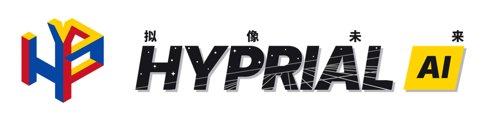
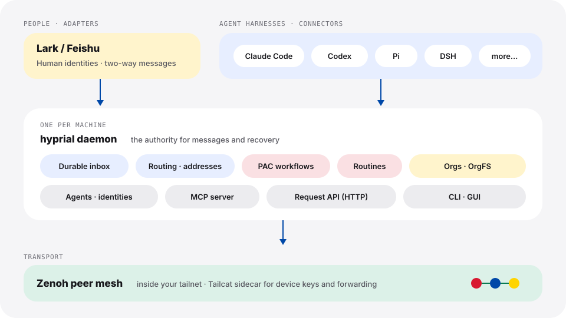

<div align="center">

<picture>
  <source media="(prefers-color-scheme: dark)" srcset="../assets/brand/hyprial-lockup-en-dark.png">
  
</picture>

### 面向 Agent 与人的组织层

[](../../pyproject.toml)
[](../../LICENSE)
[-0048A8)](#-安装)
[](https://www.hyprial.com/)

[English](../../README.md) · **简体中文**

[官网](https://www.hyprial.com/) ·
[快速上手](https://www.hyprial.com/quickstart/) ·
[文档](../README.md) ·
[变更记录](../../CHANGELOG.md)

</div>

> [!NOTE]
> **GitHub 仓库 [`Hyprial/hyprial`](https://github.com/Hyprial/hyprial) 是只读的发布镜像。**
> 开发在内部 Forgejo 上进行，GitHub 上暂不接受 pull request；问题与建议请提
> [issue](https://github.com/Hyprial/hyprial/issues)。

> 本文是 [README.md](../../README.md) 的中文译本；两者不一致时以英文版为准。

## ✨ HyprialOS 是什么

HyprialOS（命令行与包名 `hyprial`）是面向 AI agent 与其运行 harness 的去中心 durable 通信层。
它让每个人和每个 agent 都有持久身份、可靠的收件箱、共享的工作流，以及关掉终端后仍会继续运行的
routine。

你继续使用已有的工具：**connector** 把 Claude Code、Codex、Pi、DSH 等 harness 接进来，
**adapter** 把 Lark（飞书）等人的沟通渠道接到同一张网络。每台机器运行一个 **daemon**，
负责落盘消息、跨机路由和跟踪共享工作。协调者、worker 或聊天通道暂时不可用时，任务目标与消息
仍然可发现、可恢复、可核验。

## 🚀 功能

- 🪪 **持久的 agent 身份**：agent 不等于运行它的那个进程。重启、换模型或换 harness 之后，
  地址、收件箱和历史都保留。
- 📬 **跨机器的 durable 投递**：消息先落盘再投递，带回执和重试；离线托管与死信状态可查
  （`hyprial message status`、`hyprial message trajectory`）。
- 🔌 **自带 harness**：Claude Code、Codex、Pi、DSH，交互或 headless 均可；agent 通过内置
  MCP 工具接入网络。
- 💬 **人在回路中**：Lark adapter 把人和群聊映射到同一套寻址模型，Lark 里的人和 Codex 里的
  agent 以同样方式接收工作。
- 🧩 **PAC 工作流**：声明谁接哪项任务、顺序与并行、审批关口和完成证据。PAC 只派单和跟踪，
  干活的是 harness 和人（`hyprial workflow`）。
- ⏱️ **Routine**：有健康状态、历史、可暂停/恢复的持久周期职责（`hyprial routine`）。
- 🏢 **组织与 OrgFS**：带成员和访问策略的组织，以及复制同步的共享文件空间，用于文档和工作项
  （`hyprial org`、`hyprial org fs`）。
- 🛡️ **默认私有**：daemon 之间在你的 tailnet 内组成 Zenoh 对等网；随包分发的 Tailcat sidecar
  负责设备密钥和跨网络转发。

## 🏗️ 架构

<p align="center">
  
</p>

| 概念 | 作用 |
| --- | --- |
| **daemon** | 每台机器上的长驻进程，持有传输会话、durable inbox、路由和受管运行时状态，是消息与恢复的权威边界。 |
| **connector** | 把一个 harness 会话（Claude Code、Codex、Pi、DSH）接到 daemon，承接其输入、输出与生命周期。 |
| **adapter** | 连接外部平台（目前是 Lark），把平台身份和消息映射到 HyprialOS 的寻址与投递模型。 |
| **PAC** | 声明式派单与跟踪：任务图、条件与等待规则；不替 worker 执行任务。 |
| **routine** | 声明式周期职责，按看板标注产生 PAC run。 |
| **OrgFS** | 组织赖以建立的复制式共享文件空间。 |
| **sidecar** | 由 HyprialOS 校验并控制的辅助进程（Tailcat，随 wheel 分发），负责设备密钥与转发。 |

完整术语见 [GLOSSARY.md](../../GLOSSARY.md)，设计文档入口见
[docs/design/design.md](../design/design.md)。

## 📦 安装

### 一行安装（推荐）

macOS 与 Linux：

```bash
curl -fsSL https://dl.hyprial.com/install.sh | sh
```

Windows（x64），在 PowerShell 中：

```powershell
powershell -c "irm https://dl.hyprial.com/install.ps1 | iex"
```

安装脚本下载预构建 wheel，按发布的 `SHA256SUMS` 校验 SHA-256，再用
[uv](https://docs.astral.sh/uv/) 安装。没有 uv 时会先把 uv 装到 `~/.local/bin`，不改 shell
配置文件。看到 `Installed hyprial <版本>` 后打开新终端，让 `hyprial` 进入 `PATH`
（如果没有，运行 `uv tool update-shell`）。

### 发布轨道

| 轨道 | 跟随 | 选择方式 |
| --- | --- | --- |
| `stable`（默认） | 正式发布 | — |
| `nightly` | 最近一次通过定时 E2E 的构建，否则跟随 `stable` | `HYPRIAL_TRACK=nightly` |
| `internal` | 开发分支最新提交 | `HYPRIAL_TRACK=internal` |

```bash
curl -fsSL https://dl.hyprial.com/install.sh | HYPRIAL_TRACK=nightly sh
```

安装后用 `hyprial daemon upgrade` 升级。自动升级默认关闭，需运行
`hyprial config set autoUpgrade true` 开启。

### 平台支持

| 平台 | 安装 | daemon 与 agent |
| --- | --- | --- |
| macOS 13+（Apple 芯片、Intel） | ✅ | ✅ launchd 用户服务 |
| Linux，glibc（x86_64、aarch64） | ✅ | ✅ systemd 用户服务 |
| Windows（x64） | ✅ | 🚧 开发中 |

### 其他安装方式

<details>
<summary>用 uv 从公网仓库安装</summary>

跟随公网发布仓上的 `internal` 轨道 tag：

```bash
uv tool install git+https://github.com/Hyprial/hyprial.git@internal
hyprial daemon upgrade --tag internal
```

第二条命令按该提交的 `uv.lock` 重新安装，钉住依赖版本。这种方式从源码构建，还需要
Node.js 24+ 与 npm（网页 GUI）以及 Go 1.27（Tailcat sidecar）；一行安装器都不需要。

</details>

<details>
<summary>历史安装（v0.4.0 与已退役的 TypeScript 版）</summary>

从已消失的旧 `harness-bridge-py` 来源装过 v0.4.0 的机器，升级前需先用同版本刷新来源。`v0.4.0` tag
不在公网仓库上，恢复命令请向 maintainer 索取。

旧 TypeScript 版不提供迁移。若机器上仍有旧版，先停止并删除、归档其状态目录，再全新安装。
步骤见[退役 TS 安装处理](../guides/cutover-runbook.md)。

</details>

## ⚡ 快速上手

1. **登录并准备这台机器。** 浏览器会打开登录页，登录后 daemon 启动。

   ```bash
   hyprial init
   ```

   加 `--service` 会把 daemon 注册为用户服务（macOS 用 launchd，Linux 用 systemd），登录系统后
   自动启动。以后也可以再运行 `hyprial init --service`。

2. **检查安装。**

   ```bash
   hyprial version
   hyprial doctor
   ```

3. **在已有的 harness 上创建个人助手 Squire**，例如 Codex（先运行 `codex login`）：

   ```bash
   hyprial squire setup --provider openai --model gpt-6.1-sol --preferred-harness codex
   hyprial agent provider login codex --actor squire
   hyprial agent start codex --name squire --provider openai --model gpt-6.1-sol --headless
   hyprial agent list
   ```

   `squire` 一行显示 `online` 即完成。

[完整快速上手](https://www.hyprial.com/quickstart/)还包括 Pi + DeepSeek 路线、连接飞书和发送第一条
消息。加入已有网络请按[节点入网清单](../guides/onboarding-checklist.md)操作。

### 命令一览

| 命令 | 用途 |
| --- | --- |
| `hyprial init` · `login` · `doctor` · `version` | 初始化、登录与诊断 |
| `hyprial daemon …` | 启停、重启、升级；`daemon service` 管理用户服务 |
| `hyprial agent …` | 创建、启停、查看 agent；provider、凭据与授权 |
| `hyprial message …` | 发送、读取、确认与追踪消息 |
| `hyprial adapter …` | 接入和管理 Lark App、路由与身份 |
| `hyprial workflow …` · `routine …` | PAC 工作流与周期 routine |
| `hyprial org …` | 组织、成员、OrgFS、服务与工作项 |
| `hyprial gui` | 打开随包分发的网页 GUI（预览） |

所有命令都支持 `--help`，多数支持 `--json` 便于脚本调用。

## 📚 文档

| 主题 | 位置 |
| --- | --- |
| 安装、首次启动、升级、profile、登录与设备 key | [运维指南](../guides/operator-guide.md) |
| 发布轨道 | [升级轨道](../guides/upgrade-tracks.md) · [发布规则](../guides/release-rules.md) |
| 入网 · 双机部署 | [节点入网清单](../guides/onboarding-checklist.md) · [Zenoh 双机指南](../guides/zenoh-two-machine.md) |
| 接入飞书 | [Lark App onboarding](../guides/lark-app-onboarding.md) |
| daemon 生命周期 · harness provider | [P2 daemon](../reference/p2-daemon.md) · [Harness provider 模型](../reference/harness-model-providers.md) |
| PAC 工作流 | [PAC workflow](../design/design-pac-workflow.md) · [PAC v2 图/flag 反应器](../design/design-pac-graph-flag-reactor.md) |
| 网络 | [Tailcat cutover 与边车协议](../design/tailnet-cutover-architecture-2026-10-03.md) |
| 已知问题 | [已知问题](../reference/known-problems.md) |
| 其他 | [文档索引](../README.md) |

## 🗺️ 状态与路线图

HyprialOS 仍在积极开发中。版本号见 [`VERSION`](../../VERSION)，每次发布记录在
[CHANGELOG.md](../../CHANGELOG.md)；长期目标与发版义务见 [ROADMAP.md](../../ROADMAP.md)。

正在进行的工作：

- 🖥️ **网页 GUI**：`hyprial gui` 提供随包分发、逐文件校验的共享网页 GUI（源码在
  [`gui/`](../../gui/)）。目前是预览版：多数页面仍返回 `BACKEND_NOT_WIRED`，设置、聊天与首次设置
  页面正在接入 daemon 的 request API。
- 🪟 **Windows**：安装可用；原生 daemon 启动与服务正在修复。
- 💬 **更多渠道**：目前只有 Lark adapter，更多 IM adapter 在规划中。
- 🧬 **Agent 模型**：cell、thread、conversation 的新模型正在设计，将取代现有的 link 模型。

## 🤝 参与贡献

感谢关注！开发目前在内网进行：

- 🐛 **所有人**都可以在 [GitHub issues](https://github.com/Hyprial/hyprial/issues) 报告问题、提出需求。
- 🔧 **提交代码需要开发内网权限**，请联系 maintainer 申请。GitHub 镜像暂不接受 pull request。

阅读代码和运行测试可以直接 clone 公网镜像；有开发内网权限时，改用 maintainer 提供的内网地址，其余步骤相同。

```bash
git clone https://github.com/Hyprial/hyprial.git
cd hyprial
uv sync --extra test
uv run --with libcst==1.9.0 pytest tests/
uv run ruff check .
./contract/run-all.sh --isolated-only
```

功能分支先合入当前的 `release/v*` 集成分支；`dev` 只接受 `release/*` 与 `hotfix/*` 的 PR。
测试要求、PR 清单与分支模型见 [CONTRIBUTING.md](../../CONTRIBUTING.md)；通过 coding agent
贡献请读 [AGENTS.md](../../AGENTS.md)。

| 工具链 | 版本 | 用途 |
| --- | --- | --- |
| Python + [uv](https://docs.astral.sh/uv/) | 3.12+ | 全部 |
| Node.js + npm | 24+ / 11+ | 网页 GUI 与 wheel 构建 |
| Go | 1.27 | Tailcat sidecar |

## 🔒 安全

请不要在公开 issue 中报告安全问题。请通过私有渠道联系 maintainer，只附复现所需的最小、已脱敏证据，
不要附带真实凭据或生产数据。

## 📄 许可证

HyprialOS 采用 [Apache License 2.0](../../LICENSE) 授权。Copyright 2026 Hyprial Tech.
