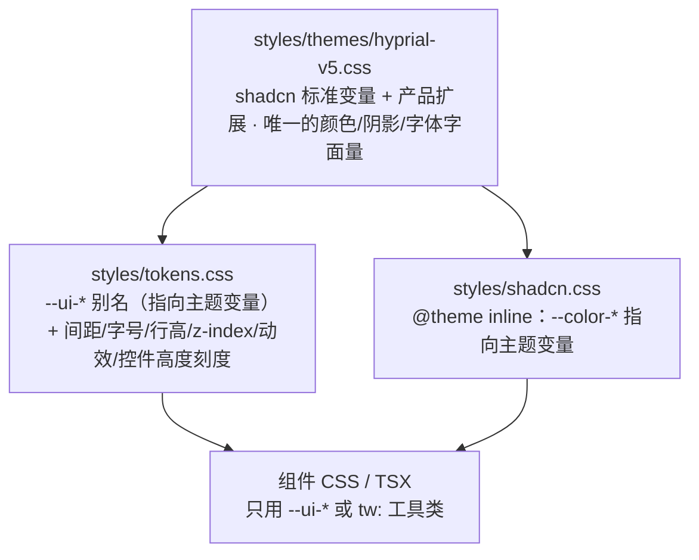

# Hyprial GUI 主题系统

GUI 的颜色、阴影、字体族只在一个主题文件里定义；组件只消费 `--ui-*`。整体换主题只需换一个文件。
硬门是 `gui/tests/theme-contract.test.ts`，随 `npm --prefix gui test` 运行。

## 1. 三层结构

缩进视图：

- 主题文件 `src/styles/themes/hyprial-v5.css`：值。只有它可以出现颜色、阴影、字体族字面量，以及 Geist 的 `@font-face`。
- `src/styles/tokens.css`：语义别名与刻度。颜色、阴影、字体族一律 `var(--主题变量)`；间距、字号、行高、z-index、动效、控件高度的数值留在这里。
- `src/styles/shadcn.css`：Tailwind 映射。`--color-*` 直接映射主题变量，`components.json` 保持 `cssVariables: true`。
- 组件与页面：只写 `var(--ui-*)` 或 `tw:` 工具类。依赖单向，下层不知道上层。

## 2. 变量命名

主题变量不带前缀，用 shadcn 标准语义名：

- 标准集：`background foreground card card-foreground popover popover-foreground primary primary-foreground secondary secondary-foreground muted muted-foreground accent accent-foreground destructive border input ring radius sidebar* chart-1…5`。
- 产品扩展（同样无前缀、语义命名）：`primary-hover/-press`、`secondary-hover`、`accent-soft/-wash`、`destructive-foreground/-wash/-wash-hover`、`success(-foreground/-wash)`、`warning(-foreground/-wash)`、`info(-foreground/-wash)`、`surface-periwinkle`、`surface-hover`、`ink-2/3/4`、`overlay`、`edge`、`shadow-float-sm/-float/-dialog`、`avatar-wash-*`、`step-current/-track`、`font-sans/-cn/-mono`。
- 浅色值在 `:root, [data-theme="light"]`，深色值在 `.dark, [data-theme="dark"]`；`color-scheme` 跟随。

## 3. `--ui-*` 与主题变量的对应

| `--ui-*` | 主题变量 |
| --- | --- |
| `--ui-ink-1` | `--foreground` |
| `--ui-ink-2/3/4` | `--ink-2/3/4` |
| `--ui-border`、`--ui-border-strong` | `--border` |
| `--ui-ground` | `--background` |
| `--ui-ground-2`、`--ui-surface-muted` | `--muted` |
| `--ui-surface` | `--card` |
| `--ui-surface-hover` | `--surface-hover` |
| `--ui-neutral-fill` / `-hover` | `--secondary` / `--secondary-hover` |
| `--ui-input-fill` | `--input` |
| `--ui-edge` | `--edge` |
| `--ui-accent` / `-hover` / `-press` | `--primary` / `--primary-hover` / `--primary-press` |
| `--ui-on-accent` | `--primary-foreground` |
| `--ui-accent-wash`、`--ui-lime`、`--ui-lime-soft`、`--ui-highlight` | `--accent-wash`、`--accent`、`--accent-soft`、`--accent-soft` |
| `--ui-focus` | `--ring` |
| `--ui-info`、`--ui-info-wash`、`--ui-info-surface` | `--info-foreground`、`--info-wash`、`--surface-periwinkle` |
| `--ui-positive`、`-wash`、`-ink` | `--success`、`--success-wash`、`--success-foreground` |
| `--ui-danger`、`-wash`、`-wash-hover`、`-ink` | `--destructive`、`--destructive-wash`、`--destructive-wash-hover`、`--destructive-foreground` |
| `--ui-warning`、`--ui-warning-wash` | `--warning-foreground`、`--warning-wash` |
| `--ui-overlay` | `--overlay` |
| `--ui-avatar-wash-blue/lime/jade/red/grey` | `--avatar-wash-*` |
| `--ui-step-current`、`--ui-step-track` | `--step-current`、`--step-track` |
| `--ui-font-ui`、`--ui-font-brand` | `--font-sans` |
| `--ui-font-cn`、`--ui-font-mono` | `--font-cn`、`--font-mono` |
| `--ui-shadow-float-sm`、`--ui-shadow-popover`、`--ui-shadow-dialog` | `--shadow-float-sm`、`--shadow-float`、`--shadow-dialog` |

侧栏变量（`--sidebar*`）与 `--ui-rail*`：

| `--ui-*` | 主题变量 |
| --- | --- |
| `--ui-rail` | `--sidebar`（墨黑底 `#0c0b10`） |
| `--ui-rail-ink` | `--sidebar-foreground`（未选中图标与文字） |
| `--ui-rail-ink-strong` | `--sidebar-foreground-strong`（悬停） |
| `--ui-rail-active`、`--ui-rail-active-ink` | `--sidebar-accent`（青柠底）、`--sidebar-accent-foreground` |
| `--ui-rail-hover` | `--sidebar-hover` |
| `--ui-rail-focus` | `--sidebar-ring` |

侧栏是全站唯一的 ink-block，深色主题取同值；只有 `.rail` 及其账号与通知控件使用 `--ui-rail*`，页面内容不得使用。

`--ui-shadow-xs/sm/card` 为 `none`：静止表面是平面色块。其余刻度（`--ui-space-*`、`--ui-text-*`、`--ui-radius-*`、`--ui-z-*`、`--ui-motion-*`、`--ui-control-height-*` 等）直接写在 `tokens.css`。

## 4. 替换或新增主题

1. 复制 `src/styles/themes/hyprial-v5.css` 为新文件（例如 `themes/acme.css`），改值，不改变量名。
2. 在 `src/styles/tokens.css` 顶部把 `@import "./themes/hyprial-v5.css";` 换成新文件。
3. 字体文件放进 `src/assets/fonts/`，`@font-face` 写在新主题文件里，附许可证到 `docs/licenses/`；不发起远程字体请求。
4. 运行 `npx vitest run tests/theme-contract.test.ts tests/token-contract.test.ts`。新主题必须满足 theme-contract：浅色与深色变量名一致、shadcn 变量齐全、`--color-*` 映射完整。

不要为了换主题去改组件或 `tokens.css` 的别名。别名不够用时按第 6 节加语义 token。

## 5. 深色模式现状

深色变量已齐全（`.dark` 或 `data-theme="dark"`，取设计系统 `tokens.css` 的 dark 段），`color-scheme` 跟随。当前没有切换入口，也没有对页面做过深色目检。引入深色模式属于功能工作，需要验收所有页面与浮层，不要把“变量齐全”写成“支持深色”。

## 6. 新增一个语义 token

1. 先在主题文件的浅色与深色块各加同名变量（`SCHEME_INDEPENDENT` 名单内的项除外）。
2. 在 `tokens.css` 增加 `--ui-*` 别名指向它。
3. 组件使用 `--ui-*`。需要 Tailwind 颜色类时，再在 `shadcn.css` 增加 `--color-*: var(--变量)`。
4. 不在组件文件里声明 `--ui-*` 或与主题同名的变量；组件内局部自定义属性允许，名字自选。

## 7. 添加 shadcn 组件

- 配置在 `gui/components.json`（`cssVariables: true`）；组件源码放 `src/components/ui/`，页面经 `components/primitives` 适配层使用。
- Tailwind 使用 `tw:` 前缀；新组件目录要加到 `shadcn.css` 的 `@source`。
- 只使用已映射的颜色类（`tw:bg-primary`、`tw:text-muted-foreground` 等）；不写任意值颜色（`tw:bg-[#fff]`）。需要新颜色按第 6 节加映射。
- 详见 [shadcn 示例说明](shadcn.md)。

## 8. CI 门

- 硬门：`gui/tests/theme-contract.test.ts`，规则：
  1. 主题目录之外的 CSS 无颜色字面量、无字体名、`box-shadow` 只用 `none` / `var(--ui-shadow-*)` / `var(--ui-edge)` / `var()` 环形描边；TSX `style` 无颜色字面量。
  2. 主题浅色块与深色块变量名一致，含全套 shadcn 变量。
  3. 只有 `tokens.css` 与 `shadcn.css` 引用主题变量。
  4. `--ui-*` 只在 `tokens.css` 声明；主题变量名只在主题目录声明（`shadcn.css` 的 `--font-sans/--font-mono` 为 Tailwind 命名空间，已精确登记）。
  5. 无悬空 `var(--…)`（`--tw-*`、`--radix-*` 放行）。
  6. `shadcn.css` 的每个 `--color-*` 都指向主题变量，且每个 shadcn 颜色都有映射。
- 提示：`npm --prefix gui run check:refactoring-ui` 的 `color-literal`、`font-literal`、`shadow-literal`、`theme-bypass`，见 [提示性检查](refactoring-ui-advisory.zh-CN.md)。

## 9. 与设计系统的关系

值来自设计系统仓库 `Hyprial/design-system`（`tokens.css` 与 `DESIGN.md` v5）。本仓为适配 GUI 的已知偏差：

- 字体：拉丁用随包 Geist；中文用随包思源黑体（Noto Sans SC = Source Han Sans SC，SIL OFL 1.1，Allen 2026-11-11 决定），来自依赖 `@fontsource-variable/noto-sans-sc`（可变字重，按 `unicode-range` 切片，从本地构建产物按需加载，无远程请求），由主题文件 `@import` 引入，许可证见 `docs/licenses/NotoSansSC-OFL.txt`。系统中文字体（PingFang、YaHei 等）只作回退；不再合成 `HP Pair` 字族，设计系统文档中的中英等粗配对按“未实现”对待，待设计系统重新测量后再定。
- Geist Mono 设计系统未分发，`--font-mono` 使用回退栈。
- `--warning-foreground` 是本仓补值（比设计系统橙色更深，保证小字对比度）。
- 产品标识（HYP 图形标）本轮未更换。

中文字体已随包，不再依赖机器上安装的系统中文字体，裸 Linux 上的截图也使用同一套字形。设计系统字重上限 600，不做伪粗体；全局 `strong`、`b`、`th`、`h1`–`h6` 在 `tokens.css` 中统一为 `--ui-weight-semibold`，避免浏览器默认的 700。
